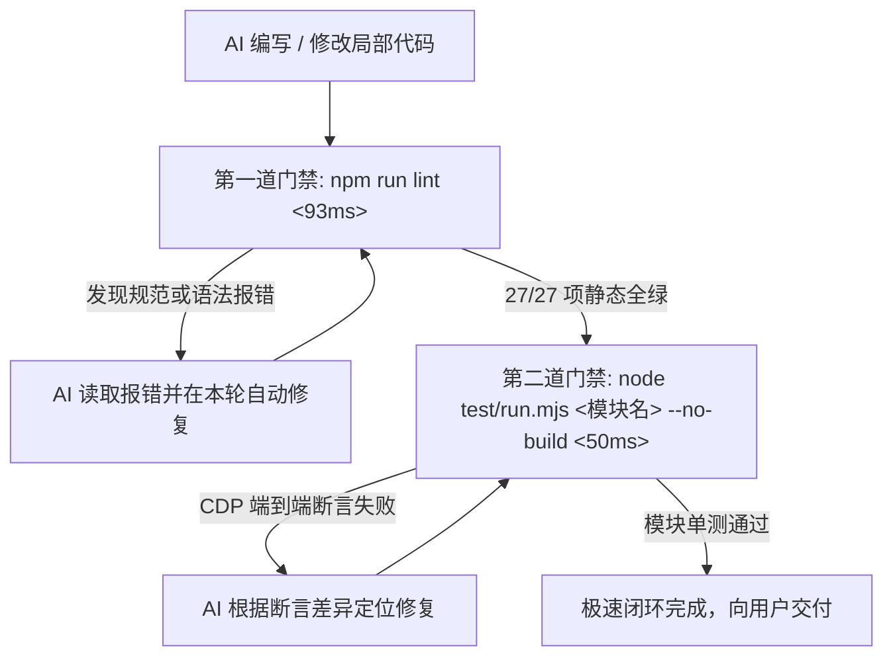

# 🤖 Glass Start — AI 编程行为宪法与工程准则 (AGENTS.md)

本文档是所有进入本项目（**Glass Start — 灵动起始页与分类导航**）的 AI 编程助手与自主代理（AI Coding Agents）必须无条件遵守的**最高级别开发宪法与工程红线**。

在阅读、分析、修改任何源码或执行重构前，AI 必须严格遵守本文档所规定的所有约束。

---

## 🚫 一、不可触碰的 10 大工程红线 (The 10 Non-Negotiable Red Lines)

### 1. 🔴 零运行时 npm 依赖原则 (Zero Runtime Dependency)
- **铁律**：严禁在 `package.json` 的 `dependencies` 中引入任何运行时的外部 npm 依赖包（如 React, Vue, Lodash, Axios, Dayjs, Date-fns, jQuery 等）。
- **执行准则**：
  - 必须使用现代原生 Web API（Native Fetch, DOM API, Canvas 2D, CSS Variables, Service Worker API, CacheStorage, Web Cryptography）；
  - 仅允许使用 `devDependencies` 中现有的 `@tailwindcss/cli`（v4 原子化编译）与 `esbuild`（AST 高性能压缩）作为离线构建工具；
  - 客户端运行时必须保持**单文件纯原生、零依赖秒开**的极简架构。

---

### 2. 🔴 CSS 零非标 `!important` 污染 (Clean CSS Enforcement)
- **铁律**：严禁在 `<style>` 或内联样式中滥用 `!important`。
- **执行准则**：
  - 唯一允许放行的特例为 `@media (prefers-reduced-motion: reduce)` 国际无障碍减弱动效白名单（`lint.mjs` 门禁会自动静态扫描）；
  - 样式覆盖必须通过 **CSS 变量动态绑定**、**组合选择器特异性（Specificity）** 或 **DOM 状态类名切换**（如 `body:not(.tab-blurred)`）解决；
  - 严禁为了“图省事”而使用 `!important` 破坏 CSS 规则级联层。

---

### 3. 🔴 移动端 iOS 16px 防自动放大规范 (iOS Viewport Guard)
- **铁律**：全站所有单行 `<input type="text">` 文本输入框的计算字体大小必须 $\ge 16\text{px}$。
- **执行准则**：
  - 必须包含 Tailwind 类名 `text-base`（或 `text-lg`/`text-xl`），禁止使用小于 16px 的类名（如 `text-xs`/`text-sm`）；
  - 此项用于彻底杜绝 iOS Safari 在聚焦输入框时强行拉近放大视口、破坏全站响应式布局的浏览器顽疾（`lint.mjs` 会进行强制校验）。

---

### 4. 🔴 W3C WAI-ARIA 无障碍全量合规 (A11y Standard)
- **铁律**：全站所有交互与装饰元素必须 100% 符合 W3C WAI-ARIA 无障碍标准。
- **执行准则**：
  - **所有 `<button>` 标签**：必须 100% 显式声明 `type="button"`（防止在 form 上下文中被意外触发为 submit）；
  - **所有装饰性 `<svg>` 图标**：必须显式标注 `aria-hidden="true"`；
  - **所有交互性图标按钮**：必须显式标注 `aria-label` 描述其可访问名称；
  - **焦点环规范**：必须遵循 Apple HIG 规范，键盘导航时呈现 `:focus-visible` 白色半透明描边与外发光，鼠标点击时 `:focus:not(:focus-visible)` 保持干净无圈。

---

### 5. 🔴 弹窗管理必须通过 OverlayStack 压退栈 (Modal Hierarchy)
- **铁律**：严禁通过直接修改 DOM 的 `style.display = 'block'` 或直接移除 `hidden` 属性来弹出/关闭弹窗。
- **执行准则**：
  - 必须统一通过 `OverlayStack.push(id, closeFn)` 进行压栈，通过 `OverlayStack.pop(id)` 进行退栈；
  - 严格遵循 4 级 $z$-index 体系（`z-150` 下拉 ➔ `z-1000` 设置 ➔ `z-2000` 提取/快捷键/鸣谢 ➔ `z-9999` 二次确认）；
  - 确保全局键盘 `Escape` 键能够按照**后进先出（LIFO）**顺序逐层剥离，并自动管理 `document.body` 的 `overflow-hidden touch-none` 滚动穿透锁定。

---

### 6. 🔴 SemVer 版本号 4 处文件强一致性 (Version Alignment)
- **铁律**：发布任何新版本时，必须同步对齐以下 4 处文件中的版本号字符串，严禁只修改单处：
  1. `package.json` 中的 `"version": "x.y.z"`
  2. `package-lock.json` 中的两处 `"version": "x.y.z"`（根节点与 packages 节点）
  3. `index.html` 设置弹窗数据仪表盘中的版本徽章 `<span ...>vx.y.z</span>`
  4. [README.md](./README.md) 第 6 节依赖清单表格中的 `Glass Start 站点版本`
- **执行准则**：严格遵循 SemVer 语义化版本规则（`主版本(MAJOR).次版本(MINOR).修订号(PATCH)`）。

---

### 7. 🔴 Git 权限边界与安全纪律 (Git Safety Protocol)
- **铁律**：**严禁在未经人类用户明确指令的情况下，擅自向远程仓库执行 `git push`！**
- **执行准则**：
  - AI 可以根据任务进展在本地执行 `git add` 和 `git commit` 保存工作区进度；
  - 所有的远程推送（`git push`）必须由人类用户明确指示后方可执行。

---

### 8. 🔴 重大任务 3 大 MD 文档说辞强一致性 (Tri-Document Coherence)
- **铁律**：在执行涉及架构重构、新增功能特性、目录或命令变更、版本发布等重大任务时，AI **必须在交付前交叉核对并统一 3 大核心 Markdown 文档的说辞与参数**，严禁只改代码而遗留文档陈旧或自相矛盾：
  1. [**AGENTS.md**](./AGENTS.md)：更新工程红线、系统地图行号索引与自愈流水线；
  2. [**ARCHITECTURE.md**](./ARCHITECTURE.md)：更新系统分层拓扑图、Mermaid 状态机与缓存机制设计；
  3. [**README.md**](./README.md)：更新目录结构表、功能说明、使用指令与依赖清单。
- **执行准则**：确保 3 大文档中的**命令参数（如 `--no-build` / `--force`）、文件路径（如 `scripts/`）、版本号与专业术语** 100% 同步对齐。

---

### 9. 🔴 严禁人为添加字体抗锯齿属性 (No Artificial Font Smoothing)
- **铁律**：**严禁在全站任何 CSS 选择器中滥加 `-webkit-font-smoothing`、`-moz-osx-font-smoothing` 或 `font-smooth` 属性！**
- **执行准则**：
  - 此类属性会强行剥离 macOS / iOS 系统的原生次像素字形饱满度，将高质量矢量字形降级为发虚、单薄、毛糙的灰度抗锯齿；
  - 必须 100% 保持操作系统与浏览器默认的纯原生次像素排版机制（`scripts/lint.mjs` 门禁会自动进行静态拦截与拦截校验）。

---

### 10. 🔴 书签副标题双轨排版与防膨胀铁律 (Bookmark CJK Typography Guard)
- **铁律**：严禁在编写/维护书签简介（`desc`）时将纯中文文案膨胀到 11~15 字，也严禁破坏已有的中英混排半角空格！
- **执行准则**：
  - **纯中文简介**：移动端双列卡片仅能容纳 10 个全角汉字字模（10.0em），必须**严格控制在 6 ~ 10 字以内**（第 11 个汉字在手机屏幕上必被截断成 `...` 省略号）；
  - **中英混排简介**：仅当描述包含半角英文字母/数字（如 `AI`、`Linux`、`GIF`、`PPT`、`UI`）及标准分词空格时，依托半角字符物理等宽特性（0.5em），允许字符串长度在 **$\le 15$ 字符** 以内；
  - 严禁 AI 产生“为了读起来顺畅而滥加修饰词凑字数”的膨胀本能，改动后必须运行 `npm run lint` 验证双轨门禁。

---

## 🛠️ 二、分级开发与质量自愈流水线 (Tiered QA & Self-Healing Pipeline)

为了最大化 AI 迭代效率并实现“零返工”闭环，项目划分为两级验证流水线：



### 1. ⚡ 日常敏捷自愈流（< 150ms，每次代码改动后必跑）
```bash
# 步骤 1：静态规范与语法极速门禁 (< 100ms)
npm run lint

# 步骤 2：针对修改模块的免构建极速单测 (< 50ms)
node test/run.mjs ui --no-build      # 修改 UI/切屏/弹窗时
node test/run.mjs data --no-build    # 修改天气/书签搜索时
node test/run.mjs infra --no-build   # 修改 SW缓存/安全标头时
```

### 2. 🚀 发布级全量验证流（重大改动或提交前执行）
```bash
# 1. 生产环境构建打包 (验证 Tailwind v4 编译、CSP 优化与 esbuild AST 压缩)
npm run build

# 2. 全量端到端自动化测试套件 (必须 3 大套件 19 项高密度断言全绿)
node test/run.mjs --force

# 3. 如涉及关键 UI / 动画 / 视口变动，执行多视口全景视觉回归测试 (11 大场景断言)
node test/visual-regression.mjs
```

---

## 🗺️ 三、系统架构导读与 423KB 局部手术准则 (Surgical Editing & System Map)

在修改任何核心业务逻辑前，请先查阅 [**ARCHITECTURE.md**](./ARCHITECTURE.md) 系统架构设计白皮书与决策图谱：

### ⚠️ 单文件局部手术铁律 (The Surgical Editing Law)
`index.html` 单文件体积达 423KB+（7,900+ 行代码）。**严禁让 AI 重新输出整份 `index.html`！**
- **只切片读取**：根据下表精准圈定行号区间或函数名进行局部读取；
- **只局部替换**：使用精确文本替换，单次改动控制在最小代码块（Diff），杜绝截断风险。

| 业务领域 | 核心逻辑位置 (`index.html`) | 核心函数/DOM 锚点 | 关联 [ARCHITECTURE.md](./ARCHITECTURE.md) 白皮书机制 |
| :--- | :--- | :--- | :--- |
| **UI 表现与 3D 光影** | `Lines 1~3045, 7770~7870` | `cacheDOM()`, `updateCardTransform`, `motionGating` | **[图 1](./ARCHITECTURE.md#1-️-系统全景分层与模块拓扑架构-high-level-layer-architecture)**：Liquid Glass、Tailwind v4、光影守卫、3D 陀螺仪 |
| **弹窗与覆盖层** | `Lines 1520~3040, 3137~4600` | `OverlayStack.push()`, `OverlayStack.pop()`, `openEditModal()` | **[图 3](./ARCHITECTURE.md#3--overlaystack-多层弹窗层叠栈与-escape-统一退栈决策-overlaystack--modal-flow)**：`OverlayStack` LIFO 栈模型、Focus Trap 焦点锁定 |
| **搜索联想与气象演化** | `Lines 6100~7200` | `fetchSuggestions()`, `initWeather()`, `weatherNum()` | **[图 5](./ARCHITECTURE.md#5--智能搜索三级模糊匹配与气象-9-阶动态演化决策-search--weather-decision-engine)**：搜索联想防竞态、零 CLS 骨架、9 阶气象形态 |
| **双屏切换与 BFCache** | `Lines 7200~7600` | `switchToNav()`, `switchToStart()`, `reconcileScreenState()` | **[图 2](./ARCHITECTURE.md#2--双屏切屏状态机手势与-bfcache-全生命周期流转-screen-state--bfcache-lifecycle)**：双屏状态机、纯内存自愈器、滚轮动量吞咽 |
| **离线与缓存底座** | `sw.js` (全量 263 行) | `CORE_CACHE`, `FAVICON_CACHE`, `IMG_CACHE` | **[图 4](./ARCHITECTURE.md#4--service-worker-三池隔离与离线数据流向-storage--cache-topology)**：三池物理隔离、FIFO 限额淘汰 |

---

## 💡 四、常见陷阱与防御式编程模式 (Defensive Patterns)

1. **防假性悬停残留（Synthetic Hover）**：
   - 普通跳转切出时已挂载 `body.tab-blurred`；
   - 所有卡片 `:hover` 规则均通过 `body:not(.tab-blurred)` 前缀保护；
   - 严禁随意删除 `handleTabBlur` 与 `clearTabBlurOnInteraction` 监听器。
2. **防修饰键后台打开迟滞**：
   - 点击书签时已通过 `e.metaKey || e.ctrlKey || e.button === 1` 精准分流；
   - 后台静默打开严禁添加 `.is-clicked` 惩罚类，交由原生 `:active` 呈现即时按压触感。
3. **防 XSS 注入与网络悬挂**：
   - 所有的动态书签渲染必须经过 `escapeHtml()` 与 `safeUrl()` 白名单过滤；
   - 气象数据入库必须经过 `weatherNum()` 强制数值化清洗；
   - 外部搜索联想必须配备 `activeSuggestReqId` 防竞态乱序。
4. **防 BFCache 与生命周期失步 4 大暗坑 (BFCache & Lifecycle State Machine Guards)**：
   - **坑点 1：类名语义污染** ➔ 严禁将布局推屏类（如 `.nr`）误作通用动画禁用类；任何切屏/自愈入口必须首行同步 `classList.remove('nr')`，并在 `<head>` 中配备 1.5s 超时防卡死兜底；
   - **坑点 2：异步跨帧竞态** ➔ 严禁使用 `el.style.transition = 'none'` + `rAF` 清理的异步反模式（后台标签页会冻结 `rAF`）；全量收敛至声明式 CSS 状态类并由 `reconcileScreenState()` 同步清空内联脏样式；
   - **坑点 3：生命周期模型割裂** ➔ 唤醒自愈必须同时挂载 `visibilitychange`（多标签页切回）与 `pageshow`（BFCache 后退）双通道，统一收敛至 `handleAppWakeUp()`，并同步触发 SW 差量更新探活；
   - **坑点 4：CSS 动画时间穿越** ➔ 带有 `animation-fill-mode: backwards` 的入场动画类（如 `.fade-in`、`.animate-item-in`、`.category-title-pulse`）播放完后必须立即卸载（通过 `animationend` 或定时器脱壳），防止 WebKit 从 BFCache 唤醒时重置动画导致永久回滚至 `opacity:0`。
5. **防 Service Worker 跨版本缓存割裂 (SW Version Lockstep Guard)**：
   - **铁律**：主文档 `index.html` 与同源核心脚本 `app.js` 必须 100% 保持同调的 **Network-First** 策略；
   - **构建防穿透**：生产环境构建时必须为 `app.js` 自动注入版本查询参数（`?v=app-core-v<timestamp>`），彻底击穿旧版 SW 缓存池残留，根绝“HTML 是新版但 JS 执行旧版”的跨版本白屏死锁。

---

## 🤝 五、人机高效协同与 Prompt 最佳实践 (Interaction Protocols)

为了获得最高质量的 AI 产出，推荐采用以下标准指令模板：

### 1. 结构化指令模板
```markdown
【目标】：优化天气卡片的风速显示布局
【涉及模块】：index.html 6100~7200 行 (initWeather)
【约束要求】：遵守 10 大工程红线，不破坏现有的 9 阶动态形态演化
【自愈验证】：修改后请执行 npm run lint 及 node test/run.mjs data --no-build 确保全绿
```

### 2. 遇错自愈指令
遇到测试或运行时报错时，直接投喂完整的报错日志即可：
> *“测试报错如下：`[粘贴 terminal 输出]`，请分析原因并定位到具体行进行最小化补丁修复，修复后重新运行验证至全绿。”*

### 3. 双屏切屏与生命周期自愈专项审查指令模板
涉及切屏交互、动画或页面唤醒逻辑时，推荐直接使用此模板：
```markdown
【双屏切屏与生命周期自愈架构专项排查指令】
在阅读与修改代码时，必须严格遵守以下 4 条历史致命暗坑的防御铁律，坚决杜绝“点击书签返回后两屏只剩一屏/划过去空白”：
1. 🔴 严禁在运行期滥加 .nr 类名（.nr 仅用于 HEAD 脚本刷新预水合，具有强制推飞首屏副作用）；
2. 🔴 严禁内联 style.transition = 'none' + 异步 rAF 清除（后台冻结 rAF 导致过渡失效，必须 100% 依赖 CSS 类名）；
3. 🔴 严禁仅监听 pageshow，必须保持 visibilitychange + pageshow 双通道自愈（覆盖多标签页切回盲区）；
4. 🔴 严禁元素长期常驻 .fade-in 动画类名（入场 800ms 后自动脱壳卸载，防止 Safari BFCache 重置回滚至 opacity:0）。
修改后请执行 npm run lint 及 node test/run.mjs ui --no-build 确保全绿通过。
```

---

*遵照上述准则，共同维护 Glass Start 的极致纯净、丝滑与工业级稳定性！*
