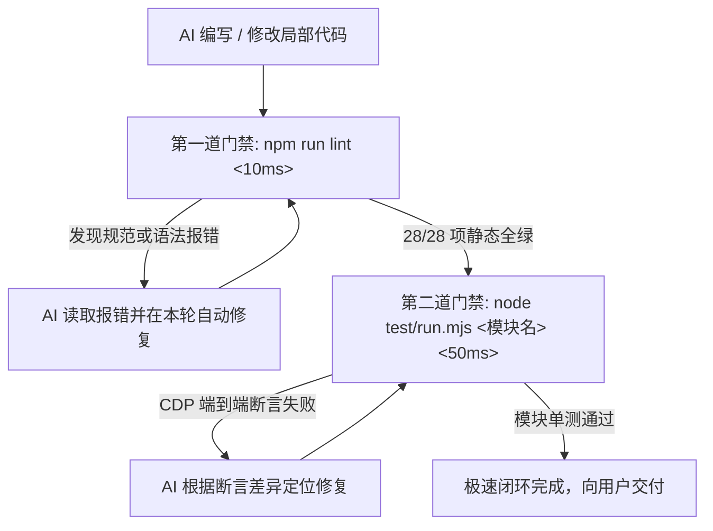

# 🤖 Glass Start — AI 编程行为宪法与工程准则 (AGENTS.md)

本文档是所有进入本项目（**Glass Start — 灵动起始页与分类导航**）的 AI 编程助手与自主代理（AI Coding Agents）必须无条件遵守的**最高级别开发宪法与工程红线**。

在阅读、分析、修改任何源码或执行重构前，AI 必须严格遵守本文档所规定的所有约束。

---

## 🚫 一、不可触碰的 7 大工程红线 (The 7 Non-Negotiable Red Lines)

### 1. 🔴 零运行时 npm 依赖原则 (Zero Runtime Dependency)
- **铁律**：严禁在 `package.json` 的 `dependencies` 中引入任何运行时的外部 npm 依赖包（如 React, Vue, Lodash, Axios, Dayjs, Date-fns, jQuery 等）。
- **执行准则**：
  - 必须使用现代原生 Web API（Native Fetch, DOM API, Canvas 2D, CSS Variables, Service Worker API, CacheStorage, Web Cryptography）；
  - 仅允许使用 `devDependencies` 中现有的 `@tailwindcss/cli`（v4 原子化编译）与 `esbuild`（AST 高性能压缩）作为离线构建工具；
  - 客户端运行时必须保持**单文件纯原生、零依赖秒开**的极简架构。

---

### 2. 🔴 纯原生 CSS、字体排版与 iOS 视口规范 (Clean CSS, Typography & Viewport Guard)
- **铁律**：全站 CSS 与排版必须纯净原生，严禁滥用非标属性、破坏规则级联或破坏移动端响应式布局。
- **执行准则**：
  - **零 `!important` 污染**：严禁在 `<style>` 或内联样式中滥用 `!important`（唯一允许放行的特例为 `@media (prefers-reduced-motion: reduce)` 无障碍白名单）；样式覆盖必须通过 CSS 变量动态绑定、组合选择器特异性或 DOM 状态类名切换解决；
  - **零人为字体抗锯齿**：严禁在全站任何 CSS 选择器中滥加 `-webkit-font-smoothing`、`-moz-osx-font-smoothing` 或 `font-smooth` 属性，100% 保持操作系统与浏览器默认的原生次像素排版字形；
  - **iOS 16px 视口守卫**：全站所有单行 `<input type="text">` 文本输入框计算字体大小必须 $\ge 16\text{px}$（必须包含 Tailwind 类名 `text-base` 或以上），彻底杜绝 iOS Safari 聚焦时强行拉近放大视口。

---

### 3. 🔴 W3C WAI-ARIA 无障碍与官方 Nu 验证全量合规 (A11y & W3C Standard)
- **铁律**：全站所有交互与装饰元素必须 100% 符合 W3C WAI-ARIA 无障碍标准，**上线与发布前必须通过 W3C 官方 Nu 验证器检查（`npm run test:w3c`）确保 0 语法错误与 0 属性违规！**
- **执行准则**：
  - **所有 `<button>` 标签**：必须 100% 显式声明 `type="button"`（防止在 form 上下文中被意外触发为 submit）；
  - **所有装饰性 `<svg>` 图标**：必须显式标注 `aria-hidden="true"`；
  - **所有交互性图标按钮**：必须显式标注 `aria-label` 描述其可访问名称；
  - **焦点环规范**：必须遵循 Apple HIG 规范，键盘导航时呈现 `:focus-visible` 白色半透明描边与外发光，鼠标点击时 `:focus:not(:focus-visible)` 保持干净无圈；
  - **发布前 W3C 官方在线门禁**：版本发布前强制执行 `npm run test:w3c`，直连 W3C 官方 Nu Html Checker 审计，确保 HTML5 语义化标签、属性契约与 ARIA 规范全量合规。

---

### 4. 🔴 弹窗管理必须通过 OverlayStack 压退栈 (Modal Hierarchy)
- **铁律**：严禁通过直接修改 DOM 的 `style.display = 'block'` 或直接移除 `hidden` 属性来弹出/关闭弹窗。
- **执行准则**：
  - 必须统一通过 `OverlayStack.push(id, closeFn)` 进行压栈，通过 `OverlayStack.pop(id)` 进行退栈；
  - 严格遵循 4 级 $z$-index 体系（`z-150` 下拉 ➔ `z-1000` 设置 ➔ `z-2000` 提取/快捷键/鸣谢 ➔ `z-9999` 二次确认）；
  - 确保全局键盘 `Escape` 键能够按照**后进先出（LIFO）**顺序逐层剥离，并自动管理 `document.body` 的 `overflow-hidden touch-none` 滚动穿透锁定。

---

### 5. 🔴 书签副标题双轨排版与防膨胀铁律 (Bookmark CJK Typography Guard)
- **铁律**：严禁在编写/维护书签简介（`desc`）时将纯中文文案膨胀到 10 字及以上，也严禁破坏已有的中英混排半角空格！
- **执行准则**：
  - **纯中文简介**：移动端双列卡片安全宽度约 9 个全角汉字字模（卡片内边距会吞掉约 1em 余量），必须**不超过 9 字**（第 10 个汉字在手机屏幕上必被截断成 `...` 省略号），且必须包含中文品类锚点、拒绝空洞词（如“工具”“网站”）；
  - **中英混排简介**：仅当描述包含半角英文字母/数字（如 `AI`、`Linux`、`GIF`、`PPT`、`UI`）及标准分词空格时，依托半角字符物理等宽特性（0.5em），允许字符串长度在 **$\le 13$ 字符** 以内；
  - 严禁 AI 产生“为了读起来顺畅而滥加修饰词凑字数”的膨胀本能，改动后必须运行 `npm run lint` 验证双轨门禁。

---

### 6. 🔴 单一真理源版本发布与核心文档强一致性 (SemVer & Tri-Document Coherence)
- **铁律**：发布新版本或执行重大架构变更时，版本号以 `package.json` 为唯一真理源（构建时自动注入 `dist/` 产物徽章），并保持 3 大核心 Markdown 文档说辞同步，严禁文档陈旧或自相矛盾。
- **执行准则**：
  - **SemVer 单一真理源**：版本号以 `package.json`（及 npm 自动联动的 `package-lock.json`）为唯一源头，由 `scripts/build.js` 自动将最新版本号注入生产 HTML 徽章，杜绝人工多处重复修改；
  - **3 大 MD 文档说辞强一致**：交付前交叉统一 [**AGENTS.md**](./AGENTS.md)、[**ARCHITECTURE.md**](./ARCHITECTURE.md) 与 [**README.md**](./README.md) 中的命令参数、文件路径与专业术语。

---

### 7. 🔴 Git 权限安全与分级测试执行纪律 (Git Safety & Testing Protocol)
- **铁律**：**严禁未经人类明确指令擅自执行 `git push`，严禁在日常开发中滥用 `--force` 启动全量重测！**
- **执行准则**：
  - **Git 远程推送安全边界**：AI 可在本地执行 `git add` 和 `git commit` 保存进度，所有的远程推送（`git push`）必须由人类明确指示后方可执行；
  - **智能增量构建感知**：测试运行器已内置智能源码哈希感知。`dist/` 产物有效时自动 0ms 跳过构建，仅在源码变动时自动增量补建；日常开发直接运行模块测试（如 `npm run test:ui`、`npm run test:data`、`npm run test:infra`、`npm run test:lifecycle`）；
  - **日常敏捷自愈流**：书签与配置微调只跑 `npm run lint`（<10ms），局部功能修改只跑指定模块单测（<50ms），常规提交前跑增量 `npm test`（利用 MD5 缓存，<1s）；
  - **`--force` 唯一合法场景**：仅在人类明确指示“全量测试”、“准备发布版本”或跨编译器重大重构时，才允许执行 `npm run test:all`（或 `node test/run.mjs --force`）。

---

## 🛠️ 二、分级开发与质量自愈流水线 (Tiered QA & Self-Healing Pipeline)

为了最大化 AI 迭代效率并实现“零返工”闭环，项目划分为两级验证流水线：



### 1. ⚡ 日常敏捷自愈流（< 50ms，每次代码改动后必跑）
```bash
# 步骤 1：静态规范与语法极速门禁 (< 10ms，支持 --fix 一键就地自愈)
npm run lint            # 校验规范 (如遇 A11y 缺失可运行 npm run lint:fix 自动修复)

# 步骤 2：针对修改模块的精准单测 (< 50ms，智能构建感知无需手动跳过)
npm run test:ui         # 修改 UI/切屏/弹窗时 (或 node test/run.mjs ui)
npm run test:data       # 修改天气/书签搜索时 (或 node test/run.mjs data)
npm run test:infra      # 修改 SW缓存/安全标头时 (或 node test/run.mjs infra)
npm run test:lifecycle  # 修改黑匣子/生命周期/自愈阶梯时 (或 node test/run.mjs lifecycle)

# 步骤 3：常规提交前验证（利用 MD5 增量缓存，< 1s）
npm test
```

### 2. 🚀 发布级全量验证流（仅在人类明确要求或版本发布前执行）
```bash
# 1. 生产环境构建打包 (验证 Tailwind v4 编译、CSP 优化与 esbuild AST 压缩)
npm run build

# 2. 全量端到端自动化测试套件 (5 大套件 24 项断言全跑)
npm run test:all        # 或 node test/run.mjs --force

# 3. W3C 官方 Nu 验证器全量合规门禁 (直连 W3C 官方 API，确保 0 语法错误与 0 属性违规)
npm run test:w3c        # 或 node scripts/validate-w3c.mjs

# 4. 如涉及关键 UI / 动画 / 视口变动，执行多视口全景视觉回归测试 (11 大场景断言)
npm run test:visual     # 或 node test/visual-regression.mjs
```

---

## 🗺️ 三、系统架构导读与 ES 模块精准开发准则 (ES Modules & System Map)

在修改任何核心业务逻辑前，请先查阅 [**ARCHITECTURE.md**](./ARCHITECTURE.md) 系统架构设计白皮书与决策图谱：

### ⚠️ 原生 ES 模块化高内聚规范 (Modular Development Standards)
项目全面采用原生模块化单源码架构（`src/index.html` 纯语义骨架 ~650 行 + `src/js/` 高内聚业务子模块，构建自动产出 `dist/`）：
- **优先按模块定位**：直接定位至 `src/js/` 下对应业务模块文件，拒绝巨石单文件扫描；
- **只切片读取**：圈定具体函数或 Symbol 进行局部读取与修改；
- **只局部替换**：使用精确文本替换，单次改动控制在最小代码块（Diff），杜绝截断风险。

| 业务领域与核心意图 | 对应 ES 模块 (`src/`) | 核心函数 / DOM 锚点 | 关联 [ARCHITECTURE.md](./ARCHITECTURE.md) 机制 |
| :--- | :--- | :--- | :--- |
| **首屏主题与 Safari 外壳预渲染** | `src/js/config/themes.js` | `PRESET_THEMES`, `targetColor` | **[§6](./ARCHITECTURE.md#6--精确符号索引地图与代码区域导航-symbol-index--region-map)**：0ms 闪电对齐，黑白二元流 |
| **全局状态与高频 DOM 缓存池** | `src/js/state/store.js`<br/>`src/js/state/dom.js` | `dom`, `state`, `cacheDOM()`, `$` | **[图 1](./ARCHITECTURE.md#1-️-系统全景分层与模块拓扑架构-high-level-layer-architecture)**：80+ 节点映射与单一数据源 |
| **壁纸持久化与即选即存** | `src/js/modules/wallpaper.js` | `commitWallpaperSelection()`, `previewDraftWallpaper()` | **[§6](./ARCHITECTURE.md#6--精确符号索引地图与代码区域导航-symbol-index--region-map)**：即选即存、IDB 双写与预设高亮 |
| **设置弹窗与生命周期管理** | `src/js/modules/settings.js`<br/>`src/js/core/overlay-stack.js` | `openEditModal()`, `closeEditModal()`, `OverlayStack` | **[图 3](./ARCHITECTURE.md#3--overlaystack-多层弹窗层叠栈与-escape-统一退栈决策-overlaystack--modal-flow)**：LIFO 栈模型、Focus Trap 焦点锁定 |
| **搜索联想与防竞态调度** | `src/js/modules/search.js` | `renderSuggestions()`, `fetchSuggestions()`, `activeSuggestReqId` | **[图 5](./ARCHITECTURE.md#5--智能搜索三级模糊匹配与气象-9-阶动态演化决策-search--weather-decision-engine)**：本地三级模糊 + 网络混排，零 CLS 骨架 |
| **气象数据清洗与动态演化** | `src/js/modules/weather.js` | `initWeather()`, `weatherNum()`, `WMO_WEATHER_MAP` | **[图 5](./ARCHITECTURE.md#5--智能搜索三级模糊匹配与气象-9-阶动态演化决策-search--weather-decision-engine)**：9 阶动态感知形态、强制数值化信任边界防御 |
| **外壳主题与底色动态管理** | `src/js/core/theme-engine.js` | `APP_THEME_DARK`, `APP_THEME_LIGHT`, `updateThemeColor()` | **[§6](./ARCHITECTURE.md#6--精确符号索引地图与代码区域导航-symbol-index--region-map)**：Safari 顶栏、`--bg-base` 与 `#bgLayer` 联动 |
| **双屏有限状态机与唤醒自愈** | `src/js/core/screen-state.js`<br/>`src/js/core/lifecycle.js` | `switchToNav()`, `switchToStart()`, `reconcileScreenState()` | **[图 2](./ARCHITECTURE.md#2--双屏切屏状态机手势与-bfcache-全生命周期流转-screen-state--bfcache-lifecycle)**：双屏状态机、滚轮吞咽、WebKit 磁贴重栅格化 |
| **VisionOS 3D 倾斜与折射高光** | `src/js/core/gestures.js` | `initGlassSpotlightAndTilt()`, `resetActiveCard()` | **[§6](./ARCHITECTURE.md#6--精确符号索引地图与代码区域导航-symbol-index--region-map)**：VisionOS 风格玻璃高光、3D 陀螺仪矩阵倾斜、RAF 帧合并 |
| **离线底座与三池物理隔离** | `sw.js` (全量 ~240 行) | `CORE_CACHE`, `FAVICON_CACHE`, `IMG_CACHE` | **[图 4](./ARCHITECTURE.md#4--service-worker-三池隔离与离线数据流向-storage--cache-topology)**：三池物理隔离、FIFO 限额淘汰 |

---

## 💡 四、常见陷阱与防御式编程模式 (Defensive Patterns)

1. **防假性悬停残留（Synthetic Hover）**：
   - 普通跳转切出时已挂载 `body.tab-blurred`；
   - 所有卡片 `:hover` 规则均通过 `body:not(.tab-blurred)` 前缀保护；
   - 严禁随意删除 `handleTabBlur` 与 `clearTabBlurOnInteraction` 监听器。
2. **防修饰键后台打开迟滞**：
   - 点击书签时已通过 `e.metaKey || e.ctrlKey || e.button === 1` 精准分流；
   - 后台静默打开严禁添加 `.is-clicked` 惩罚类，交由原生 `:active` 呈现即时按压触感。
3. **防 XSS 注入与网络悬挂**：
   - 所有的动态书签渲染必须经过 `escapeHtml()` 与 `safeUrl()` 白名单过滤；
   - 气象数据入库必须经过 `weatherNum()` 强制数值化清洗；
   - 外部搜索联想必须配备 `activeSuggestReqId` 防竞态乱序。
4. **防 BFCache 与生命周期失步 5 大暗坑 (BFCache & Lifecycle State Machine Guards)**：
   - **坑点 1：类名语义污染** ➔ 严禁将布局推屏类（如 `.nr`）误作通用动画禁用类；任何切屏/自愈入口必须首行同步 `classList.remove('nr')`，并在 `<head>` 中配备 1.5s 超时防卡死兜底；
   - **坑点 2：异步跨帧竞态** ➔ 严禁使用 `el.style.transition = 'none'` + `rAF` 清理的异步反模式（后台标签页会冻结 `rAF`）；全量收敛至声明式 CSS 状态类并由 `reconcileScreenState()` 同步清空内联脏样式；
   - **坑点 3：生命周期模型割裂与 WebKit 离屏磁贴丢弃** ➔ 唤醒自愈必须同时挂载 `visibilitychange`（多标签页切回）与 `pageshow`（BFCache 后退）双通道，统一收敛至 `handleAppWakeUp()`。**严禁对磁贴重绘添加 `wasPersisted` 狭隘门控**；必须通过瞬态重置（`display: none` ➔ `void offsetHeight` ➔ `display: ''`）强制让 WebKit 重新分配 GPU Backing Store 磁贴，根绝切回时图层空白未渲染；
   - **坑点 4：CSS 动画时间穿越** ➔ 带有 `animation-fill-mode: backwards` 的入场动画类（如 `.fade-in`、`.animate-item-in`、`.category-title-pulse`）播放完后必须立即卸载（通过 `animationend` 或定时器脱壳），防止 WebKit 从 BFCache 唤醒时重置动画导致永久回滚至 `opacity:0`；
   - **坑点 5：状态机变量与黑匣子探针脱节** ➔ 全局 `state` 必须挂载至 `window.state`，健全性探针 `snapshotHealth()` 必须实行 `window.state.currentSection` 与 `.screen-pushed-in` 物理 DOM 双重校验，确保导航页与首屏异常均能被探针即时捕捉并由 L2 自动触发重栅格化。
5. **防 Service Worker 跨版本缓存割裂与原子锁步 (SW Version Lockstep & Atomic Cache Guard)**：
   - **铁律**：主文档 `index.html` 与同源核心脚本 `app.js` 必须 100% 保持同调的**原子化 SWR 锁步**策略（CORE_CACHE 本地 0ms 秒开 + 差量 SW 换代升级）；
   - **构建防穿透**：生产环境构建时必须为 `app.js` 自动注入版本查询参数（`?v=app-core-v<timestamp>`），并维持双端构建指纹契约，彻底击穿旧版 SW 缓存池残留，根绝“HTML 是新版但 JS 执行旧版”的跨版本白屏死锁。
6. **双端构建指纹契约与运行时黑匣子纪律 (Build Fingerprint & Blackbox Contract)**：
   - **指纹对铁律**：`scripts/build.js` 必须向 `dist/index.html` 内联注入 `__GLASS_BUILD_HTML__`、向 `dist/app.js` 头部注入 `__GLASS_BUILD_APP__`，两键同源同版并由构建断言强制校验；严禁绕过 build.js 手工篡改 dist 产物；
   - **黑匣子契约**：`window.__GLASS_DIAG__`（verify/probe/dump/log）承载指纹校验、纯内存生命周期环形日志（≤40 条，零存储写入，BFCache 往返不灭）、白屏异常三级阶梯（L1 幂等校准 → L2 合成层磁贴重建 → L3 冷却守卫刷新）；严禁复活任何 UI 诊断面板（取证仅走控制台 `dump()`）；L3 触发瞬间仅允许一次性写 `gs_last_heal` 面包屑；
   - **刷新纪律**：任何自动 `location.reload()` 必须经 `gs_build_reload_at` 冷却期（60s）守卫，严禁裸调用；自动化测试环境（`navigator.webdriver`）下自动探针必须静默。
7. **防本地开发服务与生产缓存脱节 (Dev Server Watch & Cache-Busting Guard)**：
   - **自动增量监听**：`scripts/server.js` 默认内置 Watch 增量构建机制（50ms 极速防抖），编辑 `src/` 源码目录、`bookmarks.json`、`sw.js` 即时增量编译至 `dist/` 并无条件滚动构建版本指纹（`currentBuildVersion = 'app-core-v' + Date.now()`）；
   - **开发防滞后标头**：本地开发服务静态响应头强制注入 `Service-Worker-Allowed: /` 与 `no-cache, no-store, must-revalidate, max-age=0`，本地非壁纸代码资源跳过 304 协商缓存，确保本地测试 100% 拉取最新构建代码，根除开发期 SW 缓存滞后导致的切屏错位。

---

## 🤝 五、人机高效协同范式 (Interaction Protocols)

为了获得最高质量的 AI 产出，推荐采用以下标准指令模式：

```markdown
【目标】：优化天气卡片的风速显示布局
【涉及模块】：src/js/modules/weather.js (initWeather)
【约束要求】：遵守 7 大工程红线，不破坏现有的 9 阶动态形态演化
【自愈验证】：修改后请执行 npm run lint 及 npm run test:data (或 node test/run.mjs data) 确保全绿
```

- **遇错自愈**：遇到测试或运行时报错，直接粘贴完整终端报错，AI 自动定位最小补丁修复直至全绿；
- **双屏与生命周期审查**：涉及切屏交互、动画或唤醒逻辑时，必须严格遵守 §四、4 防 BFCache 与生命周期失步 5 大暗坑，杜绝“返回后两屏只剩一屏/划过去空白”。

---

*遵照上述准则，共同维护 Glass Start 的极致纯净、丝滑与工业级稳定性！*
