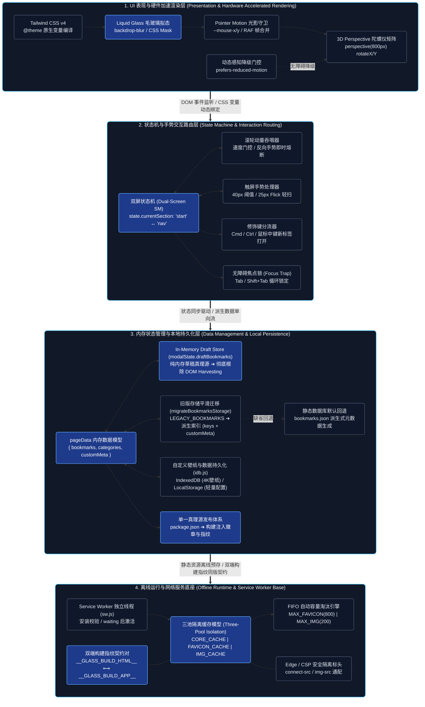
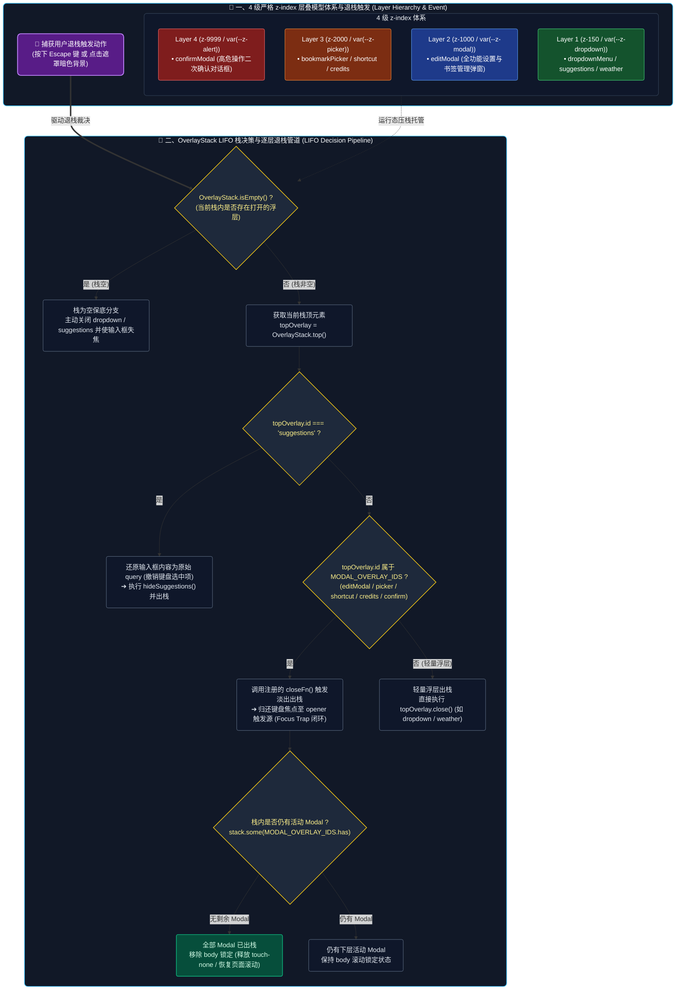
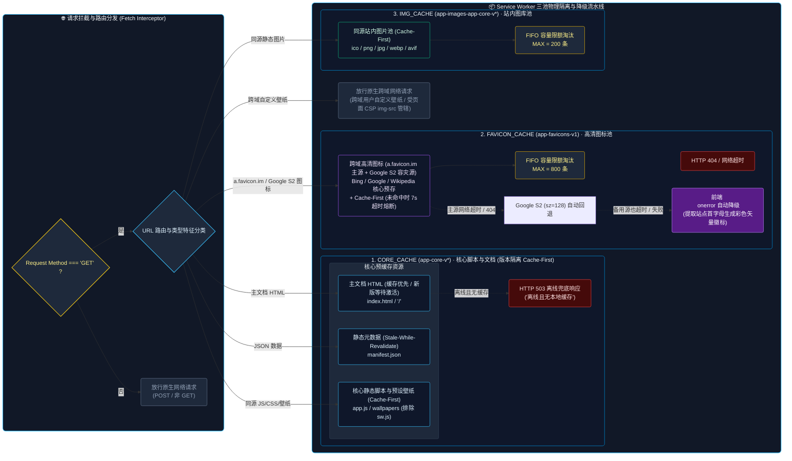

# Glass Start 架构设计与核心技术白皮书 (Architecture Whitepaper)

本文档系统性剖析 **Glass Start（玻璃拟态极简起始页与分类导航）** 的底层软件工程架构、有限状态机、弹窗优先级层叠栈、Service Worker 离线网络底座以及搜索与气象智能演化引擎。

> 🤖 **AI 编程行为准则**：关于 AI 编程助手的核心工程红线与分级自愈流水线，请参阅 ➔ [**AI 编程行为宪法 (AGENTS.md)**](./AGENTS.md)。
> 
> 📖 **全站功能与部署指南**：关于全站使用指南、书签规范、命令清单与依赖版本，请参阅 ➔ [**项目主说明文档 (README.md)**](./README.md)。

---

## 目录
- [1. 🏗️ 系统全景分层与模块拓扑架构 (High-Level Layer Architecture)](#1-️-系统全景分层与模块拓扑架构-high-level-layer-architecture)
- [2. 🔄 双屏切屏状态机、手势与 BFCache 全生命周期流转 (Screen State & BFCache Lifecycle)](#2--双屏切屏状态机手势与-bfcache-全生命周期流转-screen-state--bfcache-lifecycle)
- [3. 📚 OverlayStack 多层弹窗层叠栈与 Escape 统一退栈决策 (OverlayStack & Modal Flow)](#3--overlaystack-多层弹窗层叠栈与-escape-统一退栈决策-overlaystack--modal-flow)
- [4. 📴 Service Worker 三池隔离与离线数据流向 (Storage & Cache Topology)](#4--service-worker-三池隔离与离线数据流向-storage--cache-topology)
- [5. 🔍 智能搜索多阶模糊匹配与气象 9 阶动态演化决策 (Search & Weather Decision Engine)](#5--智能搜索多阶模糊匹配与气象-9-阶动态演化决策-search--weather-decision-engine)
- [6. 📍 精确符号索引地图与代码区域导航 (Symbol Index & Module Map)](#6--精确符号索引地图与代码区域导航-symbol-index--module-map)

---

### 1. 🏗️ 系统全景分层与模块拓扑架构 (High-Level Layer Architecture)

#### 💡 技术原理解析
1. **表现层与 GPU 硬件加速**：系统采用 Tailwind CSS v4 原子化引擎配合 CSS 变量实现有利于浏览器合成的样式与动效；具体绘制和合成路径由浏览器决定。通过 Pointer Motion Gating 与 `requestAnimationFrame` 合并帧计算，仅在指针接近卡片边界（±4px）时激活 3D 矩阵视差变换；搜索框仅应用光斑高光而不做 3D 倾斜，避免输入打字时光标抖动。
2. **状态与交互路由层**：通过双屏有限状态机解耦第一屏（Start）与第二屏（Nav），辅以滚轮动量吞咽器与触屏滑动引擎。针对 Mac 触控板高频惯性与跨屏误触，设立速度门控与反向打断机制。
3. **数据管理与派生架构**：采用单向数据流与派生式架构（Derived Bookmark Architecture），快捷书签仅存储 URL 索引，其标题、图标与分类均由 `bookmarks.json` 全量数据库动态派生，兼顾用户自定义灵活性与全局数据实时同步能力。在设置弹窗中全面确立 **In-Memory Draft Store（`modalState.draftBookmarks`）** 纯内存草稿单向数据源，所有书签编辑、增删、拖拽重排与落盘导出 100% 直接读写内存数据模型，保存与导出不从 DOM 反向解析书签数据；编辑、渲染和拖拽过程仍可能触发布局计算。
4. **离线基座与安全屏障**：Service Worker 实施三池物理隔离，配合 `public/_headers` 的严格 CSP 与 HSTS，既保证离线可用性，又防范跨域数据投毒与 CSS/JS 缓存穿透。静态资产全面收拢于 `public/` 纯静态公开层，构建时镜像同步至 `dist/`。
5. **单一真理源与双端构建指纹**：版本发布以 `package.json` 为唯一真理源，`scripts/build.js` 自动将版本号同步注入 `README.md` 与 `dist/index.html` 徽章，同时生成同步的 `__GLASS_BUILD_HTML__` 与 `__GLASS_BUILD_APP__` 双端构建指纹对，确保客户端 HTML 与 JS 逻辑同版锁步运行。

CSS 构建由 `compileTailwindCss()` 捕获 Tailwind CLI 的标准输出，再将字符串传给 `processProductionHtml(compiledCss)` 内嵌。每次构建独立持有 CSS，不读写共享的 `dist/style.css` 中间文件；编译结果为空或 HTML 处理缺少 CSS 时拒绝生成页面。该隔离解决 CSS 中间文件竞争，不代表整个 `dist/` 目录的并发写入具有事务性。

---

### 2. 🔄 双屏切屏状态机、手势与 BFCache 全生命周期流转 (Screen State & BFCache Lifecycle)

```mermaid
flowchart TD
    %% ======================= 1. DUAL SCREEN STATE MACHINE =======================
    subgraph SM_STAGE [" 🔄 1. 双屏有限状态机与手势交互流转 (Screen State Machine) "]
        direction TB
        START_STATE(["🟢 首屏态 (Start Section)<br/>state.currentSection: 'start' / #startSection 居中展示"]):::stateNode
        
        TRIG_DOWN["⬇️ 切换至导航页触发条件 (To Nav Triggers)<br/>• 滚轮向下: 瞬时 >= 100px 或速度 > 1.2px/ms 降至 60px (常规累积 >= 120px)<br/>• 触屏轻扫: deltaY >= 40px 或 Flick 快速轻扫 (>= 25px & > 0.25px/ms)<br/>• 键盘快捷: ArrowDown / PageDown (且非输入/编辑聚焦态)"]:::triggerBox
        
        TRANS_STATE{{"🟡 过渡互斥态 (isTransitioning)<br/>耗时 580ms 动画锁定 / 天然无感吞咽触控板与滚轮动量余震"}}:::transNode
        
        NAV_STATE(["🔵 导航页态 (Nav Section)<br/>state.currentSection: 'nav' / #navSection 激活展示"]):::stateNode

        TRIG_UP["⬆️ 切换回首屏触发条件 (To Start Triggers)<br/>• 滚轮向上: navContent.scrollTop <= 0 且向上累积 >= 阈值<br/>• 触屏轻扫: navContent.scrollTop <= 0 且向上滑动 deltaY <= -40px<br/>• 键盘快捷: ArrowUp / PageUp / Home 且 scrollTop <= 0<br/>• 按钮返回: 点击顶部导航条 navHeader 或「起始页」返回胶囊按钮"]:::triggerBox

        START_STATE --> TRIG_DOWN --> TRANS_STATE
        TRANS_STATE -->|"动画就绪 (580ms) / 延后 rAF 执行"| NAV_STATE
        NAV_STATE --> TRIG_UP --> TRANS_STATE
        TRANS_STATE -->|"动画结束 / 移除 nav-visible"| START_STATE
    end

    %% ======================= 2. BFCACHE & LIFECYCLE =======================
    subgraph LC_STAGE [" 🛡️ 2. BFCache 挂起与双通道唤醒自愈 (Lifecycle & BFCache Healing) "]
        direction TB
        PAGE_SUSPEND["页面挂起: 点击外链跳转 / 切换后台标签页<br/>(触发 window.pagehide 与 window.blur)"]:::actionNode
        TAB_BLUR["防悬停残留: 挂载 body.tab-blurred 标志类<br/>(强制解除一切 card:hover 与 :active 假性悬停微动)"]:::actionNode
        PAGE_WAKE["双通道唤醒: window.pageshow 与 document.visibilitychange<br/>(完整覆盖 BFCache 后退恢复与多标签页切回两种场景)"]:::actionNode
        RECONCILE["纯内存声明式自愈: reconcileScreenState(targetSection)<br/>1. 强置 isTransitioning = false 并清除残留定时器<br/>2. 瞬态重排重置 (display:none ➔ void ➔ '') 强制 WebKit 重新分配 GPU 离屏磁贴<br/>3. 剥离 .is-clicked / .dragging / .fade-in 等临时类名与手势高光<br/>4. 同步校准 scrollTop = 0 与 transform 单位矩阵"]:::activeNode

        PAGE_SUSPEND --> TAB_BLUR --> PAGE_WAKE --> RECONCILE
    end

    %% ======================= 3. DIAGNOSTICS & HEALING LADDER =======================
    subgraph DIAG_STAGE [" 🪜 3. 运行时黑匣子探针与三级自愈阶梯 (Diagnostics & 3-Tier Ladder) "]
        direction TB
        FP_CHECK{"双端构建指纹契约校验<br/>BUILD_HTML === BUILD_APP ?"}:::diagDecision
        FP_FAIL["指纹不一致 ➔ 60s 冷却守卫刷新<br/>(sessionStorage 记录 gs_build_reload_at 防刷新风暴)"]:::diagWarn
        
        PROBE{"健全性探针 snapshotHealth()<br/>首屏矩阵 ≈ 单位阵 且 哨兵真实可见 ?"}:::diagDecision
        
        subgraph HEAL_STEPS [" 连续异常自动升级修复阶梯 "]
            direction LR
            L1["L1: 幂等状态校准<br/>reconcileScreenState"]:::l1Heal
            L2["L2: WebKit 合成层重排<br/>瞬态重排强制分配磁贴"]:::l2Heal
            L3["L3: 冷却拦截安全熔断<br/>heal-reload-blocked 零写防刷新风暴"]:::l3Heal
            L1 -.->|连续异常| L2 -.->|再次异常| L3
        end

        RING_BUF["纯内存环形日志 (≤40 条，零存储写入)<br/>控制台 window.__GLASS_DIAG__.dump() 现场取证"]:::diagInfo

        FP_CHECK -- "契约对齐" --> PROBE
        FP_CHECK -- "不一致" --> FP_FAIL
        PROBE -- "健康正常" --> RING_BUF
        PROBE -- "探测异常 (升级制)" --> L1
    end

    %% ======================= VERTICAL PIPELINE LINKAGE =======================
    SM_STAGE ==>|"用户点击外链或切换标签页"| LC_STAGE
    LC_STAGE ==>|"唤醒自愈完成，驱动指纹契约与健全性探针"| DIAG_STAGE

    %% ======================= STYLES =======================
    classDef stateNode fill:#0f172a,stroke:#3b82f6,stroke-width:2px,color:#ffffff,rx:8px
    classDef transNode fill:#1e293b,stroke:#eab308,stroke-width:1.5px,color:#fef08a,rx:6px
    classDef triggerBox fill:#1e293b,stroke:#475569,stroke-width:1px,color:#e2e8f0,rx:6px
    classDef actionNode fill:#0f172a,stroke:#64748b,stroke-width:1px,color:#cbd5e1,rx:5px
    classDef activeNode fill:#1e3a8a,stroke:#60a5fa,stroke-width:1.5px,color:#ffffff,rx:6px
    classDef diagDecision fill:#1e293b,stroke:#f59e0b,stroke-width:1.5px,color:#fef3c7,rx:6px
    classDef diagWarn fill:#450a0a,stroke:#ef4444,stroke-width:1px,color:#fee2e2,rx:4px
    classDef l1Heal fill:#1e3a8a,stroke:#60a5fa,stroke-width:1px,color:#ffffff,rx:4px
    classDef l2Heal fill:#581c87,stroke:#c084fc,stroke-width:1px,color:#ffffff,rx:4px
    classDef l3Heal fill:#7f1d1d,stroke:#f87171,stroke-width:1px,color:#ffffff,rx:4px
    classDef diagInfo fill:#0f172a,stroke:#10b981,stroke-width:1px,color:#a7f3d0,rx:4px
    classDef stageBox fill:#111827,stroke:#38bdf8,stroke-width:1.5px,color:#f8fafc,rx:8px

    class SM_STAGE,LC_STAGE,DIAG_STAGE stageBox
    class HEAL_STEPS triggerBox
```

#### 💡 技术原理解析
1. **滚轮动量吞咽与反向熔断**：在从 Start 屏快速滑动进入 Nav 屏后，触控板产生的物理动量会持续 1~3 秒。系统开启 `swallowMomentum = true`，吞掉持续的同向事件，防止动量直接穿透导致导航页书签被意外跳滚；一旦检测到用户反向滚动（`curDir !== swallowDir`）或静默间隔超过 70ms（`MOMENTUM_QUIET_MS`），吞咽器立即熔断放行。
2. **触屏手势引擎**：触摸事件通过对比 X/Y 轴位移比率（`deltaX > absDeltaY` 则判定为侧边栏横滑并放行原生滚动），在垂直滑动达到 40px 阈值或满足 Flick 轻扫（位移 ≥ 25px 且速度 > 0.25px/ms）时瞬间触发切换。
3. **BFCache 与多标签唤醒幂等自愈**：当用户点击书签跳转后退或在多标签页之间切回时，页面经 BFCache 或后台唤醒恢复。双通道捕获（`pageshow` + `visibilitychange`）后调用 `reconcileScreenState()`，无视过渡动画直接在单帧内清空互斥锁、消除定时器、校准 `scrollTop` 与 DOM 类名，并无条件通过 `display` 瞬态重置（`display: none` ➔ `void offsetHeight` ➔ `display: ''`）强制 WebKit 重新分配 GPU Backing Store 磁贴，降低离屏图层恢复异常的风险。
4. **构建指纹黑匣子与三级自愈阶梯**：`window.__GLASS_DIAG__`（verify/probe/dump/log）在启动时校验 HTML 内联指纹 `__GLASS_BUILD_HTML__` 与 app.js 头部指纹 `__GLASS_BUILD_APP__` 的同版契约（不一致 → 60s 冷却期守卫单次刷新）；双屏 transform 过渡结束后执行健全性探测（当前在位屏变换矩阵 ≈ 单位阵 + 哨兵元素可见，支持 `window.state` 与 DOM 类名双重校验），连续异常按 L1 幂等校准 → L2 合成层磁贴强制重栅格化 → L3 冷却拦截安全熔断（`bbLog` 记录 `heal-reload-blocked` 拦截刷新死循环，零存储写入保活页面）。全过程记录于**纯内存环形日志**（≤40 条，零存储写入；BFCache 恢复不重置 JS 堆，天然覆盖偶发白屏的被动取证窗口）；无任何 UI 诊断面板，现场经控制台 `dump()` 导出现场取证。

#### 🛡️ BFCache 与页面生命周期失步关键防线与避坑规范 (Lifecycle Anti-Patterns & Defenses)

| 经典陷阱类别 | 错误本质与致命代价 | 工业级避坑标准与 Glass Start 防御实现 |
| :--- | :--- | :--- |
| **1. 语义污染与隐式副作用** *(Class Name Semantic Pollution)* | 将具有强破坏性推屏布局的类名（`.nr` 强推首屏至 `-100dvh`）误当通用禁用动画类；若在首屏唤醒未剥离，JS 以为在首屏，CSS 却将首屏推飞，导致两屏错乱。 | **严格入口剥离**：`reconcileScreenState`、`switchToNav`、`switchToStart` 入口首行均同步执行 `document.documentElement.classList.remove('nr')`，配合自动化断言守门。 |
| **2. 异步跨帧竞态反模式** *(Async Inter-Frame Race Condition)* | 采用 `el.style.transition = 'none'` + `rAF` 异步清除；后台标签页被浏览器完全冻结 `rAF` 时，残留内联样式在唤醒瞬间破坏 CSS 动画，导致屏幕卡死。 | **纯声明式状态类**：绝不常驻内联样式修改，100% 依托 `.screen-pushed-up` 等状态类驱动，唤醒自愈时同步清空 `startSection` / `nav` 内联脏样式。 |
| **3. 生命周期事件模型割裂** *(Lifecycle Fragmentation)* | 混淆 BFCache 唤醒（仅触发 `pageshow`）与多标签页切回（仅触发 `visibilitychange`）；若仅监听单边事件，另一侧唤醒即成为无监管死锁盲区。 | **双保险全量收敛**：统一提炼 `handleAppWakeUp()`，同时向 `visibilitychange` (`!document.hidden`) 与 `pageshow` 注册，单点实现多标签与 BFCache 统一自愈。 |
| **4. CSS 动画时间穿越隐患** *(CSS Animation Rewind Issue)* | 让带有 `animation-fill-mode: backwards` 的入场动画类（`.fade-in`、`.animate-item-in`）常驻 DOM；WebKit 从 BFCache 解冻唤醒时重估动画并回滚至 `opacity:0` 造成页面不可见。 | **入场后主动脱壳卸载**：页面首屏入场后 800ms 自动卸载 `.fade-in`，新增条目通过 `animationend` 同步卸载 `.animate-item-in`，唤醒时全局扫除动画类，保持静态 DOM。 |
| **5. 离屏图层磁贴失栅格化** *(Stale Tile Rasterization)* | 长期离屏或后台挂起的 `fixed` 双屏图层（`-100dvh` 推移 + `will-change: transform`）在多标签页切回 (`visibilitychange`) 或 BFCache 唤醒时，WebKit 会主动丢弃 GPU 离屏磁贴，导致首屏或导航屏整片空白。单纯修改 `willChange` 无法触发重绘。 | **双通道瞬态重排重栅格化 + 探针双断言闭环**：`handleAppWakeUp()` 覆盖 `visibilitychange` 与 `pageshow`，每次唤醒校准状态，并通过 `display: none` ➔ `void offsetHeight` ➔ `display: ''` 瞬态重置强制 WebKit 重新分配 GPU Backing Store 磁贴；黑匣子结合过渡状态、首屏 DOM 类名、变换矩阵与哨兵布局进行检查；正常页面不挂载 `window.state`，异常时由 L2 自动触发重栅格化。 |

---

### 3. 📚 OverlayStack 多层弹窗层叠栈与 Escape 统一退栈决策 (OverlayStack & Modal Flow)

#### 💡 技术原理解析
1. **LIFO 后进先出退栈模型**：`OverlayStack` 维护一个响应优先级栈。当用户在“设置弹窗”之上唤起“书签提取器”并进一步触发“删除确认对话框”时，弹窗依次压栈。按 `Escape` 键或点击遮罩将严格按照后进先出顺序逐层剥离，绝不发生跨层全关的穿透现象。
2. **滚动穿透锁定与引用计数**：栈内通过 `MODAL_OVERLAY_IDS` 集合监测活动弹窗。当第一个 Modal 入栈时，立即向 `document.body` 注入 `overflow-hidden touch-none`；退栈时仅当所有 Modal 全部出栈后才释放锁定，避免底层页面意外发生滚动穿透。
3. **焦点归还与 Focus Trap**：弹窗展开时记录 `editModalTriggerEl = document.activeElement`，并在弹窗内使用 `handleModalTabFocus` 拦截 `Tab` / `Shift+Tab` 键实现焦点循环锁定；弹窗销毁后平滑归还焦点到触发按钮，保证键盘纯盲操的无障碍闭环。
4. **In-Memory Draft Store 与单向数据流闭环**：设置弹窗内所有书签修改、新增、删除与 HTML5 拖拽重排直接同步至纯内存草稿 `modalState.draftBookmarks`，保存（`collectEditData`）与导出直接消费内存数组，避免从 DOM 反向解析书签数据，并在保存后同步更新 `pageData.bookmarks`。

---

### 4. 📴 Service Worker 三池隔离与离线数据流向 (Storage & Cache Topology)

#### 💡 技术原理解析
1. **三池物理隔离与版本强同调 (Version Lockstep)**：
   - `CORE_CACHE`：打包时基于构建时间戳命名（如 `app-core-v1786255428688`），主文档 `index.html` 与同源脚本 `app.js` 采用 **版本隔离的 Cache-First** 策略，缓存命中时直接返回，不在后台重验证；缓存未命中时回退网络；由构建管线自动在 HTML 注入 `app.js?v=app-core-v<timestamp>` 版本查询参数，配合 `window.__GLASS_BUILD_HTML__` 与 `__GLASS_BUILD_APP__` 双端构建指纹契约对，确保 HTML 结构与 JS 逻辑 100% 同池直出，彻底杜绝“旧 JS 执行于新 HTML”导致的切屏/BFCache 白屏死锁；新版安装时预缓存并校验核心资源与构建指纹，失败则拒绝安装；安装成功后保持 waiting，直到旧客户端全部退出才激活，不调用 `skipWaiting()` 或 `clients.claim()`。
   - `FAVICON_CACHE`：独立存储 `a.favicon.im` 与 Google S2 (`www.google.com/s2/favicons` 及其 `*.gstatic.com`) 外部图标，与核心脚本完全隔离。前端通过 `handleIconError` 与 `faviconFallbackFromUrl` 建立双轨容灾状态机，主源失败时无缝切换 Google S2 备用源，若均失败才降级为彩色字母徽标。
   - `IMG_CACHE`：独立存储站内高分辨率壁纸与本地同源书签图标（`dist/icons/*.png`），通过 Cache-First 策略实现本地同源 0ms 秒开并减少重复带宽消耗。
2. **防透明响应污染 (Anti-Opaque Poisoning)**：请求跨域图标时产生 `status = 0` 的 `opaque` 响应。若直接缓存可能存入被 DNS 劫持或损坏的数据。系统引入二次网络校验与 7 秒超时熔断（`AbortController`），确保仅有合法的 `opaque` 或 `200 OK` 响应才被允许写入，并由轻量 `pruneCache` 原生实现先进先出（FIFO）淘汰，杜绝 IndexedDB 膨胀与崩溃隐患。
3. **同源/跨域壁纸的 CSP 与缓存解耦**：同源静态图片进 `IMG_CACHE`；用户填写的任意跨域自定义壁纸直连网络，由页面的 CSP `img-src 'self' data: blob: https:` 进行安全管辖，避免因 Service Worker 上下文受 `connect-src` 严格白名单限制而拦截合法的用户壁纸主机。

---

### 5. 🔍 智能搜索多阶模糊匹配与气象 9 阶动态演化决策 (Search & Weather Decision Engine)

```mermaid
flowchart TD
    %% ======================= SECTION A: SEARCH =======================
    subgraph S_SEARCH [" 🔍 模块 A：本地书签多阶检索与网络联想调度决策管道 (Search & Suggestion Engine) "]
        direction TB
        Q_IN["用户输入搜索 Query 词条<br/>(前端自动过滤空白符与首尾标点)"]:::actionNode

        subgraph S_TIER [" 本地书签多阶检索流水线 (Local Priority Pipeline) "]
            direction TB
            subgraph T_EXACT [" ⚡ 精确命中层 (Exact & Prefix Match) "]
                direction LR
                T10["Tier 10: 标题全字匹配<br/>(bmName === q)"]:::tTier
                T20["Tier 20: 标题前缀匹配<br/>(startsWith)"]:::tTier
                T30["Tier 30: 标题子串包含<br/>(includes)"]:::tTier
            end
            subgraph T_FUZZY [" 🎯 模糊容错与描述层 (Fuzzy & Description Match) "]
                direction LR
                T40["Tier 40: 域名/URL 匹配<br/>(bmUrl.includes)"]:::tTier
                T50["Tier 50: 简介描述命中<br/>(bmDesc.includes)"]:::tTier
                T60["Tier 60+: Damerau-Levenshtein 拼写纠错<br/>(编辑距离 <= 2)"]:::tTier
            end
            T_EXACT --> T_FUZZY
        end

        SORT_LOCAL["排序并截取 Top 2 本地匹配项<br/>matches.sort((a,b) => a.tier - b.tier)"]:::actionNode
        RENDER_0MS["⚡ 0ms 瞬间渲染本地书签 + 网络骨架屏预占位<br/>(彻底消除 CLS 视口高度突变与布局抖动)"]:::accentNode

        JSONP_DISPATCH{"请求序号分配<br/>activeSuggestReqId"}:::decisionNode
        
        subgraph S_ENGINES [" 联想请求按当前引擎分流 "]
            direction LR
            ENG_BING["Bing JSONP API<br/>api.bing.com"]:::engNode
            ENG_GOOGLE["Google JSONP API<br/>suggestqueries.google.com"]:::engNode
            ENG_WIKI["Wikipedia OpenSearch (CORS fetch)<br/>zh.wikipedia.org"]:::engNode
        end

        MERGE_LIST["动态容量混排与去重渲染<br/>(本地书签数 + 网络建议数 <= 4 条)"]:::resultNode

        Q_IN --> S_TIER --> SORT_LOCAL --> RENDER_0MS --> JSONP_DISPATCH
        JSONP_DISPATCH --> S_ENGINES --> MERGE_LIST
    end

    %% ======================= SECTION B: WEATHER =======================
    subgraph S_WEATHER [" 🌤️ 模块 B：气象 9 阶动态感知演化决策引擎 (Weather 9-Stage Evolution Engine) "]
        direction TB
        W_DATA["摄取 Open-Meteo 实时气象数据<br/>(经 weatherNum 信任边界防注入清洗)"]:::actionNode

        subgraph W_STAGES [" 气象 3 维度 × 3 阶形态演化矩阵 "]
            direction LR
            subgraph HUMIDITY_STAGE [" 💧 相对湿度 (Humidity) "]
                direction TB
                H1["🌵 干燥 (Desert Dry)<br/>humidity < 35%"]:::wDry
                H2["💧 舒适 (Comfortable)<br/>35% <= humidity <= 75%"]:::wComfort
                H3["💦 潮湿 (Humid)<br/>humidity > 75%"]:::wWet
            end

            subgraph WIND_STAGE [" 🍃 实时风速 (Wind Speed) "]
                direction TB
                W1_S["🍃 微风拂面 (Light Breeze)<br/>windSpeed < 15 km/h"]:::wLight
                W2_S["🎏 清风疾风 (Moderate Wind)<br/>15 <= windSpeed < 35 km/h"]:::wMod
                W3_S["🌪️ 强风狂风 (Gale Warning)<br/>windSpeed >= 35 km/h"]:::wGale
            end

            subgraph POP_STAGE [" ☂️ 降水概率与雨具 (Precipitation) "]
                direction TB
                P1["🌂 折叠收伞 (Safe / No Rain)<br/>pop < 30%"]:::pSafe
                P2["☂️ 撑开备伞 (Standby / Moderate)<br/>30% <= pop < 70%"]:::pWarn
                P3["☔️ 暴雨倾盆 (Heavy Rain / Warning)<br/>pop >= 70%"]:::pAlert
            end
        end

        W_RENDER["渲染气象胶囊卡片与昼夜交替演化<br/>(🌅 今日日落 vs 🌄 明日日出 智能时间窗切换)"]:::resultNode

        W_DATA --> W_STAGES --> W_RENDER
    end

    %% 模块上下串联
    S_SEARCH === S_WEATHER

    %% ======================= STYLES =======================
    classDef sectionBox fill:#111827,stroke:#38bdf8,stroke-width:1.5px,color:#f8fafc,rx:8px
    classDef subBox fill:#0f172a,stroke:#334155,stroke-width:1.2px,color:#f1f5f9,rx:6px
    classDef actionNode fill:#1e293b,stroke:#64748b,stroke-width:1px,color:#f1f5f9,rx:4px
    classDef tTier fill:#0f172a,stroke:#475569,stroke-width:1px,color:#e2e8f0,rx:4px
    classDef accentNode fill:#1e3a8a,stroke:#60a5fa,stroke-width:1.5px,color:#ffffff,rx:6px
    classDef decisionNode fill:#1e293b,stroke:#facc15,stroke-width:1.5px,color:#fef08a,rx:6px
    classDef engNode fill:#0f172a,stroke:#60a5fa,stroke-width:1px,color:#bfdbfe,rx:4px
    classDef resultNode fill:#064e3b,stroke:#34d399,stroke-width:1.5px,color:#ffffff,rx:6px

    classDef wDry fill:#451a03,stroke:#f59e0b,stroke-width:1px,color:#fef3c7,rx:4px
    classDef wComfort fill:#064e3b,stroke:#10b981,stroke-width:1px,color:#d1fae5,rx:4px
    classDef wWet fill:#1e3a8a,stroke:#3b82f6,stroke-width:1px,color:#dbeafe,rx:4px

    classDef wLight fill:#064e3b,stroke:#34d399,stroke-width:1px,color:#d1fae5,rx:4px
    classDef wMod fill:#78350f,stroke:#fbbf24,stroke-width:1px,color:#fef3c7,rx:4px
    classDef galeAlert fill:#4c0519,stroke:#f43f5e,stroke-width:1px,color:#ffe4e6,rx:4px

    classDef pSafe fill:#1e293b,stroke:#94a3b8,stroke-width:1px,color:#f1f5f9,rx:4px
    classDef pWarn fill:#713f12,stroke:#eab308,stroke-width:1px,color:#fef08a,rx:4px
    classDef pAlert fill:#450a0a,stroke:#ef4444,stroke-width:1px,color:#fee2e2,rx:4px

    class S_SEARCH,S_WEATHER sectionBox
    class S_TIER,T_EXACT,T_FUZZY,S_ENGINES,W_STAGES,HUMIDITY_STAGE,WIND_STAGE,POP_STAGE subBox
    class W3_S galeAlert
```

#### 💡 技术原理解析
1. **本地多阶精准/容错匹配引擎**：
   - 匹配管道分为 7 个优先级梯队：书签名完全相等（Tier 10） ➔ 前缀匹配（Tier 20） ➔ 包含匹配（Tier 30） ➔ URL 包含（Tier 40） ➔ 描述命中（Tier 50） ➔ Damerau-Levenshtein 拼写容错（Tier 60/70）。
   - 模糊容错支持字符邻近对调与单字符增删改，在用户敲错 1~2 个字母时仍能精准命中目标书签。
2. **零 CLS 混排与防竞态调度**：
   - 输入瞬间以 0ms 延迟渲染本地书签，同时为网络建议词预留带动画的骨架屏槽位（Skeleton Pulse），彻底杜绝网络返回时下拉框高度突变引起的视觉抖动（CLS）。
   - 每次网络请求分配递增的 `activeSuggestReqId`；Bing/Google 使用独立 JSONP `<script>`，Wikipedia 使用 CORS `fetch` 与 `AbortController`，复用超时和关闭清理，废弃过期的慢网络响应，防止网络竞态乱序（Race Condition）。
3. **气象 9 阶动态感知演化算法**：
   - **湿度感知**：划分为 < 35%（沙漠干燥 🌵）、35% ~ 75%（适宜舒适 💧）、> 75%（潮湿多水 💦）。
   - **风速感知**：划分为 < 15 km/h（微风 🍃）、15 ~ 35 km/h（清风 🎏）、≥ 35 km/h（大风狂风 🌪️）。
   - **降水与雨具演化**：划分为 < 30%（折叠收伞 🌂）、30% ~ 69%（撑开备伞 ☂️）、≥ 70%（暴雨必带 ☔️）。
   - **时间与日照感知**：动态比对当前系统时间与日出/日落时间，白昼展示“今日日落 🌅”，日落后自适应切换为“明日日出 🌄”，全部气象字段均经过 `weatherNum` 强制数值化清洗，杜绝来自本地缓存的 XSS/HTML 注入风险。

---

### 6. 📍 精确符号索引地图与代码区域导航 (Symbol Index & Module Map)

为彻底杜绝开发过程中的“盲目通读大量代码”，下表提供了核心业务逻辑的微观精确路标。工程现已全面完成 `src/` 原生细粒度 ES 模块化高内聚解耦，**开发者与 AI 代理应优先直接通过对应的 `src/js/` 模块文件与导出 Symbol 进行精准切片定位**，严禁进行大范围无目的代码扫读。

| 业务领域与核心意图 | 对应 ES 模块文件 (`src/`) | 核心函数 / 关键 Symbol | 架构职责与技术细节 |
| :--- | :--- | :--- | :--- |
| **全站配置与常量真理源** | `src/js/config/constants.js` | `CONFIG`, `DEFAULT_BOOKMARKS`, `DEFAULT_CATEGORIES` | 统一管理全站键名、手势阈值、气象/搜索常量配置与默认书签回退池 |
| **首屏主题与 Safari 外壳预渲染** | `src/js/config/themes.js` | `PRESET_THEMES`, `APP_THEME_DARK`, `APP_THEME_LIGHT` | `<head>` 内由构建从 themes.js 注入配置并同步对齐：纯净黑白二元流（深色壁纸深空黑 `#0b0f19`，浅色壁纸纯净白 `#ffffff`），同步 `html/body` 底色 |
| **全局状态与高频 DOM 缓存池** | `src/js/state/store.js` `src/js/state/dom.js` | `dom`, `state`, `cacheDOM()`, `$` | 核心高频 DOM 节点集中映射缓存，`state.currentSection` / `state.bg` 单一数据源 |
| **书签体系与双栏分类导航** | `src/js/modules/bookmarks.js` | `getDerivedBookmarks()`, `renderBookmarks()`, `renderNavCategories()`, `getFaviconHTML()` | 派生书签架构（Derived BM）、双栏拼音排序、首字母徽章兜底与 Favicon 懒加载观察器 |
| **时钟引擎、快捷键与鸣谢** | `src/js/modules/clock.js` | `updateClock()`, `applyPlatformShortcuts()`, `renderShortcutModalList()` | 实时时钟节流更新、休眠唤醒即时对齐、Mac/Win 跨平台快捷键适配与开源数据鸣谢 |
| **设置弹窗内部草稿状态机** | `src/js/state/store.js` | `modalState`, `modalState.draftBookmarks` | 弹窗纯内存草稿真理源 (In-Memory Draft Store)：备份打开前的壁纸与特效状态，接管书签编辑/增删/拖拽排序，纯内存单向驱动 |
| **壁纸持久化与即选即存引擎** | `src/js/modules/wallpaper.js` | `commitWallpaperSelection()`, `previewDraftWallpaper()`, `resetDraftWallpaper()` | 选中预设、上传图片或输入 URL 后立即完成持久化（图片与预设索引保存到 IndexedDB，LocalStorage 仅保存轻量首屏提示），无需按保存即刻生效 |
| **设置弹窗全生命周期管理** | `src/js/modules/settings.js` `src/js/core/overlay-stack.js` | `openEditModal()`, `closeEditModal()`, `cancelEditModal()` | 弹窗打开备份、动画进出场、关闭清理聚焦、LIFO `OverlayStack` 压退栈管理 |
| **弹窗底部操作与落盘入口** | `src/js/modules/settings.js` `src/js/modules/bookmark-editor.js` `src/js/modules/bookmarks.js` | `saveEditModal()`, `collectEditData()`, `saveUserBookmarks()` | 弹窗底部操作栏响应；直接消费内存草稿纯数据落盘（不从 DOM 反向收集书签数据），快捷书签真正落盘与视觉特效保存入口 |
| **智能搜索与联想防竞态调度** | `src/js/modules/search.js` | `renderSuggestions()`, `fetchSuggestions()`, `activeSuggestReqId`, `damerauLevenshteinDistance()` | 多阶本地模糊匹配 + 网络建议词混排，骨架屏防 CLS，自增 reqId 防乱序 |
| **气象演化与数据数值净化** | `src/js/modules/weather.js` | `initWeather()`, `weatherNum()`, `weatherTime()`, `WMO_WEATHER_MAP` | 气象 API 拉取、缓存信任边界防御（强制数值化清洗）、9 阶动态形态演化 |
| **外壳主题与底色动态管理** | `src/js/core/theme-engine.js` | `APP_THEME_DARK`, `APP_THEME_LIGHT`, `updateThemeColor()`, `syncThemeForSection()` | 运行时壁纸主题裁决、双屏外壳色恒定同步、`--bg-base` 与 `#bgLayer` 联动 |
| **双屏有限状态机与唤醒自愈** | `src/js/core/screen-state.js` `src/js/core/lifecycle.js` | `switchToNav()`, `switchToStart()`, `reconcileScreenState()`, `handleAppWakeUp()` | 状态机流转、手势/滚轮惯性吞咽拦截、WebKit 离屏磁贴强制重栅格化 |
| **VisionOS 3D 倾斜与折射高光** | `src/js/core/gestures.js` | `initGlassSpotlightAndTilt()`, `resetActiveCard()` | VisionOS 风格玻璃物理光斑折射（`--mouse-x/y`）、3D 陀螺仪矩阵倾斜（`perspective(800px) rotateX/Y scale`）、RAF 帧合并 |
| **拖拽重排与 FLIP 物理吸附** | `src/js/core/drag-sort.js` | `initDragSort()` | HTML5 Drag & Drop 拖拽重排、FLIP 物理吸附微动效与占位指示线渲染 |
| **全局事件中枢与焦点捕获** | `src/js/core/events.js` | `bindEvents()`, `handleModalTabFocus()` | 全局键盘/点击事件委托、搜索框 IME 拼音输入防冲突与弹窗焦点循环捕获 |
| **XSS 安全防线与字符纠错** | `src/js/utils/helpers.js` | `escapeHtml()`, `safeUrl()`, `normalizeUrl()` | HTML 实体转义、`safeUrl` 协议白名单过滤、容错算法位于 `modules/search.js` 的 `damerauLevenshteinDistance()` |
| **IndexedDB 4K 壁纸持久化** | `src/js/utils/idb.js` | `getWallpaperDB()`, `setWallpaperDB()`, `removeWallpaperDB()` | 异步 IDB 4K 壁纸存取底座，防范 LocalStorage 配额爆仓 |
| **启动装配与生命周期入口** | `src/js/init.js` `src/js/main.js` | `init()`, `bootstrap()` | 双动效预水合即时对齐恢复、全量 ES 业务子模块流水线装配与异常边界捕获 |
| **运行时黑匣子与指纹契约** | `src/js/core/lifecycle.js` | `window.__GLASS_DIAG__`, `snapshotHealth()`, `probe()` | 双端构建指纹同版校验、白屏异常三级自愈阶梯（L1~L3）、纯内存环形日志（≤40条） |
| **离线底座与三池物理隔离** | `sw.js` | `CORE_CACHE`, `FAVICON_CACHE`, `IMG_CACHE`, `pruneCache()` | Service Worker 独立线程：核心资源版本隔离预缓存、跨域高清图标与站内图片三池物理隔离及 FIFO 容量淘汰 |

### 模块边界补充

生产入口 `main.js` 只装配初始化与生命周期，业务调用通过 ES 模块导入。当前回归测试所需接口集中在 `src/js/testing/bridge.js`，仅在测试预先设置 `window.__GLASS_TEST__ = true` 时挂载；可变状态使用实时访问器。生产构建在编译时将测试标记定义为 `false`，测试适配层不进入生产依赖图或产物。测试服务器使用同一编译函数按需在内存生成测试脚本，并沿用生产 HTML 的构建指纹；不覆盖 `dist/app.js`。

- `core/settings-events.js`：设置按钮、草稿编辑事件与拖拽装配；保存与图片上传调用业务模块。
- `modules/settings.js`：设置弹窗生命周期与 `saveEditModal()` 保存流程。
- `modules/bookmarks.js`：`loadBookmarks()` 恢复书签；不依赖壁纸模块或 IndexedDB。
- `modules/wallpaper.js`：`restoreWallpaper()` 恢复壁纸，`uploadWallpaper()` 读取与压缩上传图片；启动入口协调书签和壁纸恢复。
- `modules/bookmark-editor.js`：书签草稿渲染、计数与数据收集；调用方直接导入，不再经 `settings.js` 转导出。
- `core/dialogs.js`：确认框交互；不依赖设置或壁纸业务。
- `core/wallpaper-renderer.js`：壁纸视觉切换；`theme-engine.js` 专注主题采样与外壳颜色。

静态导入图由 `test/infra-module-boundaries.test.mjs` 检查无环，并通过关闭测试接口的真实页面验证生产启动和设置操作。

浏览器测试会等待首次导航或测试模式重载完成后再交出会话；CDP 协议错误直接报告，导航期间已知的执行上下文替换错误只在就绪等待中重试。触屏字号测试需同时模拟设备视口和触摸输入，等待粗指针媒体查询生效以及弹窗打开，不能只凭视口宽度判断设备类型。

切屏测试通过 `waitFor()` 等待目标屏幕及 `!isScreenTransitioning()`，再检查实际布局。动画结束事件缺失时，应用按 `CONFIG.GESTURE.TRANSITION_MS + TIMEOUT_BUFFER_MS` 兜底完成，当前为 580 + 150 = 730ms；固定等待 650ms 可能在解锁前发送下一次按键。Flick 测试在 Node 侧解析真实 transform，避免浏览器上下文缺少解析函数时误判通过。

`test/infra-security.test.mjs` 检查生产 HTML 的内嵌 CSS 包含双屏布局和输入字号样式，补充 W3C 语法校验无法发现空样式页面的缺口。Wikipedia CORS 回归覆盖正常返回、替换及关闭时取消、迟到响应隔离与 HTTP 错误本地回退；各套件每次实际运行，不将一次验证结果视为长期保证。

弹窗显示生命周期统一由 `OverlayStack.push()` / `.pop()` 驱动；`overlay-stack.js` 独占弹窗的 `hidden`、`aria-hidden`、入场动画和延迟隐藏操作，切换时取消上一轮任务。业务模块仅管理草稿与交互，设置打开的异步恢复使用请求序号防止旧请求污染重新打开的窗口。

运行时 `state`、`modalState` 与 `pageData` 是普通可变对象，调用方显式更新状态并调用渲染函数，不具备自动订阅或响应式更新机制。`core` 同时包含基础设施与业务协调入口，事件装配和切屏模块依赖业务模块；无循环依赖不等同于严格的分层隔离。

天气数值清洗函数 `weatherNum()` 维护在 `src/js/utils/weather-data.js`，`modules/weather.js` 导入并保留兼容导出；构建通过 `injectWeatherNum()` 将同一实现内联到首帧缓存恢复脚本。天气胶囊与无障碍标签统一使用舍入后的有效数值，损坏温度按既有弹窗约定回退为 `0°`。

配置读写直接访问 LocalStorage，不维护额外的永久内存缓存。书签导入、草稿收集与保存共用 `utils/helpers.js` 的 `normalizeBookmark()`；草稿标识与修改 URL 后的图标替换仍由编辑器管理。普通浏览器测试使用 `launchSession()`，特殊页面或多连接测试复用 `createEvaluator()`；求值异常统一报告。构建压缩统一使用 esbuild，失败终止，不再使用正则降级。

测试入口只维护预构建、文件切片及本次进程组与临时目录的清理，执行并发和结果汇总交给 Node 原生测试运行器。目录派生、保存、分类排序和搜索共用 `utils/category-catalog.js`；存储键与搜索去重键保持不同语义，目录内容变化统一使索引失效。简介缺省继承目录，显式空字符串保留为清空覆盖。联想结果与选中项由搜索模块持有，点击和键盘激活直接消费内存数据，DOM 只负责展示和传递索引。
