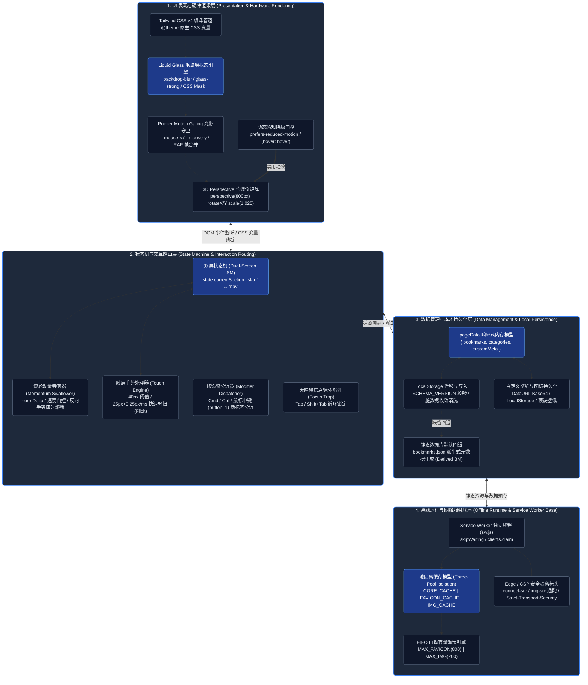
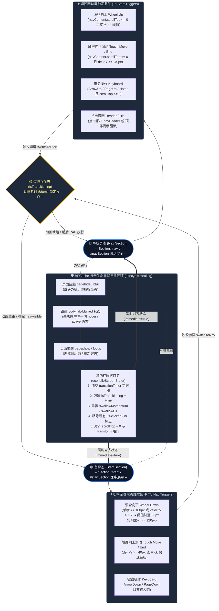
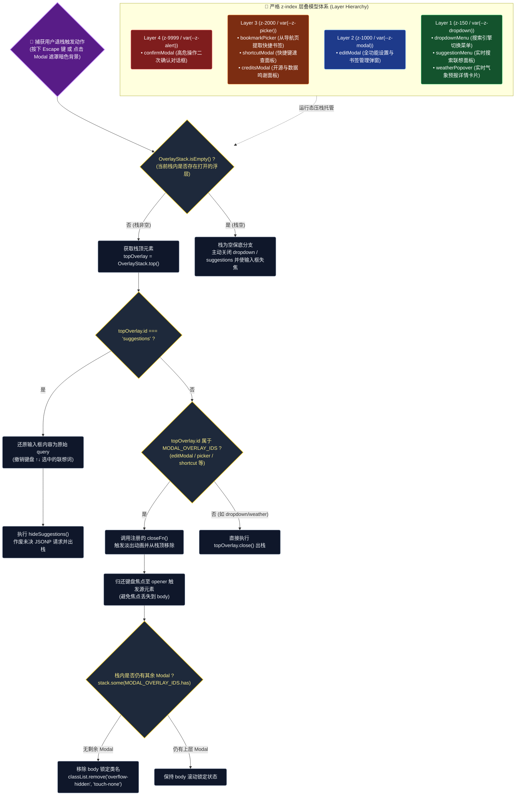
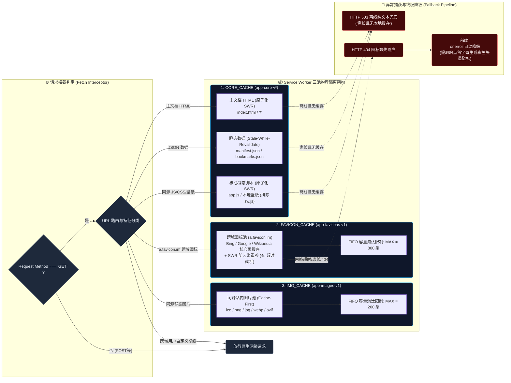
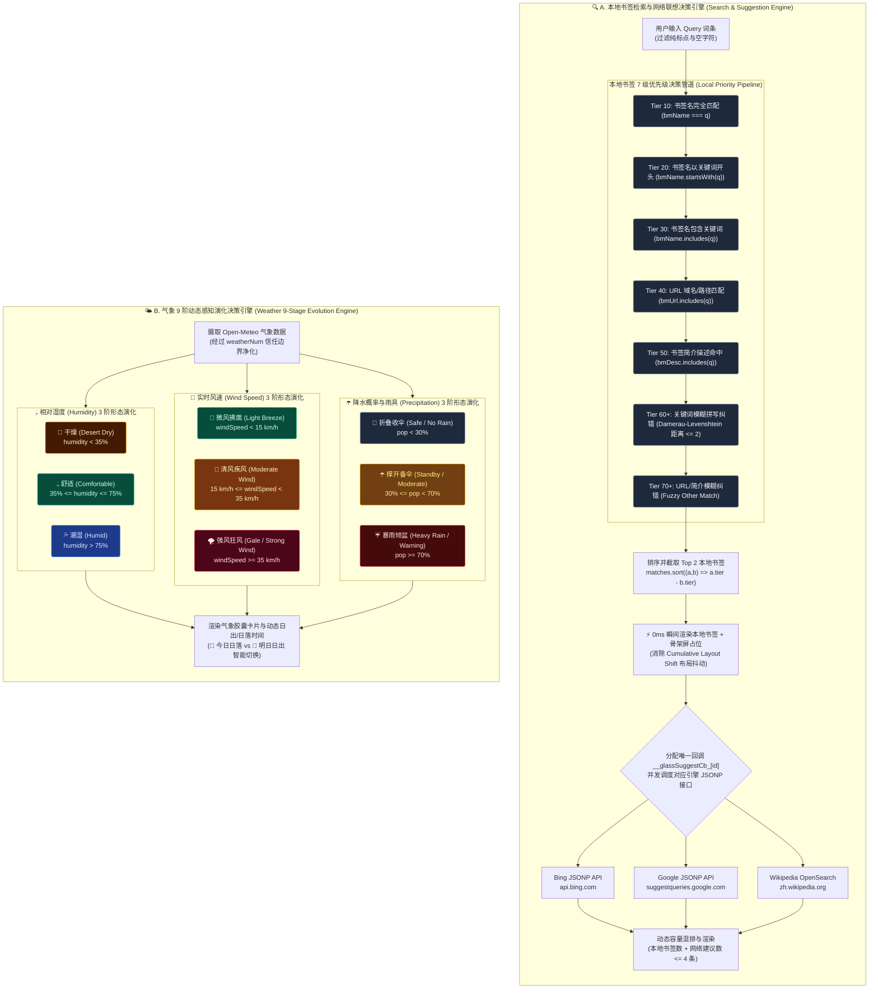

# Glass Start 架构设计与核心技术白皮书 (Architecture Whitepaper)

本文档系统性剖析 **Glass Start（玻璃拟态极简起始页与分类导航）** 的底层软件工程架构、有限状态机、弹窗优先级层叠栈、Service Worker 离线网络底座以及搜索与气象智能演化引擎。

> 🤖 **AI 编程行为准则**：关于 AI 编程助手的 7 大工程红线与分级自愈流水线，请参阅 ➔ [**AI 编程行为宪法 (AGENTS.md)**](./AGENTS.md)。
> 
> 📖 **全站功能与部署指南**：关于全站使用指南、书签规范、命令清单与依赖版本，请参阅 ➔ [**项目主说明文档 (README.md)**](./README.md)。

---

## 目录
- [1. 🏗️ 系统全景分层与模块拓扑架构 (High-Level Layer Architecture)](#1-️-系统全景分层与模块拓扑架构-high-level-layer-architecture)
- [2. 🔄 双屏切屏状态机、手势与 BFCache 全生命周期流转 (Screen State & BFCache Lifecycle)](#2--双屏切屏状态机手势与-bfcache-全生命周期流转-screen-state--bfcache-lifecycle)
- [3. 📚 OverlayStack 多层弹窗层叠栈与 Escape 统一退栈决策 (OverlayStack & Modal Flow)](#3--overlaystack-多层弹窗层叠栈与-escape-统一退栈决策-overlaystack--modal-flow)
- [4. 📴 Service Worker 三池隔离与离线数据流向 (Storage & Cache Topology)](#4--service-worker-三池隔离与离线数据流向-storage--cache-topology)
- [5. 🔍 智能搜索三级模糊匹配与气象 9 阶动态演化决策 (Search & Weather Decision Engine)](#5--智能搜索三级模糊匹配与气象-9-阶动态演化决策-search--weather-decision-engine)

---

### 1. 🏗️ 系统全景分层与模块拓扑架构 (High-Level Layer Architecture)

#### 💡 技术原理解析
1. **表现层与 GPU 硬件加速**：系统采用 Tailwind CSS v4 原子化引擎配合 CSS 变量进行纯 GPU 复合图层渲染。通过 Pointer Motion Gating 与 `requestAnimationFrame` 合并帧计算，仅在指针接近卡片边界（$\pm 4\text{px}$）时激活 3D 矩阵视差变换；搜索框仅应用光斑高光而不做 3D 倾斜，避免输入打字时光标抖动。
2. **状态与交互路由层**：通过双屏有限状态机解耦第一屏（Start）与第二屏（Nav），辅以滚轮动量吞咽器与触屏滑动引擎。针对 Mac 触控板高频惯性与跨屏误触，设立速度门控与反向打断机制。
3. **数据管理与派生架构**：采用单向数据流与派生式架构（Derived Bookmark Architecture），快捷书签仅存储 URL 索引，其标题、图标与分类均由 `bookmarks.json` 全量数据库动态派生，兼顾了用户自定义灵活性与全局数据实时同步能力。
4. **离线基座与安全屏障**：Service Worker 实施三池物理隔离，配合 `_headers` 的严格 CSP 与 HSTS，既保证离线可用性，又防范跨域数据投毒与 CSS/JS 缓存穿透。

---

### 2. 🔄 双屏切屏状态机、手势与 BFCache 全生命周期流转 (Screen State & BFCache Lifecycle)

#### 💡 技术原理解析
1. **滚轮动量吞咽与反向熔断**：在从 Start 屏快速滑动进入 Nav 屏后，触控板产生的物理动量会持续 1~3 秒。系统开启 `swallowMomentum = true`，吞掉持续的同向事件，防止动量直接穿透导致导航页书签被意外跳滚；一旦检测到用户反向滚动（`curDir !== swallowDir`）或静默间隔超过 140ms（`MOMENTUM_QUIET_MS`），吞咽器立即熔断放行。
2. **零 Reflow 触屏手势引擎**：触摸事件通过对比 $X/Y$ 轴位移比率（`deltaX > absDeltaY` 则判定为侧边栏横滑并放行原生滚动），在垂直滑动达到 40px 阈值或满足 Flick 轻扫（位移 $\ge 25\text{px}$ 且速度 $> 0.25\text{px/ms}$）时瞬间触发切换。
3. **BFCache 与多标签唤醒幂等自愈**：当用户点击书签跳转后退或在多标签页之间切回时，页面经 BFCache 或后台唤醒恢复。双通道捕获（`pageshow` + `visibilitychange`）后调用 `reconcileScreenState(undefined, true)`，无视过渡动画直接在单帧内清空互斥锁、消除定时器、校准 `scrollTop` 与 DOM 类名，并无条件通过 `display` 瞬态重置（`display: none` ➔ `void offsetHeight` ➔ `display: ''`）强制 WebKit 重新分配 GPU Backing Store 磁贴，根绝离屏图层白屏。
4. **构建指纹黑匣子与三级自愈阶梯**：`window.__GLASS_DIAG__`（verify/probe/dump/log）在启动时校验 HTML 内联指纹 `__GLASS_BUILD_HTML__` 与 app.js 头部指纹 `__GLASS_BUILD_APP__` 的同版契约（不一致 → 60s 冷却期守卫单次刷新）；双屏 transform 过渡结束后执行健全性探测（当前在位屏变换矩阵 ≈ 单位阵 + 哨兵元素可见，支持 `window.state` 与 DOM 类名双重校验），连续异常按 L1 幂等校准 → L2 合成层磁贴强制重栅格化 → L3 冷却守卫刷新升级。全过程记录于**纯内存环形日志**（≤40 条，零存储写入；BFCache 恢复不重置 JS 堆，天然覆盖偶发白屏的被动取证窗口）；无任何 UI 诊断面板，现场经控制台 `dump()` 导出，L3 自刷新瞬间一次性落 `gs_last_heal` 面包屑跨刷新留痕。

#### 🛡️ BFCache 与页面生命周期失步 5 大暗坑防线 (Lifecycle Anti-Patterns & Defenses)

| 经典陷阱类别 | 错误本质与致命代价 | 工业级避坑标准与 Glass Start 防御实现 |
| :--- | :--- | :--- |
| **1. 语义污染与隐式副作用** *(Class Name Semantic Pollution)* | 将具有强破坏性推屏布局的类名（`.nr` 强推首屏至 `-100dvh`）误当通用禁用动画类；若在首屏唤醒未剥离，JS 以为在首屏，CSS 却将首屏推飞，导致两屏错乱。 | **严格入口剥离**：`reconcileScreenState`、`switchToNav`、`switchToStart` 入口首行均同步执行 `document.documentElement.classList.remove('nr')`，配合自动化断言守门。 |
| **2. 异步跨帧竞态反模式** *(Async Inter-Frame Race Condition)* | 采用 `el.style.transition = 'none'` + `rAF` 异步清除；后台标签页被浏览器完全冻结 `rAF` 时，残留内联样式在唤醒瞬间破坏 CSS 动画，导致屏幕卡死。 | **纯声明式状态类**：绝不常驻内联样式修改，100% 依托 `.screen-pushed-up` 等状态类驱动，唤醒自愈时同步清空 `startSection` / `nav` 内联脏样式。 |
| **3. 生命周期事件模型割裂** *(Lifecycle Fragmentation)* | 混淆 BFCache 唤醒（仅触发 `pageshow`）与多标签页切回（仅触发 `visibilitychange`）；若仅监听单边事件，另一侧唤醒即成为无监管死锁盲区。 | **双保险全量收敛**：统一提炼 `handleAppWakeUp()`，同时向 `visibilitychange` (`!document.hidden`) 与 `pageshow` 注册，单点实现多标签与 BFCache 统一自愈。 |
| **4. CSS 动画时间穿越隐患** *(CSS Animation Rewind Issue)* | 让带有 `animation-fill-mode: backwards` 的入场动画类（`.fade-in`、`.animate-item-in`）常驻 DOM；WebKit 从 BFCache 解冻唤醒时重估动画并回滚至 `opacity:0` 造成页面不可见。 | **入场后主动脱壳卸载**：页面首屏入场后 800ms 自动卸载 `.fade-in`，新增条目通过 `animationend` 同步卸载 `.animate-item-in`，唤醒时全局扫除动画类，保持静态 DOM。 |
| **5. 离屏图层磁贴失栅格化** *(Stale Tile Rasterization)* | 长期离屏或后台挂起的 `fixed` 双屏图层（`-100dvh` 推移 + `will-change: transform`）在多标签页切回 (`visibilitychange`) 或 BFCache 唤醒时，WebKit 会主动丢弃 GPU 离屏磁贴，导致首屏或导航屏整片空白。单纯修改 `willChange` 无法触发重绘。 | **双通道瞬态重排重栅格化 + 探针双断言闭环**：`handleAppWakeUp()` 彻底移除单边 `wasPersisted` 限制，全量覆盖 `visibilitychange` 与 `pageshow`，通过 `display: none` ➔ `void offsetHeight` ➔ `display: ''` 瞬态重置强制 WebKit 重新分配 GPU Backing Store 磁贴；黑匣子挂载 `window.state` 并联动 `.screen-pushed-in` 物理 DOM 双断言，异常时由 L2 自动触发重栅格化。 |

---

### 3. 📚 OverlayStack 多层弹窗层叠栈与 Escape 统一退栈决策 (OverlayStack & Modal Flow)

#### 💡 技术原理解析
1. **LIFO 后进先出退栈模型**：`OverlayStack` 维护一个响应优先级栈。当用户在“设置弹窗”之上唤起“书签提取器”并进一步触发“删除确认对话框”时，弹窗依次压栈。按 `Escape` 键或点击遮罩将严格按照后进先出顺序逐层剥离，绝不发生跨层全关的穿透现象。
2. **滚动穿透锁定与引用计数**：栈内通过 `MODAL_OVERLAY_IDS` 集合监测活动弹窗。当第一个 Modal 入栈时，立即向 `document.body` 注入 `overflow-hidden touch-none`；退栈时仅当所有 Modal 全部出栈后才释放锁定，避免底层页面意外发生滚动穿透。
3. **焦点归还与 Focus Trap**：弹窗展开时记录 `editModalTriggerEl = document.activeElement`，并在弹窗内使用 `handleModalTabFocus` 拦截 `Tab` / `Shift+Tab` 键实现焦点循环锁定；弹窗销毁后平滑归还焦点到触发按钮，保证键盘纯盲操的无障碍闭环。

---

### 4. 📴 Service Worker 三池隔离与离线数据流向 (Storage & Cache Topology)

#### 💡 技术原理解析
1. **三池物理隔离与版本强同调 (Version Lockstep)**：
   - `CORE_CACHE`：打包时基于构建时间戳命名（如 `app-core-v1786255428688`），主文档 `index.html` 与同源脚本 `app.js` 统一采用 **原子化 SWR 锁步** 策略，本地 0ms 瞬出秒开（彻底消除 Safari 冷启动网络阻塞与 TTFB 延迟）；由构建管线自动在 HTML 注入 `app.js?v=app-core-v<timestamp>` 版本查询参数，配合 `window.__GLASS_BUILD_HTML__` 与 `__GLASS_BUILD_APP__` 双端构建指纹契约对，确保 HTML 结构与 JS 逻辑 100% 同池直出，彻底杜绝“旧 JS 执行于新 HTML”导致的切屏/BFCache 白屏死锁；版本换代由 SW 差量更新原子接管。
   - `FAVICON_CACHE`：独立存储 `a.favicon.im` 外部图标，与核心脚本完全隔离，防止外部网络动荡影响核心预缓存。
   - `IMG_CACHE`：独立存储站内高分辨率壁纸与图片，通过 Cache-First 策略减少重复带宽消耗。
2. **防透明响应污染 (Anti-Opaque Poisoning)**：请求跨域图标时产生 `status = 0` 的 `opaque` 响应。若直接缓存可能存入被 DNS 劫持或损坏的数据。系统引入二次网络校验与 4 秒超时熔断（`AbortController`），确保仅有合法的 `opaque` 或 `200 OK` 响应才被允许写入，并由轻量 `pruneCache` 原生实现先进先出（FIFO）淘汰，杜绝 IndexedDB 膨胀与崩溃隐患。
3. **同源/跨域壁纸的 CSP 与缓存解耦**：同源静态图片进 `IMG_CACHE`；用户填写的任意跨域自定义壁纸直连网络，由页面的 CSP `img-src 'self' data: blob: https:` 进行安全管辖，避免因 Service Worker 上下文受 `connect-src` 严格白名单限制而拦截合法的用户壁纸主机。

---

### 5. 🔍 智能搜索三级模糊匹配与气象 9 阶动态演化决策 (Search & Weather Decision Engine)

#### 💡 技术原理解析
1. **本地多阶精准/容错匹配引擎**：
   - 匹配管道分为 7 个优先级梯队：书签名完全相等（Tier 10） $\to$ 前缀匹配（Tier 20） $\to$ 包含匹配（Tier 30） $\to$ URL 包含（Tier 40） $\to$ 描述命中（Tier 50） $\to$ Damerau-Levenshtein 拼写容错（Tier 60/70）。
   - 模糊容错支持字符邻近对调与单字符增删改，在用户敲错 1~2 个字母时仍能精准命中目标书签。
2. **零 CLS 混排与防竞态调度**：
   - 输入瞬间以 0ms 延迟渲染本地书签，同时为网络建议词预留带动画的骨架屏槽位（Skeleton Pulse），彻底杜绝网络返回时下拉框高度突变引起的视觉抖动（CLS）。
   - 每次网络请求分配递增的 `activeSuggestReqId` 与独立 `<script>` 节点，废弃过期的慢网络响应，彻底解决网络竞态乱序（Race Condition）。
3. **气象 9 阶动态感知演化算法**：
   - **湿度感知**：划分为 $<35\%$（沙漠干燥 🌵）、$35\%\sim 75\%$（适宜舒适 💧）、$>75\%$（潮湿多水 💦）。
   - **风速感知**：划分为 $<15\text{km/h}$（微风 🍃）、$15\sim 35\text{km/h}$（清风 🎏）、$\ge 35\text{km/h}$（大风狂风 🌪️）。
   - **降水与雨具演化**：划分为 $<30\%$（折叠收伞 🌂）、$30\%\sim 69\%$（撑开备伞 ☂️）、$\ge 70\%$（暴雨必带 ☔️）。
   - **时间与日照感知**：动态比对当前系统时间与日出/日落时间，白昼展示“今日日落 🌅”，日落后自适应切换为“明日日出 🌄”，全部气象字段均经过 `weatherNum` 强制数值化清洗，杜绝来自本地缓存的 XSS/HTML 注入风险。
