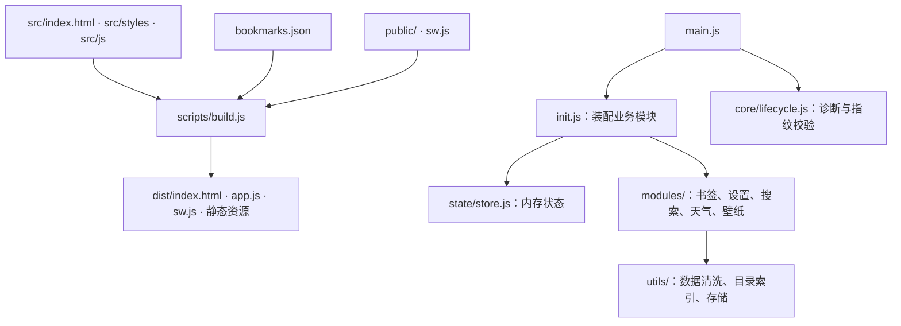
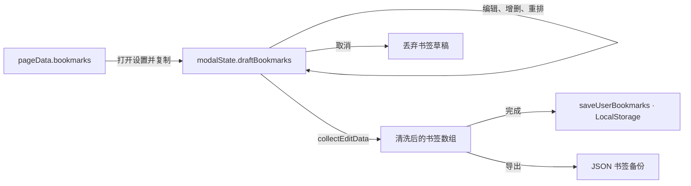

# Glass Start 架构说明

本文说明源码组织、状态流、缓存策略和验证边界。使用与部署见 [README.md](./README.md)，工程约束及源码入口索引见 [AGENTS.md](./AGENTS.md)。实现细节以对应源码为准，配置值统一维护在 `src/js/config/constants.js`。

## 目录

- [模块与构建](#模块与构建)
- [书签与设置状态](#书签与设置状态)
- [壁纸与主题](#壁纸与主题)
- [切屏与页面生命周期](#切屏与页面生命周期)
- [浮层与无障碍](#浮层与无障碍)
- [离线缓存与更新](#离线缓存与更新)
- [搜索与天气](#搜索与天气)
- [安全与验证边界](#安全与验证边界)

## 模块与构建

应用使用原生 ES 模块与 Web API，无 npm 运行时依赖。Tailwind CSS v4 和 esbuild 仅参与开发与构建。

- `main.js`：启动初始化与生命周期诊断；业务之间通过模块导入调用。
- `state/store.js`：持有 `state`、`modalState`、`pageData`，均为普通可变对象；调用方显式更新并触发渲染，不自动订阅变化。
- `state/dom.js`：集中缓存具名 DOM 节点。新增或更名 HTML ID 时同步更新 `cacheDOM()`。
- `core/`：包含浮层、手势等基础设施，也包含事件装配和切屏等业务协调入口；不是严格独立的底层。
- `utils/`：提供 URL 与文本清洗、目录索引、IndexedDB 存储等共用能力。

构建以 `package.json` 为版本来源，同步 README 与产物徽章；每次构建生成统一指纹，注入 HTML、应用脚本与 Service Worker。HTML 引用的 `app.js` 同时携带版本查询参数。

构建在内存中传递并内嵌本次编译的 CSS，不共享磁盘中间文件。空 CSS、编译或压缩失败会阻断构建；这不保证整个 `dist/` 的并发写入具有事务性。HTML 使用唯一构建插槽注入入口、样式和 SVG；标记缺失、重复或顺序错误会阻断构建。主题与天气清洗脚本分别从 `config/themes.js`、`utils/weather-data.js` 注入，避免维护副本。

`public/` 在构建时复制到 `dist/`；`src/index.html` 是构建模板。修改构建脚本或其加载的辅助脚本后需重启开发服务。

## 书签与设置状态

`bookmarks.json` 提供默认快捷书签和分类目录，构建时由 `config/constants.js` 导入。用户配置保存在 LocalStorage：快捷书签使用 URL 键列表，自定义名称、简介和图标使用元数据覆盖；`getDerivedBookmarks()` 从目录与覆盖数据派生当前条目。旧版完整书签数组由 `migrateBookmarksStorage()` 迁移。

`utils/category-catalog.js` 为派生、保存、分类排序和搜索提供共用索引，目录内容变化时重建。持久化使用完整的 `normalizeUrl()` 键，搜索使用自己的去重键，两者语义不同。`normalizeBookmark()` 共用于导入、草稿收集和保存；简介缺省时继承目录，显式空字符串表示清空。

`state/bookmark-draft.js` 集中处理草稿替换、增删、字段修改和重排；事件与编辑器只负责调用和渲染。书签重置通过书签模块恢复入口执行，壁纸状态由壁纸模块维护。

保存与导出直接读取内存草稿，不从 DOM 反向解析书签。DOM 仍用于事件定位、焦点管理和拖拽几何测量；FLIP 动画会读取布局，并非零 Reflow。

设置职责按模块划分：

| 模块 | 职责 |
| :--- | :--- |
| `modules/settings.js` | 打开、完成、取消、导入导出与重置 |
| `modules/bookmark-editor.js` | 草稿行渲染、计数、收集及目录挑选器 |
| `core/settings-events.js` | 设置控件事件、草稿字段更新和拖拽装配 |
| `core/drag-sort.js` | 鼠标与触屏重排、迟滞判定和 FLIP 动画 |
| `core/dialogs.js` | 共用确认框，不依赖设置或壁纸业务 |

## 壁纸与主题

壁纸选择即存，背景暗度与快捷书签则在点击「完成」时提交。取消设置不撤销已经保存的壁纸。

`modules/wallpaper.js` 管理选择、预加载、图片上传及旧数据迁移；`core/wallpaper-renderer.js` 管理图层切换；`core/theme-engine.js` 管理采样与浏览器外壳颜色。

壁纸内容（Data URL 或图片 URL）与预设索引在同一个 IndexedDB 事务中写入。写入及删除等待事务 `complete` 才报告成功；失败时保留原记录。连续选择通过请求序号和提交队列协调，迟到的图片加载结果不能覆盖新选择。上传图片按配置限制尺寸并压缩。

LocalStorage 仅保存背景索引和轻量首屏提示，新选择不写入 Base64。读取时先尝试迁移旧记录，再优先使用 IndexedDB 选择记录；没有现代记录时兼容内存、旧 IndexedDB 键和旧 LocalStorage 键。迁移成功后才清理本次读取的旧值。

首帧与运行时共用 `config/themes.js` 的预设主题与深浅底色；自定义壁纸可由运行时采样决定主题。HTML 预渲染遇到 IndexedDB 自定义壁纸时先恢复底色，等待应用异步恢复图片，避免误请求默认预设。

## 切屏与页面生命周期

`core/screen-state.js` 管理 `state.currentSection`（`start` / `nav`）和过渡锁。CSS 状态类决定两屏位置，`inert` 与无障碍属性隔离离屏内容。

- 滚轮按瞬时位移、速度及累计位移识别切屏意图；切屏后吞掉同向惯性，反向输入或静默间隔后放行。
- 触屏按方向、位移和速度区分普通滑动与快速轻扫。
- 导航页返回首屏须在内容顶部；顶部返回按钮不受此滚动位置限制。键盘输入及浮层状态由事件中枢协调。
- 过渡通常在 `transitionend` 完成；事件缺失时以配置的动画时长加缓冲兜底。

`reconcileScreenState()` 清理过渡任务、恢复保存的目标屏、校准状态类及可访问性，并移除预渲染类 `.nr`。它本身不执行 `display` 重置；默认无明确目标且仍在过渡时会跳过，唤醒调用传入 `force=true`。

`handleAppWakeUp()` 统一处理 `pageshow` 和恢复可见的 `visibilitychange`：清理残留交互状态，强制校准屏幕，尝试检查 Service Worker 更新，并对两屏执行 `display: none` → 布局读取 → 恢复显示，以促使浏览器重新绘制。该措施不能保证具体 GPU 磁贴分配行为。`blur` / `pagehide` 添加 `body.tab-blurred`，收到下一次用户交互后解除，防止悬停残留。

`core/lifecycle.js` 提供 `window.__GLASS_DIAG__`（`verify`、`probe`、`dump`、`log`）：

1. 启动时比较 HTML 与应用指纹。不一致时尝试以 SessionStorage 记录刷新时间，按冷却期限制刷新；存储不可用时该限制无法跨刷新可靠保留。
2. `snapshotHealth()` 在首屏应显示且未过渡时检查变换矩阵及哨兵元素的宽度；它不检测真实像素或导航页完整可见性。
3. 连续异常先校准状态，再切换首屏 `will-change` 并读取布局；第三次仅记录 `heal-reload-blocked` 并结束，不刷新页面。

日志只保存在有容量上限的内存缓冲中；BFCache 恢复可保留，重新加载清空。控制台调用 `window.__GLASS_DIAG__.dump()` 取证，没有诊断 UI。

## 浮层与无障碍

`OverlayStack` 维护 LIFO 栈，Escape 由 `core/events.js` 调用栈顶关闭函数；遮罩点击交给对应浮层处理。

浮层由低到高分为下拉、设置、辅助弹窗和确认层；层级约束见 AGENTS.md，具体样式由源码定义。

弹窗可见性只由 `OverlayStack.push()` / `.pop()` 驱动。层叠栈内部统一设置 `hidden`、`aria-hidden`、入场动画及延迟隐藏，切换前取消旧任务。下拉组件仍使用自己的状态类展示，但同样注册关闭回调。

栈内存在 Modal 时锁定 body 滚动；全部 Modal 关闭后解锁。栈顶弹窗打开时移入焦点，通过 `inert` 隔离沿祖先路径的兄弟区域；Tab / Shift+Tab 在弹窗内循环。关闭后优先恢复下层弹窗或有效触发元素的焦点，并恢复原有 `inert` 状态。

## 离线缓存与更新

`sw.js` 只处理匹配路由的 GET 请求；其他请求交给浏览器。

| 缓存 | 内容与策略 |
| :--- | :--- |
| `CORE_CACHE` | 按构建版本隔离；HTML、JS/CSS 缓存优先，清单后台重验证；安装时预存核心资源 |
| `FAVICON_CACHE` | 外部图标缓存优先；网络请求有超时，按容量限额淘汰并保护核心引擎图标 |
| `IMG_CACHE` | 同源图片按构建分池，先查缓存再请求网络；保留上一版供网络失败或服务端错误时回退 |

缓存命名、配额、超时及预缓存清单统一以 `sw.js` 为准。

安装时校验核心资源存在且响应成功，并核对 HTML 与应用指纹；失败则删除残缺核心池并拒绝安装。核心文档和脚本请求使用 `reload`，首张预设壁纸使用 `no-cache` 条件重验证。外部引擎图标的预存失败不阻断核心安装。

新版安装成功后保持 waiting，不调用 `skipWaiting()` 或 `clients.claim()`；旧客户端全部退出后才激活。普通刷新不保证立即升级。核心缓存命中时不后台重验证；缓存丢失后的网络回退不逐次校验指纹，启动指纹检查补充检测 HTML/JS 不一致。

外部图标请求允许成功或 `opaque` 响应入池；`opaque` 的状态与正文不可读，因此这不是内容安全校验。图标显示失败由前端捕获阶段监听处理，尝试 Google S2，最终回退首字母徽标。

同源预设书签图标使用 `./icons/<host>.png`。`scripts/sync-icons.mjs` 优先请求 a.favicon.im，遇到占位标可尝试 `www`，再回退 Google S2，经 macOS `sips` 转换为正方形 PNG；支持在 `PINNED_HOSTS` 集合中声明锁定名单，以保护经典定制图标免遭上游网络拉取覆盖。跨域自定义壁纸不进入上述图片池，由页面 CSP 与浏览器网络处理；其 URL 可保存到 IndexedDB，远程图片正文不因此保证离线可用。

## 搜索与天气

`utils/bookmark-search.js` 负责纯数据匹配与排序，`modules/search.js` 负责候选装配、请求和界面。后者将本地书签与网络联想混排，容量与防抖由配置控制；本地结果先显示，网络等待期间预留骨架行，以减少结果区域高度变化，不承诺零延迟或零布局偏移。

本地匹配优先级为名称全等、名称前缀、名称包含、URL 包含、简介包含、名称模糊、其他字段模糊。拼写容错采用支持相邻字符交换的受限 Damerau–Levenshtein（OSA）距离，编辑距离容差与最小查询长度由配置控制。距离矩阵复用 `Int32Array`，容量不足时扩容。

Bing / Google 使用 JSONP，Wikipedia 使用 CORS `fetch`。请求序号 `activeSuggestReqId`、超时和关闭清理共同隔离过期响应；切换查询或关闭列表后，旧结果不能覆盖新状态。选中项和激活行为消费内存结果，DOM 仅展示并传递索引。

`utils/weather-model.js` 负责天气代码、地点及响应转换，调用方传入配置和时间；`modules/weather.js` 使用 IP 定位与地名解析获取位置，再请求 Open-Meteo。按缓存有效期决定是否更新，唤醒时重新检查。

湿度、风速和降水概率分别按配置分档选择图标，不表示降雨强度或气象灾害等级。日出日落显示由当前时间与预报时间选择。数值通过共用的 `weatherNum()` 清洗，时间经 `weatherTime()` 校验，地点等文本在 HTML 输出时转义。

## 安全与验证边界

动态 HTML 文本经 `escapeHtml()` 转义；`safeUrl()` 检查 HTTP(S)、图片 Data URL 及本地图标路径后返回适合 HTML 属性的转义值，不应将该返回值直接当作未转义原始 URL 使用。CSP 同时存在于 HTML 与 `public/_headers`，后者需托管平台实际支持。当前内联脚本及样式仍使用 `'unsafe-inline'`；不能据此声称消除了所有 XSS 风险。

测试入口、命令和环境要求见 README。以下边界用于解释验证结果：

- 生产构建编译时裁掉 `testing/bridge.js`；测试服务器按需在内存编译带接口的脚本，仍需预先设置 `window.__GLASS_TEST__ = true` 才挂载接口，不覆盖生产 `dist/app.js`。
- `infra-module-boundaries.test.mjs` 检查静态导入无环并验证关闭测试接口的页面启动；无环不等于严格分层。
- 浏览器测试使用 Chrome CDP，模拟移动视口和触摸输入不等于真机 Safari / iOS 验证。导航完成与切屏完成分别等待，避免固定延时掩盖竞态。
- W3C 脚本提交 HTML 给在线 Nu 校验器，过滤代码中列出的现代 CSS 消息及 CSP 警告；通过表示过滤后无剩余消息，不代表完整无障碍、视觉或功能合规。样式完整性由基础架构测试另行检查。
- `typecheck` 使用 JSDoc 与 `types.d.ts` 检查核心模型，包含负向类型契约；覆盖范围以 `tsconfig.json` 为准，尚未覆盖全项目。
- 生命周期约束通过页面行为测试验证；Service Worker 测试执行完整脚本及真实升级流程，不通过截取函数体判断实现是否正确。
