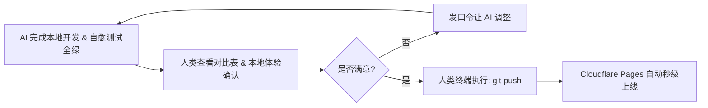

# 🕹️ Glass Start — 人类驾驶舱与指挥手册 (COCKPIT.md)

欢迎来到 **Glass Start** 人类驾驶舱！本文档专为您（人类开发者 / 项目掌舵人）量身定制，无需记忆底层的技术规范，只需根据意图**一览全局、一键启停、发号施令**。

---

## 🚀 一、 一键启停与日常调试中控

| 需求场景 | 最优快捷操作 | 作用与说明 |
| :--- | :--- | :--- |
| **日常使用 / 极速预览** | 🖱️ **双击 [scripts/start.command](./scripts/start.command)** | 免开终端，自动增量打包并拉起本地服务与默认浏览器 (`http://localhost:3000`) |
| **命令行开发预览** | 终端运行 `npm run dev` | 自动编译 Tailwind CSS、同步数据并在局域网全网卡广播 |
| **代码语法快速体检** | 终端运行 `npm run lint` | **< 100ms** 极速静态扫描 22 项规范（AST、A11y、iOS 16px、书签合规） |
| **模块极速回归单测** | 终端运行 `npm test` | **< 10ms** 基于 MD5 增量缓存极速跳过未改动套件 |
| **全量端到端深度测试** | 终端运行 `node test/run.mjs --force` | 拉起真实无头 Chrome 验证 19 项全景断言 |

---

## 🗣️ 二、 通用可插槽式 AI 指挥口令库 (Universal Command DSL)

由于 `AGENTS.md` 宪法已在后台自动生效，您在日常提问时**无需重复粘贴规则红线**，直接套用以下通用意图模板（只需替换 `[方括号]` 内容）：

### 1. 📌 数据维护令（新增 / 修改 / 剔除书签）
```text
在【[分类名称]】中[添加 / 修改 / 删除]书签：[网站名称] - [URL]（关键词/简介：[核心品类词]），执行同步与自愈交付。
```
> 💡 *AI 自动遵循：只改 `bookmarks.json`、简介控制在 6~10 字（上限 15 字）、直连 HTTPS、自动跑 `npm run build`、`lint` 与 `data` 单测。*

---

### 2. 🎨 视觉与交互修改令（UI / 布局 / 动效）
```text
请修改 [组件名称，如：天气卡片 / 搜索框 / 侧边栏] 的 [具体样式 / 交互逻辑]，期望效果：[具体表现描述]。按局部手术与 A11y 规范实施，跑 lint 与 ui 测试交付。
```
> 💡 *AI 自动遵循：精准行号局部替换、不滥用 `!important`、保持 iOS 16px 视口防护与 Apple 焦点环规范。*

---

### 3. 📋 复杂需求探索令（Plan-First 方案驱动）
```text
我想实现 [功能构想 / 重构想法]，请先不要动代码，结合 ARCHITECTURE.md 输出技术设计、改动范围与风险评估，待我确认后再执行。
```
> 💡 *AI 自动遵循：先出 `implementation_plan.md`，对齐数据结构、状态机与接口契约后再动工。*

---

### 4. 🐛 报错异常修复令（Zero-Analysis Error Dump）
```text
[具体操作/复现步骤] 异常，报错如下：
[直接粘贴终端报错日志 或 浏览器 Console 输出]
请分析根本原因并执行最小化补丁修复，重新运行验证至全绿。
```
> 💡 *AI 自动遵循：读取堆栈定位源码、单点打补丁、循环自检直到 0 报错。*

---

### 5. 🏷️ 语义化版本发布令（Release Alignment）
```text
准备发布新版本 [vX.Y.Z]（[简述本次核心更新]），请执行红线 6 & 8 全量对齐与 3 大 MD 文档同源核对，全量测试全绿后本地 commit 归档。
```
> 💡 *AI 自动遵循：SemVer 4 处版本号强对齐 + `AGENTS.md`/`ARCHITECTURE.md`/`README.md` 参数口径同步 + E2E 全量通过。*

---

### 6. ⚡ 极简高频短语（One-Liner Shortcuts）
* `git保存` ➔ AI 自动执行 `git add` + 原子化 `git commit`（严格禁止私自 push）
* `跑一下全量测试` ➔ AI 执行 `node test/run.mjs --force`
* `全站体检一下` ➔ AI 执行 `npm run lint`

---

## 🛡️ 三、 人类决策与上线控制台 (Release Guard)



- **🛑 远程推送铁律**：AI 绝对禁止私自 `git push`，本地已自动为您做好原子化 Commit。
- **🚀 一键上线**：当您在本地浏览器体验满意后，只需在终端敲入：
  ```bash
  git push
  ```
  Cloudflare Pages 将在 15 秒内完成全自动化全球 CDN 部署。
- **⚡ 跳过云端构建小技巧**：若推送仅为代码备份无需触发线上构建，提交信息附带 `[skip ci]` 即可。

---

## 🎨 四、 资产与数据日常微调速查

### 1. 书签数据速改 (`bookmarks.json`)
- **添加新分类**：在 `categories` 数组中追加 `{ "name": "新分类", "icon": "emoji或图标", "bookmarks": [] }`。
- **编写简介 `desc`**：推荐 **6~10 字**（硬上限 **$\le 15$ 字**），建议包含中文品类词（方便全局搜索召回）。

### 2. 本地高清壁纸替换 (`wallpapers/`)
- 预设壁纸位于 [wallpapers/](./wallpapers) 目录（命名为 `bg1.avif` ~ `bg8.avif` 及其缩略图 `bg1-thumb.avif`）。
- 替换新图片后，运行一次 `npm run build` 即可自动同步至离线打包产物中。

---

*💡 驾驶舱已就绪，祝您调度愉快！*
