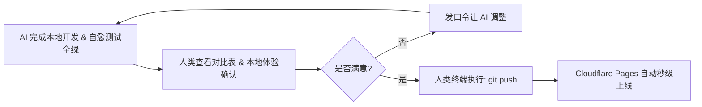

# 🕹️ Glass Start — 人类驾驶舱与指挥手册 (COCKPIT.md)

欢迎来到 **Glass Start** 人类驾驶舱！本文档专为您（人类开发者 / 项目掌舵人）量身定制，无需记忆复杂的底层技术细节，只需在此**一览全局、一键启停、发号施令**。

---

## 🚀 一、 一键启停与日常调试中控

| 需求场景 | 最优快捷操作 | 作用与说明 |
| :--- | :--- | :--- |
| **日常使用 / 极速预览** | 🖱️ **双击 [scripts/start.command](./scripts/start.command)** | 免开终端，自动增量打包并拉起本地服务与默认浏览器 (`http://localhost:3000`) |
| **命令行开发预览** | 终端运行 `npm run dev` | 自动编译 Tailwind CSS、同步数据并在局域网全网卡广播 |
| **代码语法快速体检** | 终端运行 `npm run lint` | **< 100ms** 极速静态扫描 22 项规范（AST、A11y、iOS 16px、书签合规） |
| **模块极速回归单测** | 终端运行 `npm test` | **< 10ms** 基于 MD5 增量缓存极速跳过未改动套件 |
| **全量端到端深度测试** | 终端运行 `node test/run.mjs --force` | 拉起真实无头 Chrome 验证 19 项全景断言 |

---

## 🗣️ 二、 指挥 AI 高频口令卡 (直接复制使用)

遇到任何开发或维护需求时，无需长篇大论，直接复制以下现成口令发给 AI：

### 1. 📌 添加 / 修改书签
> **【口令】**：
> `请在 bookmarks.json 的【AI 工具】分类中添加一个新书签：名称 "Claude"，URL "https://claude.ai"，简介 "旗舰 AI 智能助手"（控制在 6~10 字，上限 15 字，包含核心品类词）。修改后执行 npm run build、npm run lint 及 node test/run.mjs data --no-build 自愈全绿交付。`

### 2. 🌤️ 局部 UI / 气象优化
> **【口令】**：
> `参考 AGENTS.md 系统地图，定位到 index.html 6900 行附近的气象模块，优化天气弹窗卡片的排版布局。遵守 8 大红线（不使用 !important，保持 zero-dependency），修改后执行 npm run lint 与 ui 单测全绿交付。`

### 3. 🚀 发布新版本
> **【口令】**：
> `准备发布新版本 v3.4.5。请严格遵循红线 6 与红线 8，同步对齐 package.json、package-lock.json、index.html 和 README.md 中的 4 处版本号，并交叉核对 3 大 MD 文档说辞，执行全量测试通过后本地 commit 归档。`

### 4. 🛠️ 遇错自动自愈
> **【口令】**：
> `测试/构建报错如下：[直接粘贴终端报错日志]。请分析根本原因并执行最小化补丁修复，重新运行验证至全绿。`

---

## 🛡️ 三、 人类决策与上线控制台 (Release Guard)



- **🛑 远程推送铁律**：AI 绝对禁止私自 `git push`，本地已自动为您做好原子化 Commit。
- **🚀 一键上线**：当您在本地浏览器体验满意后，只需在终端敲入：
  ```bash
  git push
  ```
  Cloudflare Pages 将在 15 秒内完成全自动化全球 CDN 部署。
- **⚡ 跳过云端构建小技巧**：若推送仅为代码备份无需触发线上构建，提交信息附带 `[skip ci]` 即可。

---

## 🎨 四、 资产与数据日常微调速查

### 1. 书签数据速改 (`bookmarks.json`)
- **添加新分类**：在 `categories` 数组中追加 `{ "name": "新分类", "icon": "emoji或图标", "bookmarks": [] }`。
- **编写简介 `desc`**：推荐 **6~10 字**（硬上限 **$\le 15$ 字**），建议包含中文品类词（方便全局搜索召回）。

### 2. 本地高清壁纸替换 (`wallpapers/`)
- 预设壁纸位于 [wallpapers/](./wallpapers) 目录（命名为 `bg1.avif` ~ `bg8.avif` 及其缩略图 `bg1-thumb.avif`）。
- 替换新图片后，运行一次 `npm run build` 即可自动同步至离线打包产物中。

---

*💡 驾驶舱已就绪，祝您调度愉快！*
