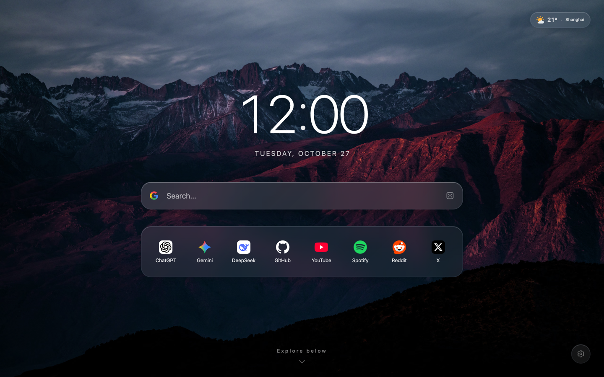
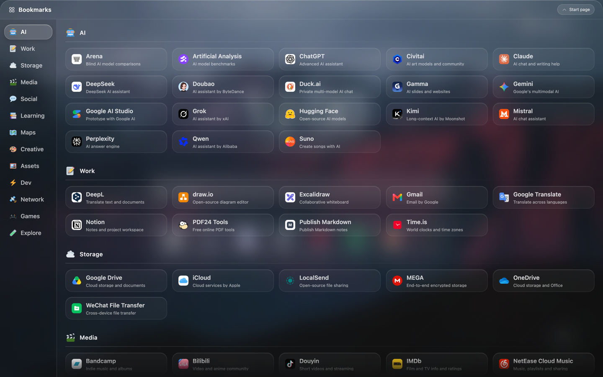

<p align="center">
  
</p>

<h1 align="center">Glass Start — A Clear Start</h1>

<p align="center">
  A clean, minimal browser start page with a frosted glass design, available as a website and a Chrome new tab extension.
</p>

<p align="center">
  <a href="./README.md">简体中文</a> · <strong>English</strong>
</p>

<p align="center">
  <a href="./LICENSE"></a>
  <a href="https://github.com/leosdcn/glass-start/actions/workflows/ci.yml"></a>
  <a href="https://tailwindcss.com/"></a>
  <a href="#features"></a>
  <a href="#features"></a>
</p>

<p align="center">
  <a href="https://goldcoast.dpdns.org/" target="_blank" rel="noopener noreferrer"><strong>⚡ Cloudflare demo</strong></a>
  &nbsp;&nbsp;·&nbsp;&nbsp;
  <a href="https://leosdcn.github.io/glass-start/" target="_blank" rel="noopener noreferrer"><strong>🌐 GitHub demo</strong></a>
</p>

<p align="center">
  
</p>

<p align="center">
  
</p>

---

## Contents

- [Features](#features)
- [Getting started and deployment](#getting-started-and-deployment)
- [Chrome new tab extension](#chrome-new-tab-extension)
- [User guide and customization](#user-guide-and-customization)
- [Development and contributing](#development-and-contributing)
- [Technical documentation](#technical-documentation)
- [License and notices](#license-and-notices)

---

## Features

- 🧩 **Chrome new tab extension**: use Glass Start as your new tab page. Code, icons and preset wallpapers are bundled locally. Install it by [loading the unpacked extension](#chrome-new-tab-extension).
- 🪐 **Liquid Glass appearance**: highlights, frosted backgrounds and press animations.
- 🎬 **Two connected screens**: a start page for the clock and search, and a second page for categorized bookmarks, with smooth transitions and content that fades near the bottom edge.
- 🕊️ **No distractions**: no embedded ads, promotional links or trending feeds. The project itself does not track user behavior or add analytics instrumentation.
- 🌤️ **Weather and forecasts**: no API key required. Uses IP-based location and place-name lookup, with cached conditions and forecasts for the next few days.
- 🌐 **English and Chinese**: follow your browser language or choose one manually. The interface, weather and built-in bookmark catalog are localized; your custom text is preserved.
- ⚡ **Zero runtime dependencies**: the production page requires no npm runtime libraries. Inline rendering reduces flashes on reload; actual loading speed depends on the device, cache and network.
- 🖼️ **Wallpapers save immediately**: cycle through preset wallpapers, choose a local image, use an image URL or adjust background dimming. Local images are compressed and stored in IndexedDB.
- 🛡️ **Security measures**: Content Security Policy (CSP), escaped dynamic HTML text and URL protocol filtering with `safeUrl`. Configure the response headers in `public/_headers` as required by your hosting platform.
- 📱 **Offline PWA support on the web**: the Service Worker maintains three separate caches. Cached resources remain available offline; installation options and support vary by browser.

---

## Getting started and deployment

Glass Start can be built as a Chrome new tab extension or deployed as a static website. Response headers and deployment under a subpath depend on the hosting platform. Building from source requires Node.js 24 or newer and npm.

### Chrome new tab extension

**Download**: get the extension ZIP from [Releases](https://github.com/leosdcn/glass-start/releases/latest). Follow the installation and update instructions in the release notes.

**Build from source**:

```bash
npm ci
npm run build:extension
```

Open `chrome://extensions/` in Chrome, enable **Developer mode**, click **Load unpacked** and select the generated `extension/` folder in the project root. Open a new tab to use Glass Start. If Chrome asks you to confirm the new tab change, choose to keep it.

The extension uses Manifest V3. Code, icons and preset wallpapers are bundled locally. Weather and online search suggestions require a connection, with host permissions declared for the relevant endpoints. It does not read your browser bookmarks, history or webpage content. Custom wallpapers and settings stay in the extension's own local storage; they are not automatically shared with the website or synced across devices. You can import bookmark JSON exported from the website into the extension. This backup does not include wallpapers or preferences.

The extension opens offline using its bundled resources. It does not register the website's Service Worker or show website update notices. **Clear cache and reload** in settings clears temporary caches while keeping saved bookmarks, wallpapers and settings. Remote wallpapers, weather and online suggestions still depend on network availability.

After updating the source, run `npm run build:extension` again, click **Reload** on the extensions page and open a new tab. Keeping the folder path unchanged and reloading the extension preserves local data; removing the extension deletes its storage. `npm run build` still generates only the web build in `dist/`; the two builds do not overwrite each other. Extension packages are currently distributed through GitHub Releases only, not the Chrome Web Store.

To run the extension regression test, use `npm test -- infra-chrome-extension`. It loads the extension through CDP in a separate temporary profile and requires a recent Chrome version supporting `Extensions.loadUnpacked`. It covers new tab replacement, initial background color and theme restoration, suggestions for all three engines, saved settings and offline reloads. Suggestion responses use fixtures and do not verify live third-party services.

### Automatic deployment with Cloudflare Pages

1. Fork this project or upload it to your GitHub repository.
2. Create a Pages project in the [Cloudflare dashboard](https://dash.cloudflare.com/) and connect your Git repository. Refer to the [official static site guide](https://developers.cloudflare.com/pages/framework-guides/deploy-anything/) for the current setup flow.
3. Select the repository and configure:
   - **Framework preset**: `None`
   - **Build command**: `npm run build`
   - **Build output directory**: `dist`
   - **Environment variable**: `NODE_VERSION=24`, meeting the project's Node.js requirement. See the [build environment documentation](https://developers.cloudflare.com/pages/configuration/build-image/).
4. Save and deploy. Subsequent pushes to the configured production branch trigger updates. Use your actual production branch; it need not be `main`.

### Vercel, Netlify and GitHub Pages

- **Vercel / Netlify**: import the Git repository, set the build command to `npm run build` and the output directory to `dist`. Configure response headers using the platform's supported format.
- **GitHub Pages**: select GitHub Actions under **Settings → Pages**. Follow the [official custom workflow guide](https://docs.github.com/en/pages/getting-started-with-github-pages/using-custom-workflows-with-github-pages) to install dependencies, build and upload `dist/` as the Pages artifact. For branch-based publishing, place the output in the publishing branch's root or `/docs`; `/dist` cannot be selected directly.

### Local preview and offline use

Install the locked development dependencies and start the preview:

```bash
npm ci
npm run preview
```

`npm run preview` builds the website and starts an HTTP server. Open the address printed in the terminal. The Service Worker can register over HTTPS or on localhost; once resources have been cached, those resources can be used offline. Live weather, online suggestions and external websites still need a connection. Opening `dist/index.html` directly with `file://` does not provide Service Worker caching.

---

## User guide and customization

### 1. Scrolling between screens

- **Wheel / swipe**: scroll down or swipe up on the start page to open the bookmarks page. At the top of the bookmarks page, scroll up or swipe down to return.
- **Return button**: click **Start page** at the top of the bookmarks page.
- **Keyboard**: when no dialog or panel blocks page navigation and you are not editing another input, press `PageDown` / `↓` to open bookmarks. At the top of the bookmarks page, press `PageUp` / `Home` / `↑` to return. When search suggestions are open, arrow keys select suggestions first.

### 2. Search and quick navigation

- **Type to search**: type letters or numbers on the start page; the search field receives focus and your input automatically.
- **Combined suggestions**: matching local bookmarks appear first, followed by search-engine suggestions. Online results depend on service availability; cached results can appear immediately.
- **Keyboard selection**: use `↑` / `↓` to cycle through results and `Enter` to open the selected item.
- **Open in a new tab**: press `Cmd + Enter`, `Ctrl + Enter` or `Alt + Enter` to open the selected item or run the search in a new tab.
- **Search engines**: click the icon on the left of the search field to choose Bing, Google or Wikipedia. Without a saved preference, English defaults to Google and Chinese to Bing. Your saved engine choice takes priority over the language default.

### 3. Maintaining default bookmarks

**The shared bookmark catalog and Chinese default quick bookmarks are maintained in the root `bookmarks.json`:**

```json
{
  "bookmarks": [
    {
      "name": "LocalSend",
      "url": "https://web.localsend.org",
      "icon": "./icons/web.localsend.org.png"
    }
  ],
  "categories": [
    {
      "id": "work",
      "name": "办公协作",
      "icon": "🛠️",
      "bookmarks": [
        {
          "name": "GitHub",
          "url": "https://github.com",
          "desc": "代码托管与协作",
          "icon": "./icons/github.com.png"
        }
      ]
    }
  ]
}
```

This is a structural example. Chinese source text is intentional: English names, categories and descriptions are maintained separately in `src/js/config/locales/catalog-en.json`. `bookmarks.json` is the single complete bookmark catalog, with international URLs as shared identifiers. Chinese destination overrides live in `catalog-zh-CN.json`; English overrides live in `catalog-en.json`. An optional `url` field controls only the link opened. Saving, exporting and deduplication use the shared URL. Sites that select their language automatically use the shared URL. A `legacyUrl` field retains retired Chinese destinations only for saved-link compatibility. Old Chinese preset URLs resolve to shared URLs when loaded, preserving custom text and order; the stored keys update on the next save.

- **`bookmarks`**: default quick bookmarks on the Chinese start page, with `name`, `url` and `icon`.
- **`categories`**: categories on the bookmarks page. Each has a stable `id`, a display `name`, an `icon` and a `bookmarks` list. Match category IDs in the English catalog when adding or changing categories.
- **`name`**: use the official Chinese name for Chinese services and the official English name for international services. Localized names can be provided in the English catalog.
- **`desc`**: a short subtitle. In `bookmarks.json`, Chinese-only descriptions are limited to 9 characters; descriptions containing Latin letters or numbers are limited to 13 characters. English catalog descriptions are limited to **28 characters, including spaces and punctuation**, enforced by lint. A character limit does not guarantee that text fits every card width.
- **`url`**: use the official HTTPS address, preferably a direct link with no unnecessary redirects.
- **`icon`**: preset bookmarks use same-origin paths such as `./icons/<domain>.png`, loaded from the site or its cache. The sync script fetches icons based on the URL hostname, converts them to square PNGs using `sips` and writes back the local paths. The `icon` field is not a custom download source.
- **English defaults**: `defaultBookmarks` in `src/js/config/locales/catalog-en.json` defines the English start page's URL order. These URLs reuse entries from the shared catalog and must be unique, with the same count as the Chinese defaults. Language defaults apply when no quick bookmark configuration has been saved. Saved bookmark choices are preserved when changing languages; resetting bookmarks restores the current language's defaults.
- **Validation and builds**: after adding bookmarks or changing URLs or icon sources, run `npm run sync:icons`, then `npm run lint`. The sync script reuses valid icons and only fetches missing or damaged ones. For name, description or ordering changes, or bookmark removal, run lint. Validate behavior changes according to [AGENTS.md](./AGENTS.md#验证) (Chinese). `npm run build` bundles bookmark data and local icons into `dist/`.

#### Bookmark selection criteria

Preset bookmarks should serve common everyday needs. Developer tools and popular commercial platforms are not the main focus for new additions. A smaller, useful catalog is preferable to filling every category.

- **Scope**: exclude shopping sites and cloud storage services with poor usability, aggressive upselling or excessive restrictions. Avoid sites dominated by ads, obstructive pop-ups, forced redirects or download prompts.
- **Ease of use**: prefer tools that work immediately, ideally without signing in or downloading software, and require no specialist knowledge.
- **Practical value**: the free offering should solve a complete problem and add a clear use case beyond existing bookmarks. Ads should be limited and should not interrupt the main task.
- **Maintenance**: do not add bookmarks simply to increase the count. Notice recurring needs and consider a tool after it has repeatedly solved a real problem.

Run `npm run sync:icons:refresh` to download all icons again and convert them to square PNGs with macOS `sips`.

### 4. Settings and backups

Click the settings button at the bottom right to edit quick bookmarks, customize appearance and manage data. Categories on the bookmarks page remain defined in `bookmarks.json`.

- **Done / Cancel**: **Done** saves quick bookmarks, background dimming and language. **Cancel** discards those draft changes. Wallpaper selections save immediately and are not undone by Cancel.
- **Language**: select **Follow browser**, **简体中文** or **English** at the top right of settings, then click **Done** to reload and apply. The interface, weather and built-in catalog follow the selected language; custom and imported text stays as entered. On first use, the app follows your browser's language, falling back to English for unsupported languages. The website and extension save their preferences separately, and language changes also work offline. Time remains in 24-hour format and temperature in Celsius. The extension's name on Chrome's management page follows Chrome's language; PWA installation names keep the default metadata.
- **Export / Import**: export includes the current quick bookmark draft, even before clicking Done. Importing JSON asks you to replace the draft; click Done to save it. Backups do not contain wallpaper images, appearance settings or search preferences.
- **Refresh offline cache / Restore defaults**: the confirmation dialog specifies what will be cleared. Restoring defaults immediately removes custom quick bookmarks, wallpapers and preferences. Export bookmarks first if you need a backup.

### 5. Keyboard shortcuts

Press `Cmd/Ctrl + /` to open the in-app shortcut panel for the complete list and platform-specific keys.

---

## Development and contributing

This is my first substantial open-source project, and I am still learning and improving it. Issues, suggestions and pull requests are welcome. Please read the [contribution guide](./CONTRIBUTING.en.md) before contributing.

> “Entities should not be multiplied beyond necessity.” Keep changes as small as necessary and avoid overengineering.

`src/index.html` is the shared template for both builds. Use the development server to preview the website and deploy `dist/`. Build the extension and load `extension/` in Chrome; the development server does not rebuild it automatically. Restart the development server after changing build scripts or their helpers. For module responsibilities, state flow and caching, see [ARCHITECTURE.md](./docs/ARCHITECTURE.md) (Chinese).

### Requirements

- Node.js 24 or newer, with npm. The test driver uses Node's native `fetch` and `WebSocket`; follow the version requirement in `package.json`. Use `npm ci` to install or restore dependencies.
- Google Chrome for browser regression tests. Set `CHROME_PATH` if needed, for example `CHROME_PATH="/path/to/chrome" npm test`. Chrome is the acceptance baseline; mobile viewports and touch interactions are simulated through Chrome CDP. Testing in Safari or on physical iOS devices is not required for routine development, full tests or releases.
- `npm run sync:icons` and icon-conversion regression tests require macOS `sips`. Use macOS for complete validation. Building and static hosting do not call `sips`; other systems can build using the icons already in the repository.
- Dependency installation, icon downloads or refreshes, and online W3C validation require a connection. Reusing local icons does not contact external icon services.

### Local development workflow

```bash
# 1. Install development dependencies, including Tailwind CLI, esbuild and TypeScript.
npm ci

# 2. Start the development server: watch and rebuild, with LAN access.
# Refresh the browser manually after changes.
npm run dev

# 3. Only after adding bookmarks or changing URLs or icon sources:
npm run sync:icons

# 4. Validate according to the change. Documentation changes need no tests.
# Example for a local behavior change; choose the relevant filename fragment.
npm run lint
npm test -- data-settings-save

# 5. Build when deploying or inspecting the production website.
# No separate build is needed if the test runner has already built it.
npm run build

# Extension development: build, reload in Chrome and open a new tab.
npm run build:extension
```

[AGENTS.md](./AGENTS.md#验证) (Chinese) defines the required validation scope. Prefer directly relevant tests for local changes. `npm test -- <filename-fragment>` checks types and builds as needed before running matching files. When a build is needed, it runs alongside the type check, so do not repeat either manually. The build is skipped only when all matching tests are on the runner's [standalone unit-test list](./test/support/test-selection.mjs). With no arguments, `npm test` and `test:all` run the full suite, intended for high-risk changes across modules, releases or explicitly requested full validation. Use `test:ui`, `test:data`, `test:infra` or `test:lifecycle` to widen the scope by area. Available commands are defined in `package.json`.

`npm run typecheck` checks types in selected JavaScript modules for core data, drafts, the DOM cache and state. The scope is defined in `tsconfig.json`. `npm run test:unit` checks search, weather conversion and draft logic without Chrome.

`npm run benchmark` builds and measures frame intervals during initial and repeated screen transitions. By default, it accesses only local resources. See the [transition benchmark guide](./docs/TRANSITION_BENCHMARK.md) (Chinese) for options, metrics and headless-browser limitations.

`npm run lint` uses Acorn to check DOM references and PostCSS to inspect CSS declarations and nesting. It also checks that `!important` is limited to reduced-motion rules and verifies the prefix order for frosted glass properties. These parsers are development tools and are not included in the website output.

`npm run test:icons` and `npm run test:visual` are separate commands: build first, then run them as needed. The visual script produces screenshots and layout metrics; it does not automatically compare pixels against baseline images. `npm run lint:fix` only fixes mechanical rules supported by the script. The [Safari smoke checklist](./docs/SAFARI_SMOKE_CHECKLIST.md) (Chinese) is optional and used only when explicitly requested, not as a default acceptance or release requirement.

After building, run `node scripts/capture-preview.mjs --lang=en` to regenerate the English README screenshots. Omit `--lang=en` to generate the Chinese screenshots.

> 💡 **macOS launcher**: double-click `start.command` in the project root to check the existing Node environment, build and launch a browser preview. Run `npm ci` before the first launch. This launcher uses the cache-clearing URL, which deletes bookmarks, wallpapers and preferences for that local site.

---

## Technical documentation

The following technical documents are currently in Chinese:

- [Architecture](./docs/ARCHITECTURE.md): modules, state flow, overlays, caching and page lifecycle.
- [AGENTS.md](./AGENTS.md): change boundaries, implementation constraints and validation by risk.
- [Safari smoke checklist](./docs/SAFARI_SMOKE_CHECKLIST.md): optional Safari/iOS checks, not part of default acceptance or release requirements.
- [Transition benchmarks](./docs/TRANSITION_BENCHMARK.md): initial and repeated production transitions, rAF frame intervals and CPU-throttling methodology.
- [Historical reports](./docs/ARCHITECTURE.md#目录速查): audit and performance reports live in `docs/reports/`; each report records its version and validation environment.

The [Simplified Chinese documentation](./README.md) is the primary maintained version. This English version is a translation. If anything is unclear or inconsistent, the Chinese version takes precedence. Translation corrections are welcome. The project's open-source license is governed by the original [LICENSE](./LICENSE) file.

---

## License and notices

Copyright (C) 2026 leosdcn

Project code is licensed under the [GNU General Public License v3.0](./LICENSE) (GPL-3.0-or-later). Third-party assets retain their respective licenses and rights notices.

Both web and extension builds copy the original root `LICENSE` into the output as `LICENSE.txt` and include [SOURCE.txt](./public/SOURCE.txt), which identifies the copyright, license and source repository. Keep these files when deploying or distributing the extension. If you distribute a modified version, also provide the corresponding source and build instructions.

- **Online demos**: hosted pages are for demonstration and evaluation. They may change, be suspended or be discontinued during development; continuous availability is not promised. Self-host for long-term use.
- **Third-party trademarks and icons**: website names, branding and logos used in preset bookmarks, including those in `public/icons/` and `bookmarks.json`, belong to their respective owners. They are used for personal indexing and identification; this project claims no trademark rights. Inclusion does not imply endorsement, affiliation or sponsorship. The GPL does not grant rights to third-party trademarks.
- **External links**: preset bookmarks and icons identify websites and demonstrate navigation features. External content, privacy policies and services are the responsibility of their operators. Use your own judgment before visiting.
- **Wallpapers**: bundled wallpapers and thumbnails in `public/wallpapers/` are derived from Unsplash images and remain covered by the [Unsplash License](https://unsplash.com/license), not the project's GPL. The license permits commercial and noncommercial use but prohibits selling images without significant modification or compiling them to reproduce a similar or competing service. Refer to the original license for the full terms.
- **Public services**: weather, reverse geocoding and search suggestions depend on free public services from third parties. Continued availability and accuracy are not guaranteed.
- **Data and privacy**: custom bookmarks and preferences are stored in the current browser's LocalStorage. Uploaded wallpapers are processed in the browser and stored in IndexedDB, not sent to a server. Clearing browser data can delete this information; back up as needed. Search suggestions may send typed queries to the selected search engine. Weather uses IP-location services and sends place names or coordinates to Open-Meteo. Remote wallpapers and third-party icons request resources from their respective services; icon requests may include the target website's domain. Each service's privacy policy governs its processing.
- **Self-hosting**: check third-party asset licenses, API conditions and your hosting platform's data practices. The default free Open-Meteo API is limited to noncommercial use and has request limits. Commercial deployments need an option compatible with its [terms](https://open-meteo.com/en/terms). Weather data is licensed under [CC BY 4.0](https://open-meteo.com/en/licence), including attribution requirements. Data licensing and API access conditions apply separately.
- **Reporting issues**: report broken links, unexpected content or rights concerns through the project's [Issues](https://github.com/leosdcn/glass-start/issues), including the relevant page and a description. Do not post personal information or sensitive materials publicly; request a private contact method through an issue first. The maintainer will investigate and make corrections, remove material or provide clarification as appropriate.

### Third-party icon licenses

| Asset | Used in | Source and license |
| :--- | :--- | :--- |
| Heroicons | Identified interface icons in `src/svg/sprite.svg`; some attributes are adjusted for the interface | [Tailwind Labs / Heroicons](https://github.com/tailwindlabs/heroicons), Copyright (c) Tailwind Labs, Inc.; [full MIT license](./public/licenses/heroicons-MIT.txt) |
| Twemoji | Local emoji SVGs in `public/icons/emoji/`, named for their use in the project | [Twemoji project and contributors](https://github.com/jdecked/twemoji); graphics under [CC BY 4.0](https://creativecommons.org/licenses/by/4.0/), see the [upstream graphics license](https://github.com/jdecked/twemoji/blob/main/LICENSE-GRAPHICS) |

Heroicons and the version of Tailwind CSS used here share the same copyright notice and MIT license text, included in `public/licenses/heroicons-MIT.txt`. Both builds copy this file to `licenses/heroicons-MIT.txt`; keep it when deploying or distributing the extension. These third-party assets are not relicensed under the project's GPL. The in-app Credits dialog links to their licenses.

### Bundled wallpaper sources

Each wallpaper was checked against its Unsplash photo page, author and original image. These entries correspond to the [wallpaper configuration](./src/js/config/backgrounds.js), full-size AVIF files and `-thumb.avif` thumbnails. Images are resized and compressed as AVIF; display names are project labels rather than original photo titles.

| File | Display name | Photographer | Photo page and original |
| :--- | :--- | :--- | :--- |
| `bg1.avif` | Mountains at dusk | JOHN TOWNER | [Photo page](https://unsplash.com/photos/aerial-photo-of-brown-moutains-JgOeRuGD_Y4) · [Original](https://images.unsplash.com/photo-1477346611705-65d1883cee1e) |
| `bg2.avif` | Valley sunrise | Bailey Zindel | [Photo page](https://unsplash.com/photos/river-in-yosemite-valley-at-low-light-NRQV-hBF10M) · [Original](https://images.unsplash.com/photo-1506744038136-46273834b3fb) |
| `bg3.avif` | Peaks under stars | Benjamin Voros | [Photo page](https://unsplash.com/photos/snow-mountain-under-stars-phIFdC6lA4E) · [Original](https://images.unsplash.com/photo-1519681393784-d120267933ba) |
| `bg4.avif` | Mountain dawn | Urban Vintage | [Photo page](https://unsplash.com/photos/landscape-photography-of-mountain-hit-by-sun-rays-78A265wPiO4) · [Original](https://images.unsplash.com/photo-1469474968028-56623f02e42e) |
| `bg5.avif` | City skyline | Sean Pollock | [Photo page](https://unsplash.com/photos/low-angle-photo-of-city-high-rise-buildings-during-daytime-PhYq704ffdA) · [Original](https://images.unsplash.com/photo-1486406146926-c627a92ad1ab) |
| `bg6.avif` | Quiet corridors | Nastuh Abootalebi | [Photo page](https://unsplash.com/photos/hallway-between-glass-panel-doors-yWwob8kwOCk) · [Original](https://images.unsplash.com/photo-1497366754035-f200968a6e72) |
| `bg7.avif` | Violet flow | Milad Fakurian | [Photo page](https://unsplash.com/photos/blue-orange-and-yellow-wallpaper-E8Ufcyxz514) · [Original](https://images.unsplash.com/photo-1618005182384-a83a8bd57fbe) |
| `bg8.avif` | Dream colors | Rodion Kutsaiev | [Photo page](https://unsplash.com/photos/a-close-up-of-water-droplets-on-a-window-pVoEPpLw818) · [Original](https://images.unsplash.com/photo-1550684848-fac1c5b4e853) |

As of October 27, 2026, all eight photo pages identified the [Unsplash License](https://unsplash.com/license) as applicable, permitting free commercial and noncommercial use, including copying, modification and distribution. Images must not be sold without significant modification or compiled to reproduce a similar or competing image service. Each wallpaper remains subject to its asset license and is not relicensed under the project's GPL.
