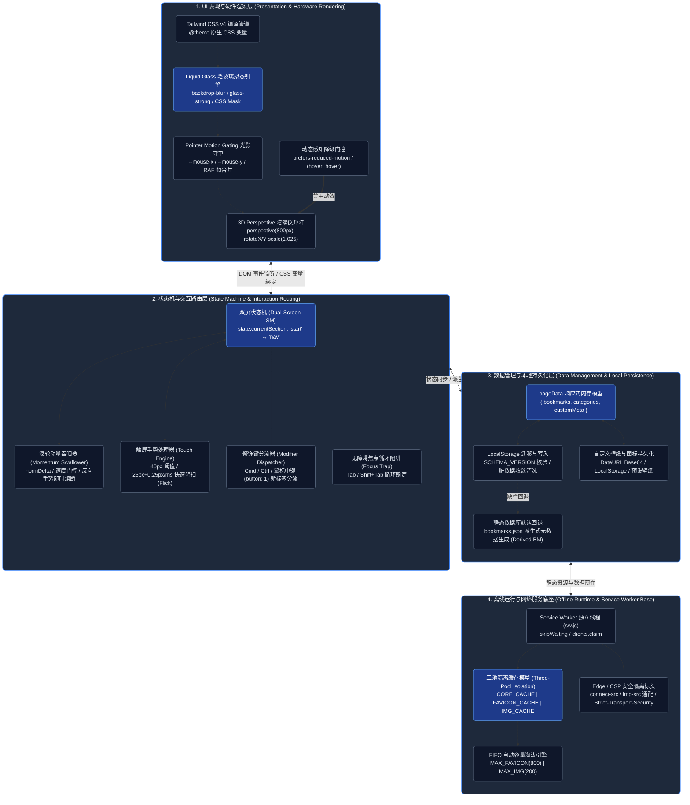
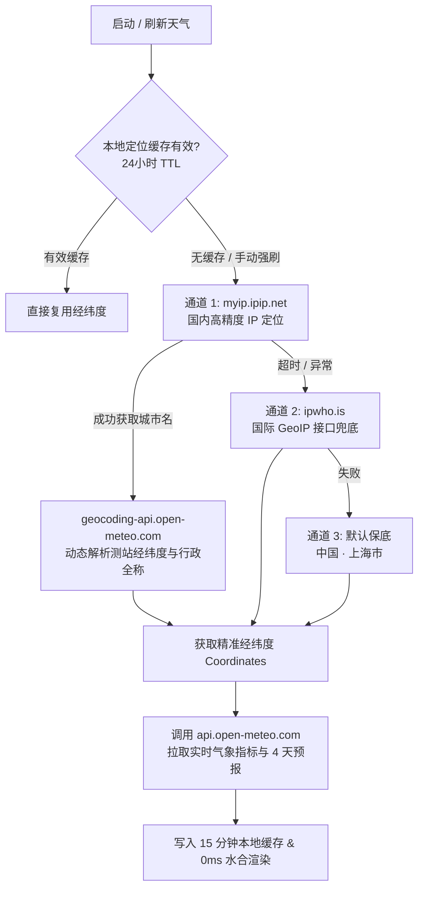

# Glass Start - 灵动起始页与分类导航

灵动优雅、极简纯净的玻璃拟态浏览器起始页与分类导航。

---

## 目录
- [✨ 核心亮点与安全性能特性](#-核心亮点与安全性能特性)
- [🏛️ 系统架构与设计决策](#️-系统架构与设计决策)
- [📖 用户使用指南手册](#-用户使用指南手册)
- [🛠️ 开发者与 Agent 工作流指南](#️-开发者与-agent-工作流指南)
- [🏗️ 代码结构与全栈架构设计](#️-代码结构与全栈架构设计)
  - [1. 项目目录结构与文件职责](#1-项目目录结构与文件职责)
  - [2. 核心运行与数据同步机制](#2-核心运行与数据同步机制)
  - [3. 项目全栈缓存与存储架构](#3-项目全栈缓存与存储架构-cache--storage-architecture)
  - [4. 全链路天气 API 架构与调度机制](#4-全链路天气-api-架构与调度机制-weather-api-architecture)
  - [5. HTTP 生产安全响应头最佳实践配置](#5-http-生产安全响应头最佳实践配置-security-headers-guide)
  - [6. 框架与依赖版本清单](#6-框架与依赖版本清单-framework--dependency-versions)
  - [7. 语义化版本规范与升级指南](#7-语义化版本规范与升级指南-semantic-versioning-guide)

---

## ✨ 核心亮点与安全性能特性

- 🪐 **Liquid Glass 物理高光与玻璃拟态**：采用 Apple HIG 规范的 1px 物理折射高光、微拟物触感反馈与 iOS 18 物理按压微缩放。
- 🌤️ **实时天气小组件与全球预报**：免 Key 开源气象底座 + 三通道高精度 IP 定位，首帧 0ms 水合秒开，支持 2×2 实时气象指标、未来 4 天天气预报与 15 分钟智能节流缓存，100% 符合 WCAG 2.5.3 无障碍标准。
- 🎬 **原生双动效系统 (双屏滚动 + 底部透光收口)**：支持起始页与导航页全屏平滑推移（「双屏滚动」），以及导航视窗底部基于 `mask-image` 72px 纯 Alpha 真实透光渐隐（「底部透光收口」），全流程 0 渲染空白。
- ⚡ **零开销双模式构建与 esbuild 极速压缩**：开发模式使用 Tailwind v4 CDN 随改随看；生产打包（`npm run build`）集成 Tailwind CLI 静态编译与 `esbuild` AST 极速压缩，全量内嵌样式，实现首屏秒开与 100% 离线可用。
- ⚡ **`<head>` 零闪烁预加载恢复 (Pre-hydration)**：在 DOM 挂载前通过 `<head>` 内联脚本瞬间还原上次屏间位置、背景壁纸与遮罩模糊滤镜，消除刷新闪烁 (FOUC)。
- 🛡️ **严格安全防护**：内置严格 Content Security Policy (CSP)、全面 XSS HTML 实体转义、`safeUrl` 协议白名单拦截（防 `javascript:` 注入）、JSONP 超时悬挂防爆防护。
- ♿ **UI 弹窗栈管理与无障碍 Focus Trap**：基于 `OverlayStack` 管理全局弹窗与下拉菜单，弹窗激活时自动锁定 `Tab` 键焦点循环，按 `Esc` 键依后进先出 (LIFO) 顺序平滑逐层关闭。
- 🚀 **图标高性能缓存**：内置 Service Worker (v10)，三池隔离（800+200配额）与原生 CacheStorage FIFO 容量限额自动淘汰，结合 no-cors 隔离与自愈机制彻底消除 Chrome 存储配额膨胀问题。

---

## 🏛️ 系统架构与设计决策

Glass Start 采用现代纯前端响应式架构与零依赖离线底座，整体分为 **UI 表现与硬件渲染层**、**双屏状态机与交互路由层**、**数据管理与持久化层** 以及 **Service Worker 离线网络底座** 4 大核心分层：



> 📘 **深入架构与交互决策**：关于双屏状态机流转、OverlayStack 弹窗逆序退栈、Service Worker 三池物理隔离、智能搜索匹配及气象演化引擎的完整 Mermaid 图表与深度解析，请参阅 ➔ [**Glass Start 架构设计与核心技术白皮书 (ARCHITECTURE.md)**](./ARCHITECTURE.md)。
> 
> 🤖 **AI 编程行为准则**：关于 AI 代理与自动化代码助手的 7 大工程红线、验证门禁与开发纪律，请参阅 ➔ [**AI 编程行为宪法 (AGENTS.md)**](./AGENTS.md)。

---

## 📖 用户使用指南手册

### 1. 双屏滚动与书签入场交互
- **双屏滚动 (Dual-Screen Scroll)**：
  - **顶部 / 右侧快捷按钮**：点击导航页顶部 Header 栏或右侧「向上滚动返回」胶囊按钮，可随时平滑切回首屏。
  - **滚轮 / 触摸屏滑动**：首屏向下滚动或滑屏可平滑切换至「导航页」；在导航页顶部向上滚动或滑屏可返回「起始页」。
  - **零闪烁状态记忆**：系统自动记录上次停留的屏间位置（`SessionStorage`），刷新页面时自动无闪烁恢复。
  - **键盘快捷键切换**：非输入状态下按 `PageDown` 或 `↓` 前往导航页；在导航页顶部按 `PageUp`、`Home` 或 `↑` 返回首屏。
- **底部透光收口 (Bottom Alpha Fade)**：
  - 在导航页内部向下滚动浏览时，视口底部 72px 区域自动通过 `mask-image` 产生纯净 Alpha 透明渐隐，平滑透出底层动态壁纸，全流程零黑灰脏色、零卡顿。

### 2. 搜索与搜索引擎操作
- **搜索引擎切换**：点击搜索框左侧引擎图标（支持 Bing、Google、Wikipedia），在下拉菜单中快速切换。
- **盲打自动聚焦**：在起始页非输入状态下，直接按下键盘上的任意字母/数字键，搜索框将自动获得焦点并输入。
- **中文拼音输入法 (IME) 保护**：输入中文时自动识别拼音合成状态（`compositionstart` / `compositionend`），避免选字过程中误触发搜索或拦截。
- **混合联想与本地书签匹配**：
  - 输入关键词后，下拉菜单同时拉取**搜索引擎建议词**与**本地快捷书签模糊匹配**（高亮显示图标）。
  - 按 `↑` / `↓` 方向键可在联想建议词与本地匹配书签间上下循环挑选（按上/下超出范围时自动恢复原始输入内容）。
  - 选中匹配的本地书签按 `Enter` 可直接跳转至目标网站。
  - 按 `Enter` 回车直接在当前页搜索；按 `Cmd + Enter` (Mac) 或 `Alt + Enter` (Windows) 可在**新标签页**中打开搜索结果。
  - 按 `Esc` 键快速收起联想下拉框或取消搜索框焦点。

### 3. 壁纸与外观偏好设置
- **一键轮播壁纸**：在非输入状态下按下快捷键 `Ctrl + B` (Windows) 或 `Cmd + B` (Mac)，可在线轮播内置的高清风光壁纸。
- **自定义壁纸与玻璃滤镜**：
  - 点击右下角齿轮设置按钮 ⚙️ ➔ 切换至「外观壁纸」Tab。
  - 支持 **上传本地图片**（自动转换为 4K JPEG 存入 IndexedDB 数据库，打破 5MB 限制）。
  - 支持 **输入网络图片 URL 地址**。
  - 支持 **选择预设高清壁纸库**（精选 8 款系统经典壁纸）。
  - 支持 **遮罩透明度 (0% ~ 80%)** 与 **高斯模糊强度 (0px ~ 20px)** 拖动条微调，实时预览并无闪烁保存。
  - 支持 **恢复默认壁纸**。

### 4. 快捷书签管理与拖拽排序
- **编辑管理弹窗**：点击右下角常驻的齿轮设置按钮 ⚙️（Hover 时齿轮平滑旋转 90 度）打开「设置与偏好」面板。
- **拖拽排序 (Drag & Drop)**：在「快捷书签」Tab 中，按住书签条目左侧的 `⋮⋮` 拖拽手柄，即可自由上下拖动调整书签在首屏的排列顺序。
- **手动添加 / 从导航页挑选**：
  - 点击「+ 手动输入」可新增自定义网站名称与 URL（URL 可简写为 `github.com`，系统会自动补充 `https://` 并抓取图标）。
  - 点击「🗂️ 从导航页选择」可打开可视化挑选弹窗，一键将导航页大全中的精选网站添加至首屏快捷书签。

### 5. 数据备份、恢复与重置
- **导出 JSON 备份**：在设置面板 ➔「数据与备份」Tab 中点击「📤 导出 JSON 备份文件」，可将当前所有快捷书签一键导出为 `.json` 备份文件。
- **导入 JSON 备份**：支持点击导入或直接将 `.json` 备份文件**拖入拖拽区 (Dropzone)**，系统将自动解析恢复书签。
- **一键重置系统**：在「危险区域 (Danger Zone)」中点击「⚠️ 重置所有系统设置」，可恢复为网站初始默认状态并清除本地缓存。

### 6. 全站键盘快捷键速查
- **一键唤起 / 关闭**：在任何状态下按下组合快捷键 `Cmd + /` (Mac) 或 `Ctrl + /` (Windows)，可随时唤起或关闭晶莹透亮的毛玻璃快捷键速查面板。
- **界面入口**：点击右下角设置齿轮 ⚙️ ➔ 设置面板 Header 右上角「⌨️ 快捷键速查」按钮亦可一键打开。
- **无障碍与快速退出**：速查面板激活时支持 Tab 键焦点循环锁定 (Focus Trap)，随时按 `Esc` 键或点击背景即可快速退出。

### 7. 实时天气与气象小组件
- **常驻天气胶囊**：起始页右上角常驻极简毛玻璃胶囊（`#weatherBtn`），显示实时温度、天气 Emoji 与城市名（默认基准城市为 `中国 · 上海市`，支持全球 IP 自动高精度定位）。
- **2×2 工位高信息密度全动态气象网格**：
  - **优先级排布**：左上「相对湿度」、右上「实时风速 (km/h)」、左下「降水概率」、右下「日落/日出时间感知」。
  - **相对湿度三阶感知**：`<35%` ➔ `🌵`（干燥加湿）；`35% ~ 75%` ➔ `💧`（舒适清润）；`>75%` ➔ `💦`（潮湿水汽）。
  - **实时风速三阶感知**：`<15 km/h` ➔ `🍃`（微风和风）；`15 ~ 35 km/h` ➔ `🎏`（清风疾风）；`≥35 km/h` ➔ `🌪️`（大风狂风预警）。
  - **降水概率三阶形态**：`0% ~ 29%` ➔ `🌂`（低概率收伞）；`30% ~ 69%` ➔ `☂️`（备伞）；`≥70%` ➔ `☔️`（高概率必带伞）。
  - **24 小时日出日落智能时间感知**：日出后至日落前智能展示「今日日落 🌅」，日落后自动平滑切换为「明日日出 🌄」，凌晨日出前展示「今日日出 🌄」。
- **未来预报等宽排版**：预报列表左侧日期列严格渲染「今天」、「明天」、「周X」两字符等宽对齐标签。
- **手动即时刷新**：弹窗右上角提供「🔄」刷新按钮，点击时 100% 穿透缓存，强制重新定位并拉取最新天气。
- **智能缓存节流**：气象数据本地缓存 15 分钟，IP 定位信息本地缓存 24 小时，杜绝重复网络请求与 API 限流。

---

## 🛠️ 开发者与 Agent 工作流指南

### 1. 本地开发与生产部署 (Dev vs Prod)

#### 本地开发模式 (Development)
- **一键双击启动 (macOS)**：在访达（Finder）中直接双击 `scripts/start.command` 快捷指令，自动完成构建同步并在局域网启动 `dist/` 网页服务，秒级打开默认浏览器。
- **命令行启动**：运行 `npm run dev`（或 `npm run preview`）会自动构建打包并通过原生 `scripts/server.js` 启动 `dist/` 局域网预览服务 (`http://localhost:3000`)。
- **文件增量监听**：在编辑源码 `index.html` 或 `bookmarks.json` 时，可在另一终端开启 `npm run watch` 文件修改监听，保存时自动秒级重建 `dist/` 产物。
- **免构建直开模式**：若直接双击根目录 `index.html`（`file://` 协议），页面仍内置 **Tailwind v4 Browser CDN** 运行时脚本，保持零环境开箱即用。

#### 生产环境打包上线 (Production)
在需要部署到生产服务器或 GitHub Pages / Cloudflare Pages 时，运行打包命令：
```bash
npm run build
```
构建过程会自动执行：
1. **自动数据双向同步**：解析 `bookmarks.json` 最新数据，自动同步注入更新源码 `index.html` 的 `DEFAULT_BOOKMARKS` 与 `DEFAULT_CATEGORIES` 数组（解决本地 `file://` 协议双击打开时因 CORS 拦截导致的降级书签不一致问题）。
2. **Tailwind 静态编译与 CSS 压缩**：调用 Tailwind CLI (`-m`) 扫描 `index.html` 编译并输出极致 Minify 压缩的 CSS 样式。
3. **JS 逻辑提取与零依赖压缩**：从 `index.html` 提取 `<script id="main-script">` 主体逻辑，对默认书签 JSON 数据做紧凑序列化，并剥离注释与缩进（`minifyJsCode`）后独立输出为 `dist/app.js`。
4. **HTML 结构精简与 CSS 全量内嵌**：自动处理 `dist/index.html`，移除 v4 Browser CDN 运行时脚本，将压缩好的 CSS 全量安全转义后内嵌至 `<style>` 标签（消除 `style.css` 渲染阻塞与网络 RTT 请求），替换内联脚本为外链 `app.js`，并执行零依赖 HTML 体积压缩（`minifyHtml`，剥离非功能性注释与冗余空白）。
5. **静态资源全量复制**：将 `sw.js` 缓存脚本（自动更新版本号 `app-core-v<timestamp>`）、`wallpapers/` 壁纸资源目录及 `_headers` 配置文件全量复制至 `dist/` 目录（实现极简打包部署与 100% 离线支持）。

**上线发布**：只需将生成的 **`dist/` 文件夹下的全部内容** 上传部署至 GitHub Pages、Cloudflare Pages、Vercel 或 Nginx 即可。

#### Cloudflare Pages / Workers 自动部署 (推荐)

本项目已通过 **Cloudflare Pages 连接 Git 仓库**实现 CI/CD 自动部署，**push 到 `main` 分支即自动构建上线**，无需手动上传：

- **Git 仓库**：`https://github.com/leosdcn/glass-start`（私有仓库）
- **生产分支**：`main`（每次 push 自动触发部署）
- **构建命令 (Build command)**：`npm run build`
- **部署命令 (Deploy command)**：`npx wrangler deploy`
- **静态资源目录**：`dist/`（通过根目录 `wrangler.jsonc` 的 `assets.directory = "dist"` 声明，仅上传 `dist/` 产物，避免整仓上传超 25 MiB 限制）
- **自定义域名**：`goldcoast.dpdns.org`
- **回滚策略**：无需维护 dev 分支；回滚依赖频繁 commit（`git log` / `git reset`）与 Cloudflare 历史部署版本

### 2. 书签单点维护与撰写规范
1. **修改/添加书签**：**只需要修改 `bookmarks.json` 一个文件即可**。
   * **`name` 网站命名统一规范（Language & Naming Rules）**：
     - **中文网站使用中文名**：中文本土项目与服务一律使用标准中文官方名。
     - **英文及国际网站使用英文名**：国际通用产品与服务一律使用其官方英文/国际品牌名。
     - **特定语种本土知名服务**：保留其原产国官方原名。
   * **`desc` 简介副标题编写规范**（参见源码 `index.html` 导航卡片渲染模板）：
     - **字数限制（Character Limits & Language Rules）**：纯中文简介**必须严格控制在 6 ~ 10 个中文字符以内**（严禁超过 10 字）；中英混排 / 含英文字符与分词空格的简介，静态门禁硬上限放宽至 **$\le 13$ 字符**（用于充分容纳半角英文字母与必要分词空格的排版占位，超出将直接触发 `npm run lint` 拦截）。
     - **布局与截断**：展示在导航卡片标题下方，窄屏或超长字符会自动触发单行截断（`truncate`）。
     - **内容准则**：精准概括网站核心定位，直述产品核心价值，避免夸大与冗余修饰词。
     - **中文搜索关键词锚点（Search Intent Keyword Anchor）**：简介必须包含工具所属的标准中文品类词，推荐采用「品质定语/特性」+「中文核心品类词」结构，确保用户在搜索框输入中文通用词时能精准召回对应英文品牌工具。
   * **书签筛选与用户友好准则（Bookmark Selection & User-Friendliness Rules）**：
     - **品质优先与杜绝同质堆叠（Quality & Differentiation First）**：秉持宁缺毋滥原则，坚决避免功能雷同、缺乏实质差异的工具盲目堆叠；优先精选各领域综合体验好、口碑高的代表性产品，保持页面克制高效。
     - **拒绝「伪同质化」，尊重独立生态位（Niche Coverage）**：避免粗暴按宽泛大类一刀切，精准识别各工具在细分场景、垂直受众、内容来源或核心模式上的独特性，对于具备不可替代价值的独立生态予以充分保留。
     - **为「稀缺极客工具」保留特席**：对于具备不可替代性、生态位绝对唯一或极具探索趣味的特色极客工具，即使日常使用频次偏低，亦不受常规精简指标限制，坚决予以特席保留。
     - **用户友好度审核**：优先收录 **免注册、无打扰、支持一键复制/下载、无强迫付费弹窗** 的优质开源/免费工具。坚决剔除商业化过度干扰、充斥 Pro 锁头弹窗或体验不佳的网站。
   * **`url` 与 `icon` 规范与最新官方主域原则（Direct Canonical URLs & No Obsolete Redirects）**：
     - **直连最新官方规范主域**：必须填写真实有效的官方规范直连主域名，杜绝已废弃、产生 3xx 多跳重定向或过渡性质的旧域名与二级子域。
     - **消除重定向开销 (0-RTT Direct Connect)**：直连规范主域可消除多余的 HTTP 301/302/307/308 重定向往返耗时，提升网页瞬时直开体验，并规避旧域名未来可能面临的 SSL 证书过期或重定向失效风险。
     - **`icon` 域名与服务主域精准对齐**：使用 `https://a.favicon.im/<domain>` 图标服务时，`<domain>` 参数应与当前官方主域（或主站 Apex 域名）保持严格对齐，确保高清 Favicon 正确解析与三池缓存加速。
     - **矩阵型服务专属图标特例（Matrix Services Subdomain Exception）**：对于旗下拥有众多独立子产品的矩阵型服务，由于图标服务仅按 Host 主机名提取图标，若跳转 `url` 采用通用主站路径规范，`icon` 字段应保留产品专属子域，以精准拉取该产品的独立专属 Logo，避免降级为通用企业主标。
   * **规则纯粹性与严禁具象举例（Pure Principles & Anti-Bias Rules）**：
     - **严禁在规范中添加具象举例**：所有文档规则、设计准则与维护规范必须始终保持高度抽象、普适与纯粹，**严禁在规则正文中添加“例如：……”等具象案例**；确保所有审核与决策均基于通用技术原理与实时客观现状进行独立审查与判断，坚决杜绝因特定示例产生先入为主的思维定势或认知偏差。
2. **执行自动同步**：修改完成后，运行 `npm run build` 自动同步注入源码与 `dist/` 产物。
3. **修改搜索引擎**：可在 `index.html` 中的 `engines` 引擎配置对象中新增或定制新的搜索引擎（Google、Bing 等）。

### 3. 静态检查、Git 规范与自动化测试指南 (Agent / Dev Guidelines)
- ⚡ **静态代码检查 (`npm run lint`)**：耗时约 0.08 秒（全量 27 项机器级语法与工程红线门禁守门）。自动完成 `index.html` 内嵌 JS、`scripts/build.js`/`sw.js`/`scripts/server.js` 语法预检及 `bookmarks.json`/`manifest.json`/`package.json` 的 JSON 合法性校验，并强校验生命周期与 BFCache 防退化守卫。修改代码后运行此命令做轻量校验。
- 🚀 **生产构建打包 (`npm run build`)**：耗时约 0.5 秒（Tailwind v4 CLI + esbuild 引擎）。编译 Tailwind CSS 并同步书签数据，自动校验产物完整性。
- 🧪 **自动化测试套件 (`npm test` 或 `node test/run.mjs`)**：
  - 内置 **4 大核心领域端到端与架构综合测试套件（覆盖 24 项高密度全景断言）**。
  - **测试目录文件职责明细 (`test/`)**：
    - `run.mjs` — MD5 增量缓存测试运行器。未改动套件自动秒级跳过；支持 `--force` 强制全量重跑、指定单套件名精准调试与 `--no-build` 跳过构建极速测试。
    - `cdp.mjs` — 无头 Chrome 启动器与 CDP (Chrome DevTools Protocol) WebSocket 连接管理（临时独立用户配置目录，跑完自动清理）。
    - `server.mjs` — 面向自动化测试的零依赖静态服务器，负责在随机空闲端口服务 `dist/` 构建产物。
    - `helpers.mjs` — 共享工具函数库（随机空闲端口探测、键盘事件模拟、测试会话一键拉起等）。
    - `data-features.test.mjs` / `infra-security.test.mjs` / `ui-interaction.test.mjs` / `lifecycle-diag.test.mjs` — 数据功能、基础安全、UI 交互、构建指纹与生命周期自愈四大领域断言套件。
    - `visual-regression.mjs` — 独立运行的视觉回归脚本（对标 **MacBook Air 1470×956** 桌面端与 **iPhone 17 402×874** 移动端 11 场景全页截图与关键组件几何校验），产物输出至项目内 `test/artifacts/` 目录（已加入 `.gitignore`）。手动执行：`node test/visual-regression.mjs`。
    - `preview.html` — 天气组件独立「演练场」页面，供浏览器直接打开隔离调试 UI，不参与自动化测试流水线。
  - **智能增量 MD5 缓存加速**：未变动模块在测试运行时自动秒级命中缓存（`<10ms`），源码或依赖修改后精准触发对应套件重跑；亦可通过 `node test/run.mjs --force` 强制全量重跑。
  - **独立套件调试**：支持单独运行特定领域测试文件，例如 `node test/data-features.test.mjs`。
- 🎨 **CSS 样式级联与 `!important` 禁入规范 (CSS Specificity & Anti-Pollution Rules)**：
  - **严禁引入常规 `!important`**：坚决杜绝在常规组件样式、状态类（如 `.hidden`、`.dragging`、`.active`）或瞬态类（如 `.nr`）中使用 `!important`，避免破坏双屏推移（`translateY(100dvh)`）物理动效与组件生命周期。
  - **特异性与层叠优先**：样式优先级一律纯粹依靠 **CSS 特异性（Specificity: ID > Class > Element）** 与 **ITCSS 级联顺序** 天然实现。
  - **唯一合规例外（W3C A11y 白名单）**：仅允许在 `@media (prefers-reduced-motion: reduce)` 中针对通配符 `*, *::before, *::after` 强制关停动效时使用，以严格符合 WCAG 2.1 AAA 级国际无障碍规范（`npm run lint` 已配置自动化守门，拦截任何非法 `!important`）。
- 🛡️ **BFCache 与页面生命周期防失步准则 (BFCache & Lifecycle Guardrails)**：
  - **防语义污染**：布局推屏类 `.nr` 严禁滥用为通用动画禁用类，任何切屏/自愈入口同步剥离；
  - **防跨帧竞态**：严禁 `style.transition = 'none'` + `rAF` 异步反模式，100% 依赖声明式状态类，唤醒自愈同步清除内联脏样式；
  - **防模型割裂**：`visibilitychange` 与 `pageshow` 双通道收敛至 `handleAppWakeUp()` 单点自愈；
  - **防动画时间穿越**：入场动画（`.fade-in` / `.animate-item-in`）播放完后必须立即卸载，避免 WebKit BFCache 解冻回滚至 `opacity:0`；
  - **防磁贴失栅格化**：离屏 `fixed` 图层在 BFCache 恢复后可能出现合成层磁贴丢失（白屏），磁贴重建抖动仅在 `persisted=true` 时间窗内执行。
- 🩺 **运行时诊断黑匣子 (Runtime Diagnostic Blackbox)**：
  - 构建产物内置双端指纹契约：`__GLASS_BUILD_HTML__`（HTML 内联）与 `__GLASS_BUILD_APP__`（app.js 头部）由 build.js 同源注入并断言校验；运行时不一致即判定跨版本缓存割裂，按 60s 冷却期执行单次守卫刷新；
  - 纯内存环形日志（≤40 条，零存储写入；BFCache 恢复不重置 JS 堆）被动记录 pageshow(persisted)/visibilitychange/reconcile/controllerchange/js-error 与白屏异常三级阶梯（L1 校准 → L2 磁贴重建 → L3 守卫刷新）全过程；L3 自刷新瞬间仅在 sessionStorage 落一条 `gs_last_heal` 面包屑解释自刷原因；
  - 无任何诊断 UI：线上复发白屏且未自动痊愈时，保持页面不刷新，打开 DevTools 控制台执行 `__GLASS_DIAG__.dump()` 导出事件流定位（若页面已被 L3 自动刷新过，改查 `sessionStorage['gs_last_heal']`）。
- 📱 **真机 BFCache 回归 QA 协议 (Real-Device BFCache QA Protocol)**：
  - ⚠️ CDP 无头测试只能模拟合成生命周期事件，无法模拟真实往返缓存（BFCache）恢复路径——每次发布前必须在真机执行以下矩阵：
  - **iPhone Safari**：导航页点书签跳出 → 外部站停留 → 左上角返回 / 右滑手势返回 → 上滑切回首屏，断言首屏时钟/搜索框/书签完整可见无白屏；重复 3 次（含冷启动后首次）；
  - **macOS Safari / Chrome**：同链路使用 ⌘[ 与后退按钮各验证一轮；PWA 独立窗口从最近任务切回再验证一轮；
  - 若复现白屏：保持现场不刷新 → DevTools 控制台执行 `__GLASS_DIAG__.dump()` 导出事件流（若已被 L3 自动刷新，改查 `sessionStorage['gs_last_heal']` 面包屑），按 anomaly/heal-reload 事件序列定位阶梯拦截情况。
- ☁️ **云端自动部署与构建提示 (CI/CD Guidelines)**：
  - 🛑 **严禁自行推送云端 (No Auto Push)**：严禁 Agent 自动执行 `git push` 推送至远程 Git 仓库；所有云端推送必须由用户下达明确指令（如“推送”、“git push”）后方可执行。
  - **Cloudflare Pages 自动构建**：push 到 `main` 分支会自动触发线上构建与部署。
  - **跳过云端构建**：若仅需向远程仓库推送备份代码但**不想触发线上构建**，请在提交信息中加上 `[skip ci]`（如：`git commit -m "wip: 修改样式 [skip ci]"`）。

---

## 🏗️ 代码结构与全栈架构设计

### 1. 项目目录结构与文件职责

```text
glass-start/
├── 📄 根目录核心生产文件 (8 个)
│   ├── index.html            # 源码主入口（开发模式直开，内置 Tailwind v4 Browser CDN）
│   ├── bookmarks.json        # 全站唯一书签数据真源（构建时自动注入 HTML）
│   ├── sw.js                 # Service Worker 离线网络拦截与三池隔离缓存底座
│   ├── manifest.json         # PWA Web App 应用程序清单
│   ├── apple-touch-icon.png  # iOS Safari 主屏幕 180x180 图标
│   ├── robots.txt            # 搜索引擎爬虫协议规则
│   ├── _headers              # Cloudflare Pages 生产环境 HTTP 安全响应头配置
│   └── wrangler.jsonc        # Cloudflare Pages / Workers 自动构建与部署配置
│
├── ⚙️ 根目录工程配置与文档体系 (6 个)
│   ├── package.json          # Node 项目配置（0 运行时依赖，仅 devDependencies 构建工具）
│   ├── package-lock.json     # 依赖锁定清单（严格锁定 SemVer v3.8.2）
│   ├── .gitignore            # Git 忽略规则（已严格隔离 dist/、node_modules/、test 产物）
│   ├── README.md             # 全站功能特性、使用手册、架构表与部署指南
│   ├── ARCHITECTURE.md       # 系统分层、双屏状态机、OverlayStack 等 5 大 Mermaid 白皮书
│   └── AGENTS.md             # AI 编程行为宪法（7 大红线、局部手术地图、自愈流水线）
│
├── 🛠️ scripts/ 自动化工程工具目录 (4 个)
│   ├── build.js              # 生产环境编译打包流水线（Tailwind CLI + esbuild AST 压缩）
│   ├── lint.mjs              # 零依赖静态语法与 7 大红线规范门禁（<80ms 极速自愈）
│   ├── server.js             # 原生 Node.js 零依赖本地开发与局域网预览服务器
│   └── start.command         # macOS 访达一键双击启动快捷指令
│
├── 🧪 test/ 自动化测试与质量保障目录 (9 个源码文件)
│   ├── run.mjs               # MD5 增量缓存测试运行器（支持 --force / --no-build）
│   ├── cdp.mjs               # 无头 Chrome 启动器与 CDP WebSocket 通信管理
│   ├── server.mjs            # 面向自动化测试的随机空闲端口静态服务器
│   ├── helpers.mjs           # 测试共享辅助函数库（键盘模拟、端口探测等）
│   ├── infra-security.test.mjs # 基础架构、安全标头与 SW 离线缓存领域断言套件 (5项)
│   ├── data-features.test.mjs  # 搜索匹配、轻量存储、气象 9 阶演化领域断言套件 (7项)
│   ├── ui-interaction.test.mjs # 双屏状态机、手势、BFCache、OverlayStack 领域断言套件 (7项)
│   ├── visual-regression.mjs   # 桌面端 + 移动端 11 大场景视觉几何与截图回归套件
│   └── preview.html          # 天气小组件独立隔离演练场（已在 README.md 明确职责）
│
└── 🖼️ wallpapers/ 预设高清壁纸资产库 (16 个文件)
    ├── bg1.avif ~ bg8.avif   # 8 款精选 2.5K AVIF 极清风光壁纸（支持 10-bit 色深）
    └── bg1-thumb.avif ~ bg8-thumb.avif # 8 款设置面板壁纸选择器极速微缩缩略图
```

| 文件 / 目录名 | 属性 | 文件作用描述 | 必选性 |
| :--- | :--- | :--- | :--- |
| **`index.html`** | **源码主入口** | 开发模式页面主入口。内置 Tailwind v4 Browser CDN，AI/开发者修改代码立即可见，零编译开销。 | **必须** |
| **`bookmarks.json`** | **唯一数据源** | 唯一数据维护源。修改书签只需编辑此文件，运行 `npm run build` 会自动将书签同步注入 HTML。 | **必须（数据真源）** |
| **`sw.js`** | 缓存脚本 | Service Worker 独立脚本。专门用于在 HTTPS/localhost 环境下本地缓存 Favicon 网站图标与壁纸，提升加载速度。 | 推荐（缺失时不影响主流程运行） |
| **`wallpapers/`** | **本地壁纸库** | 高清预设 AVIF 壁纸目录（包含 bg1.avif ~ bg8.avif），由构建脚本自动打包至 `dist/` 实现全量离线可用。 | **必须** |
| **`scripts/`** | **工具与脚本目录** | 包含生产构建打包 (`build.js`)、零依赖静态检查 (`lint.mjs`)、本地开发服务 (`server.js`) 与 macOS 双击启动 (`start.command`)。 | 工具目录 |
| **`manifest.json`** | Web App 应用配置 | PWA 应用清单文件。配置应用名称、图标、启动 URL、主题颜色，支持添加至手机主屏幕与独立 Web App 运行。 | PWA 必需 |
| **`_headers`** | 部署响应头配置 | Cloudflare Pages HTTP 安全响应头与静态资源缓存控制配置文件。 | 部署配置 |
| **`test/`** | **测试目录** | 自动化测试目录。内含 4 大领域 CDP 自动化端到端测试套件（24 项高密度全景断言）与 MD5 增量缓存运行器。 | 测试框架 |
| **`package.json`** | 项目配置 | Node 项目配置文件，提供 `npm run dev`、`npm run watch`、`npm run build`、`npm run lint` 与 `npm test` 命令。 | 配置文件 |
| **`dist/`** | **生产输出** | `npm run build` 自动生成的生产构建目录（⚠️ 严禁直接编辑）。包含剥离 v4 Browser CDN、内嵌 CSS 及外链 `app.js` 的上线资源。 | 生产部署产物 |
| **`wrangler.jsonc`** | 部署配置 | Cloudflare Workers / Pages 部署配置，声明 `assets.directory = "dist"` 指定静态资源上传目录。 | Cloudflare 部署必需 |
| `.gitignore` | 配置文档 | Git 版本控制忽略配置。 | 运维配置 |
| **`README.md`** | 说明文档 | 本文档，记录项目架构、文件职责、运行机制及部署指南。 | 运维文档 |

---

### 2. 核心运行与数据同步机制

```
[ 开发者维护 bookmarks.json ] ──(运行 npm run build)──> 自动注入更新 index.html 默认数组
                                                                     │
[ 用户访问网页 / 打开 index.html ] <──────────────────────────────────┘
         │
         └── 100% 内存同步加载: 读取 HTML 内置 DEFAULT_* 默认数组 (零 HTTP 额外请求，消除 404 隐患)
```

---

### 3. 项目全栈缓存与存储架构 (Cache & Storage Architecture)

本项目采用了多层级、高可用、离线优先的全栈缓存体系，覆盖 **Service Worker 离线网络拦截**、**浏览器持久化偏好存储**、**IndexedDB 高清大图存储**、**会话状态防闪烁缓存**、**内存级 DOM/UI 节点映射** 以及 **构建期静态数据回退** 6 大核心维度，确保网页秒级加载、零重复开销与 100% 离线可用。

#### ⚙️ 缓存分层架构概览

| 缓存层级 | 技术实现 | 作用目标与缓存对象 | 缓存策略 / 容量限制 | 失效与清理机制 |
| :--- | :--- | :--- | :--- | :--- |
| **Service Worker 离线网络层** | `sw.js` (CacheStorage API) | `a.favicon.im` 图标、`.ico` 静态图标、`index.html`、`app.js` 等 | 图标: `Cache-First` (三池隔离: Favicon 800条 / 本地图片 200条)<br>核心程序(HTML/JS): `原子化 SWR 锁步 (0ms 瞬开)` | `npm run build` 自动更新版本号 `app-core-v<timestamp>` 与 `app.js?v=...` 防缓存割裂，原生 FIFO 容量限额自动淘汰 |
| **天气与定位数据缓存层** | `LocalStorage` (`glass_weather_*`) | 实时温度、4天预报、城市与省市区经纬度坐标 | 天气数据: 15 分钟 TTL<br>地理定位: 24 小时 TTL | 黄金节流平衡点，弹窗右上角「🔄」刷新按钮支持 100% 穿透强制即时刷新 |
| **持久化偏好存储层** | `LocalStorage` | 默认引擎、遮罩透明度、模糊度、自定义书签、壁纸偏好 | key-value / 容量上限 ~5MB | 用户手动点击「重置系统设置」或浏览器清除 Cookie |
| **高清大图存储层** | `IndexedDB` (`GlassStartDB`) | 4K 高清自定义上传壁纸 (`wallpapers` 表) | 3840x2160 JPEG Base64 / 容量 50MB~数百MB | 彻底打破 LocalStorage 5MB 上限，随重置系统操作清空 |
| **会话状态防闪烁层** | `SessionStorage` + `<head>` 脚本 | 页面屏间位置 (`startpage_section`: `start` / `nav`) | 仅在当前会话生命周期内有效 | 渲染前 Head 内联脚本检测并同步添加 `.nr` 类 (带1.5s自愈兜底)，防止刷新首屏闪烁 |
| **运行时内存缓存层** | JS 全局变量 (`dom` / 侧边栏 Cache) | 68 个常用 DOM 节点引用、导航分类与 Section 映射 | 内存映射，零 DOM 树二次查询开销 | 页面卸载或重新载入时自动释放与重新建立 |
| **静态回退与离线数据层** | HTML 内联 `DEFAULT_*` 数组 | `bookmarks.json` 最新镜像数据 | 内存直接加载 / 零 HTTP 请求开销 | `npm run build` 时通过 `scripts/build.js` 自动双向同步 `bookmarks.json` 数据 |

#### ⚡ 核心缓存与防闪烁机制详解

* **Service Worker 三池隔离与 FIFO 限额淘汰 (`sw.js`)**：
  - `CORE_CACHE`：存放 HTML/JS/CSS/JSON 等核心程序资源，采用原子化 SWR 锁步策略，本地 0ms 瞬开且差量原子换代更新。
  - `FAVICON_CACHE`：`a.favicon.im` 外部图标专用池（配额上限 **800 条**）。
  - `IMG_CACHE`：站内本地图片及 `.ico` 资源池（配额上限 **200 条**）。
  - 核心优势：图标作为导航站核心功能享有独立高额配额，且不会被本地大图挤占。
  - 原生 CacheStorage FIFO 自动淘汰：通过 `pruneCache` 轻量监测缓存条目总数，超限时自动修剪淘汰旧资源，杜绝缓存无限膨胀并彻底免除 IndexedDB 依赖。
* **IndexedDB 4K 高清壁纸存储**：
  - 针对用户上传的 4K 本地壁纸，系统在 Canvas 中统一优化转换为 3840x2160 @ 95% 高品质 JPEG DataURL。
  - 存入专用 IndexedDB 数据库 `GlassStartDB` 的 `wallpapers` 对象存储，成功避开 LocalStorage 5MB 上限。
* **`<head>` 内联防闪烁状态恢复**：
  - 在 HTML `<head>` 最顶部内联同步脚本：若检测到 `sessionStorage` 记录的 `startpage_section === 'nav'`，立即赋予 `<html>` `nr` 标志类，DOM 挂载前即可完成布局定位。
* **缓存管理与一键清理**：
  - **离线缓存一键刷新**：设置面板「数据与备份」中提供 `[清理离线缓存]` 按钮，直接调用 `caches.delete()` 清空 Service Worker 离线存储。
  - **系统全量重置**：设置面板「危险区域」提供 `[重置所有系统设置]` 按钮，一键清空 LocalStorage 及 IndexedDB 数据库。

---

### 4. 全链路天气 API 架构与调度机制 (Weather API Architecture)

天气模块采用 **「高精度主通道 ➔ 国际通道兜底 ➔ 静态保底」** 的三级高可用容灾链路，兼顾 **100% 免 API Key 开箱即用**、**国内地级市高精度定位** 与 **24h 智能缓存节流**：

#### 🌐 天气调用链路与容灾流程图



#### 📡 全链路 API 职责与 DNS 预连接清单

| 接口 / 服务 | 协议 / 域名 | 职能说明 | 预连接配置 (`<head>`) |
| :--- | :--- | :--- | :--- |
| **国内定位主通道** | `https://myip.ipip.net/json` | 国内权威 IP 库，毫秒级快速提取当前城市名（如“上海”） | `<link rel="preconnect" href="https://myip.ipip.net" crossorigin>` |
| **地理编码逆解析** | `https://geocoding-api.open-meteo.com/v1/search` | 官方多语言测站编码库，将城市名精准转换为经纬度与行政区划 | `<link rel="preconnect" href="https://geocoding-api.open-meteo.com" crossorigin>` |
| **全球气象预报底座** | `https://api.open-meteo.com/v1/forecast` | 拉取当前实时温度、体感、湿度、风速、降水概率、天气代码及 4 天日出/日落预报 | `<link rel="preconnect" href="https://api.open-meteo.com" crossorigin>` |
| **国际定位备用通道** | `https://ipwho.is/?lang=zh-CN` | 国际 GeoIP 容灾兜底（IPIP 受阻或海外用户时自动无缝接管） | 按需触发（次级容灾） |

#### ⚡ 关键设计与节流优化
1. **两步高精度流水线（IPIP + Open-Meteo Geocoding）**：
   - 解决免 Key 接口中“国内高精度城市”与“气象经纬度”难以兼得的问题，保证国内地级市定位不漂移；
2. **24 小时地理定位缓存 (`LOC_TTL = 24h`)**：
   - 定位坐标存入 LocalStorage，用户日常打开/刷新页面时 **0 次网络请求 IP 接口**，彻底消除限流风险；
3. **15 分钟气象数据缓存 (`WEATHER_TTL = 15min`)**：
   - 日常开屏 0 延迟秒开，弹窗右上角「🔄」强刷按钮支持 100% 穿透缓存，强制即时同步最新气象。

---

### 5. HTTP 生产安全响应头最佳实践配置 (Security Headers Guide)

在部署至 Cloudflare Pages、Nginx、Caddy 或 Vercel 等 Web 服务器时，推荐配置以下 HTTP 安全响应标头（符合 Web Security / Lighthouse 最高安全合规等级）：

```nginx
# 1. 强制 HTTPS 传输 (HSTS, Strict-Transport-Security)
add_header Strict-Transport-Security "max-age=31536000; includeSubDomains; preload" always;

# 2. 防点击劫持防护 (Clickjacking Protection / X-Frame-Options)
add_header X-Frame-Options "SAMEORIGIN" always;

# 3. 防止 MIME 类型混淆嗅探 (X-Content-Type-Options)
add_header X-Content-Type-Options "nosniff" always;

# 4. 引用策略保护 (Referrer-Policy)
add_header Referrer-Policy "strict-origin-when-cross-origin" always;

# 5. 跨源隔离政策 (COOP - Cross-Origin-Opener-Policy)
add_header Cross-Origin-Opener-Policy "same-origin" always;

# 6. 现代硬件权限防御策略 (Permissions-Policy)
add_header Permissions-Policy "accelerometer=(), camera=(), geolocation=(), gyroscope=(), magnetometer=(), microphone=(), payment=(), usb=()" always;

# 7. 内容安全策略 (Content-Security-Policy HTTP 标头)
add_header Content-Security-Policy "default-src 'self'; script-src 'self' 'unsafe-inline' https://api.bing.com https://suggestqueries.google.com https://zh.wikipedia.org https://static.cloudflareinsights.com; style-src 'self' 'unsafe-inline'; img-src 'self' data: blob: https:; connect-src 'self' https://api.open-meteo.com https://geocoding-api.open-meteo.com https://myip.ipip.net https://ipwho.is https://a.favicon.im https://cloudflareinsights.com https://zh.wikipedia.org; worker-src 'self' blob:; object-src 'none'; base-uri 'none'; form-action 'self'; frame-ancestors 'self'; upgrade-insecure-requests" always;
```

---

### 6. 框架与依赖版本清单 (Framework & Dependency Versions)

本项目框架依赖极简——**唯一的构建期工具依赖是 Tailwind CSS 与 esbuild**，生产运行环境为原生纯静态文件（0 框架依赖 / 0 Runtime Dependencies）。以下为所有带明确版本号的框架 / 组件清单：

| 名称 | 类型 | 版本号 | 位置 / 说明 |
| :--- | :--- | :--- | :--- |
| **Tailwind CSS** | CSS 框架（第三方） | `4.3.3` | `package.json` `devDependencies`；CSS 编译核心 |
| **@tailwindcss/cli** | Tailwind v4 构建 CLI | `4.3.3` | `package.json` `devDependencies`；由 `scripts/build.js` 调用完成生产 CSS 编译 |
| **@tailwindcss/browser** | Tailwind v4 浏览器运行时 | `@4`（对应 4.3.3） | `index.html` dev CDN 脚本，仅开发预览使用；生产构建自动内嵌编译 CSS 并剥离该脚本 |
| **esbuild** | 构建与 CSS 编译器 | `0.28.2` | `package.json` `devDependencies`；由 `scripts/build.js` 调用实现 AST 级极速样式与脚本压缩 |
| **Service Worker** | 项目内组件 | `v11` | `sw.js` 头部注释；三池隔离 + FIFO 容量限额缓存架构 |
| **CORE_CACHE** | 缓存池版本 | `app-core-v<时间戳>` | `sw.js`；每次 `npm run build` 自动更新，强制客户端刷新旧缓存 |
| **FAVICON_CACHE / IMG_CACHE** | 缓存池版本 | `v1` | `sw.js`；图标 / 本地图片独立缓存池 |
| **Glass Start 站点版本** | 项目发布版本 | `v3.8.2` | `package.json` + `index.html` 设置面板徽章 |

**无版本号的外部服务**（非框架，版本由服务商维护，升级无需本项目介入）：
- `a.favicon.im` — Favicon 图标 API
- `api.open-meteo.com` / `geocoding-api.open-meteo.com` — 全球气象与地理编码 API (免 Key 开源底座)
- `myip.ipip.net` / `ipwho.is` — 高精度 IP 归属地定位解析 API
- Bing / Google / Wikipedia — 搜索联想建议 API
- `wallpapers/` — 本地预设 2.5K AVIF 高清壁纸库（支持 10-bit 色深与全量预缓存）
- `scripts/server.js` / `scripts/start.command` — 原生 Node.js 零依赖本地与局域网开发静态服务器 (0ms 秒级启动)

---

### 7. 语义化版本规范与升级指南 (Semantic Versioning Guide)

本项目严格遵循国际通用的 **SemVer（Semantic Versioning 语义化版本规范：`主版本号(MAJOR).次版本号(MINOR).修订号(PATCH)`）**。版本号由点号分隔的独立计数器构成（非十进制小数，不采用满十进一），日常迭代升级请参考以下三种场景与准则：

| 升级类型 | 版本演进示例 | 触发条件与适用场景 | 典型变更内容与规则 |
| :--- | :--- | :--- | :--- |
| **小修小补（Patch）** | `v3.1.4` ➔ **`v3.1.5`**<br>`v3.1.9` ➔ **`v3.1.10`** | **Bug 修复、细节微调、依赖升级** | 仅递增末位修订号。用于修复机型兼容问题、微调动画参数、更新书签数据或升级构建依赖，不改变既有功能架构与 DOM 交互契约。 |
| **功能新增（Minor）** | `v3.1.4` ➔ **`v3.2.0`**<br>`v3.2.x` ➔ **`v3.3.0`** | **新增功能模块、向下兼容特性上线** | 递增中间次版本号，**末位修订号强制重置归零**。用于新增独立功能（如待办/便签小组件、主题色彩切换、新搜索引擎添加器）或重大性能体验重构。 |
| **重大重构（Major）** | `v3.x.x` ➔ **`v4.0.0`** | **颠覆性架构升级、破坏性重构** | 递增首位主版本号，**后两位次版本与修订号全部强制归零**。用于底层渲染引擎颠覆、核心视觉形态根本性改变或不向下兼容的存储模型迁移。 |

#### 🛠️ 版本升级操作清单（4 处文件对齐）
每次发布新版本时，需同步对齐以下 4 处文件中的版本号字符串：
1. `package.json`：`"version": "x.y.z"`
2. `package-lock.json`：第 3 行与第 9 行 `"version": "x.y.z"`
3. `index.html`：设置弹窗中的数据仪表盘版本徽章 `<span ...>vx.y.z</span>`
4. `README.md`：第 6 节依赖清单表格中的 `Glass Start 站点版本`

#### 🚀 标准发布构建与测试流水线
```bash
# 1. 语法检查与生产编译打包
npm run lint && npm run build

# 2. 全量端到端自动化测试验证 (4 大核心领域套件 24 项高密度断言)
node test/run.mjs --force

# 3. 提交并打本地 Git Tag
git add .
git commit -m "release: 发布 vx.y.z 正式版"
git tag -a vx.y.z -m "release: Glass Start vx.y.z"

# 4. 推送至远程私有仓库（⚠️ 仅限人类用户手动执行，Agent 严禁未经指令自动推送）
git push origin main --tags
```

