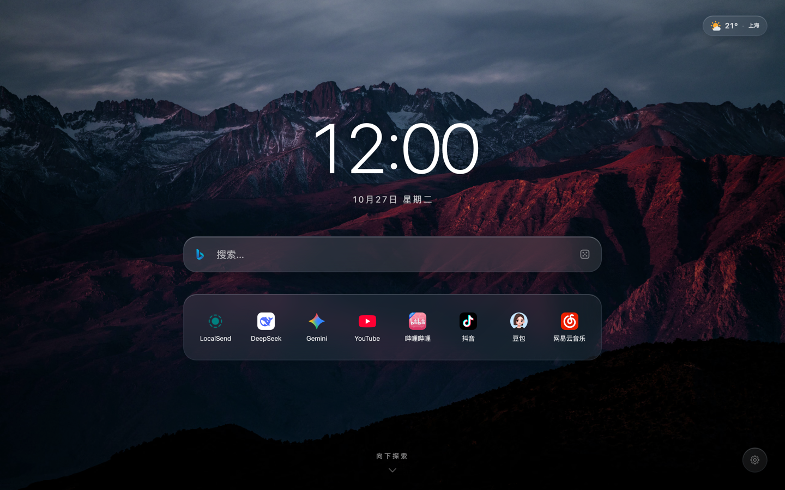
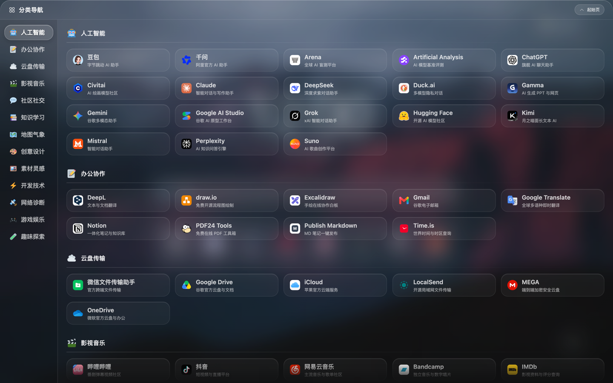

<p align="center">
  
</p>

<h1 align="center">Glass Start — 通透起始页</h1>

<p align="center">
  极简纯净的毛玻璃浏览器起始页，支持网页版与 Chrome 新标签页扩展。
</p>

<p align="center">
  <strong>简体中文</strong> · <a href="./README.en.md">English</a>
</p>

<p align="center">
  <a href="./LICENSE"></a>
  <a href="https://github.com/leosdcn/glass-start/actions/workflows/ci.yml"></a>
  <a href="https://tailwindcss.com/"></a>
  <a href="#-核心特色"></a>
  <a href="#-核心特色"></a>
</p>

<p align="center">
  <a href="https://goldcoast.dpdns.org/" target="_blank" rel="noopener noreferrer">
    <strong>⚡ Cloudflare 在线演示</strong>
  </a>
  &nbsp;&nbsp;·&nbsp;&nbsp;
  <a href="https://leosdcn.github.io/glass-start/" target="_blank" rel="noopener noreferrer">
    <strong>🌐 GitHub 在线演示</strong>
  </a>
</p>

<p align="center">
  
</p>

<p align="center">
  
</p>

---

## 目录

- [✨ 核心特色](#-核心特色)
- [🚀 快速开始与部署](#-快速开始与部署)
- [🧩 Chrome 新标签页扩展安装](#chrome-新标签页扩展)
- [📖 用户指南与个性化定制](#-用户指南与个性化定制)
- [🛠️ 开发者与贡献者指南](#️-开发者与贡献者指南)
- [📚 核心技术文档索引](#-核心技术文档索引)
- [📄 开源协议与免责声明](#-开源协议与免责声明)

---

## ✨ 核心特色

- 🧩 **Chrome 新标签页扩展**：将 Glass Start 设为新标签页，代码、图标与预设壁纸随扩展打包；目前支持[本地加载安装](#chrome-新标签页扩展)；
- 🪐 **Liquid Glass 外观**：高光、毛玻璃背景与按压缩放动效；
- 🎬 **双屏切换**：起始页显示时钟与搜索，导航页显示分类书签；两屏平滑切换，底部内容渐隐；
- 🕊️ **纯净无干扰**：无广告植入、商业推广链接或热搜信息流；项目本身不追踪用户行为，也不设置数据埋点；
- 🌤️ **天气与预报**：无需 API Key，通过 IP 定位与地名解析获取位置，支持缓存展示和多日预报；
- 🌐 **中英文界面**：跟随浏览器或手选语言，覆盖界面、天气和内置书签目录，保留用户自定义文字；
- ⚡ **零运行时依赖**：生产页面不依赖 npm 运行时库；内联预渲染减少刷新闪烁，加载速度取决于设备、缓存与网络；
- 🖼️ **壁纸即选即存**：内置高清壁纸可循环切换，支持上传图片（压缩后写入 IndexedDB）、图片直链与遮罩暗度调节；
- 🛡️ **安全防护**：使用 Content Security Policy (CSP)、动态 HTML 文本转义与 `safeUrl` 协议过滤；部署时需按托管平台要求配置 `public/_headers` 中的响应头规则；
- 📱 **网页版 PWA 离线支持**：Service Worker 使用三个独立缓存池，已缓存资源可离线使用；安装入口与支持程度取决于浏览器。

---

## 🚀 快速开始与部署

本项目可构建为 Chrome 新标签页扩展，也可作为纯前端静态应用部署；网页响应头与子路径部署需按托管平台要求配置。

### Chrome 新标签页扩展

**下载安装**：前往 [Releases](https://github.com/leosdcn/glass-start/releases/latest) 下载扩展 ZIP，安装与更新方法见发布说明。

**从源码构建**：执行以下命令。

```bash
npm ci
npm run build:extension
```

在 Chrome 地址栏打开 `chrome://extensions/`，开启「开发者模式」，点击「加载已解压的扩展程序」，选择项目根目录下生成的 `extension/` 文件夹。新建标签页即可使用 Glass Start；如 Chrome 提示确认新标签页更改，请选择保留。

扩展使用 Manifest V3，代码、图标和预设壁纸均打包在本地；天气和在线搜索联想需要联网，并仅为相应接口声明域名权限。不读取浏览器书签、历史记录或网页内容。自定义壁纸和设置保存在扩展自己的本地存储中，不自动与网页版共享或跨设备同步。网页版导出的书签 JSON 可以在扩展设置中导入；该备份不包含壁纸和偏好设置。

扩展依靠随包资源离线打开，不注册网页版的 Service Worker，也不显示网页版本更新提示。设置中的“清理缓存并刷新”只清理临时缓存，不删除已保存的书签、壁纸和设置；远程壁纸、天气与在线联想仍受网络可用性影响。

更新源码后重新执行 `npm run build:extension`，在扩展管理页点击「重新加载」并重新打开新标签页。保持文件夹路径不变并直接重载，可保留本地数据；移除扩展会删除其存储。`npm run build` 仍只生成网页版 `dist/`，两种构建互不覆盖。扩展安装包目前仅通过 GitHub Release 分发，尚未上架 Chrome 应用商店。

扩展回归测试：`npm test -- infra-chrome-extension`。测试通过 CDP 在独立临时配置中实际加载扩展，需要支持 `Extensions.loadUnpacked` 的新版 Chrome。覆盖新标签页替换、首屏底色与主题恢复、三引擎联想、设置保存和离线重载；联想响应使用固定数据，不代表真实第三方接口联网验证。

### Cloudflare Pages 自动部署
1. Fork 或上传本项目到你的 GitHub 仓库；
2. 在 **[Cloudflare Dashboard](https://dash.cloudflare.com/)** 创建 Pages 项目并连接 Git 仓库（入口以[官方静态站点指南](https://developers.cloudflare.com/pages/framework-guides/deploy-anything/)为准）；
3. 选择你的仓库，构建配置如下：
   - **Framework preset**: `None`
   - **Build command**: `npm run build`
   - **Build output directory**: `dist`
   - **环境变量**：`NODE_VERSION=24`，满足项目的 Node.js 版本要求；配置方式见[构建环境文档](https://developers.cloudflare.com/pages/configuration/build-image/)。
4. 保存并部署。后续推送到配置的生产分支会触发更新；生产分支按实际仓库选择，不一定是 `main`。

### Vercel / Netlify / GitHub Pages
- **Vercel / Netlify**：导入 Git 仓库，构建命令设为 `npm run build`，输出目录设为 `dist`；响应头规则须按各平台要求配置。
- **GitHub Pages**：在 Settings ➔ Pages 选择 GitHub Actions，按[官方自定义工作流指南](https://docs.github.com/en/pages/getting-started-with-github-pages/using-custom-workflows-with-github-pages)安装依赖、执行构建并上传 `dist/` 作为 Pages 产物。若从分支发布，需将产物放在发布分支根目录或 `/docs`，不能直接选择 `/dist`。

### 本地预览与离线使用
安装锁定的开发依赖后启动本地预览：
```bash
npm ci
npm run preview
```
`npm run preview` 会构建并启动 HTTP 服务。使用终端显示的地址访问页面；HTTPS 或 localhost 下可注册 Service Worker，完成资源缓存后可断网使用已缓存内容。实时天气、网络联想和外部网站仍需网络。直接双击 `dist/index.html` 使用 `file://` 时不具备 Service Worker 离线缓存能力。

---

## 📖 用户指南与个性化定制

### 1. 双屏滚动与屏幕切换
- **滚轮 / 滑动**：在首屏向下滚动或用手指上滑，进入「导航页」；在导航页顶部向上滚动或下滑即可回到「起始页」。
- **快捷按钮**：点击导航页顶部的「起始页」按钮可返回首屏。
- **键盘翻页**：未打开阻止翻页的弹窗或面板，且未在其他输入框编辑时，按 `PageDown` / `↓` 前往导航页；导航内容位于顶部时，按 `PageUp` / `Home` / `↑` 返回首屏。搜索框有联想列表时，方向键优先选择联想。

### 2. 智能搜索与快捷跳转
- **盲打即搜**：在首屏直接键入字母或数字，搜索框自动获得焦点并接收输入。
- **混合联想**：输入关键词后，先展示**本地书签匹配结果**，再补充返回的**搜索引擎联想词**；网络结果取决于服务可用性，已有缓存时可直接展示。
- **键盘挑选**：通过 `↑` / `↓` 方向键循环挑选结果，按 `Enter` 打开选中项。
- **新标签打开**：按 `Cmd + Enter`、`Ctrl + Enter` 或 `Alt + Enter` 可在新标签页中打开选中项或执行搜索。
- **多引擎切换**：点击搜索框左侧图标，可切换 Bing、Google、Wikipedia 等搜索引擎。没有保存的偏好时，中文默认 Bing，英文默认 Google；用户已保存的选择优先。

### 3. 默认书签维护
**共享书签目录与中文默认快捷书签维护在根目录 `bookmarks.json`**：
```json
{
  "bookmarks": [
    {
      "name": "GitHub",
      "url": "https://github.com",
      "icon": "./icons/github.com.png"
    }
  ],
  "categories": [
    {
      "id": "work",
      "name": "办公协作",
      "icon": "🛠️",
      "bookmarks": [
        {
          "name": "GitHub",
          "url": "https://github.com",
          "desc": "代码托管与协作",
          "icon": "./icons/github.com.png"
        }
      ]
    }
  ]
}
```
以上为结构示例；英文分类名、书签名与简介维护在 `src/js/config/locales/catalog-en.json`。

- **`bookmarks`**：中文首屏默认快捷书签列表（包含 `name`、`url`、`icon`）。
- **`categories`**：导航页分类列表，包含稳定标识 `id`、分类名 `name`、图标 `icon` 及分类书签 `bookmarks`；新增或修改分类时，同步英文目录中的分类 ID。
- **`name`**：中文服务使用标准官方中文名，国际服务使用官方英文名。
- **`desc`**：精简的副标题。`bookmarks.json` 中纯中文 <= 9 字，含英数混排 <= 13 字符；英文目录简介 <= 28 字符（含空格、标点），由 lint 校验。字符上限不保证在所有卡片宽度下都完整显示。
- **`url`**：使用官方 HTTPS 地址，优先直达目标页面并减少不必要的跳转。
- **`icon`**：预设书签统一使用同源路径 `./icons/<domain>.png`，从本站加载或读取缓存。同步脚本根据书签 URL 的主机名抓取图标，使用 `sips` 转换为正方形 PNG，并回写本地路径；`icon` 字段不是自定义下载源。
- **英文默认入口**：`src/js/config/locales/catalog-en.json` 的 `defaultBookmarks` 定义英文首屏的 URL 顺序，复用共享目录条目；URL 不重复，数量与中文默认入口一致。未保存快捷书签配置时采用对应语言的默认值；已有保存配置不会因切换语言被替换，重置书签会恢复当前语言的默认入口。
- **验证与构建**：新增书签或修改 URL、图标来源后，运行 `npm run sync:icons`，再运行 `npm run lint`；同步脚本复用合规图标，仅补齐缺失或损坏项。仅修改名称、简介、排序或删除书签时，只运行 lint。功能改动按 [AGENTS.md](./AGENTS.md#验证) 验证；`npm run build` 将书签数据与本地图标打包到 `dist/`。

#### 预设书签筛选标准

预设书签面向大众日常需求，不以开发者工具或热门商业平台为主要新增方向。宁可少收录，也不为凑齐分类降低质量。

- **收录范围**：不收录购物网站，以及体验差、诱导付费或限制繁多的网盘；避免广告密集、弹窗遮挡、强制跳转和诱导下载的网站。
- **使用门槛**：优先打开就能用、尽量无需登录或下载、普通人无需专业背景即可理解的工具。
- **实用价值**：免费部分应能完整解决一个问题，相比现有书签有明确的新用途，广告克制且不打断主要操作。
- **维护方式**：不为凑数而新增书签；留意日常反复搜索的需求，某个工具多次解决实际问题后，再考虑收录。

运行 `npm run sync:icons:refresh` 可重新下载全部图标，并用 macOS `sips` 转换为正方形 PNG。

### 4. 设置与备份

点击右下角设置按钮，可编辑首屏快捷书签、调整外观并管理数据。导航分类仍由 `bookmarks.json` 维护。

- **完成 / 取消**：「完成」保存快捷书签、背景暗度与语言；「取消」放弃这些草稿修改。选择壁纸会立即保存，取消设置不撤销壁纸。
- **界面语言**：在设置弹窗底栏左侧选择跟随浏览器、简体中文或 English，点击「完成」后刷新生效。界面、天气、内置分类和书签简介随语言切换，用户改写和导入的文字保留原文。首次使用默认跟随浏览器，不支持的语言回退英文；网页与扩展的选择分别保存，离线也可切换。时间保持 24 小时制，天气保持摄氏度。扩展管理页名称跟随 Chrome 的语言，PWA 安装名称保留默认元数据。
- **导出 / 导入**：导出当前快捷书签草稿，包含尚未点击「完成」的书签修改；导入 JSON 后确认替换草稿，再点击「完成」生效。备份不包含壁纸图片、外观或搜索偏好。
- **刷新离线缓存 / 还原初始设置**：以界面确认框列出的清理范围为准；还原会立即清除自定义快捷书签、壁纸与偏好，操作前可先导出书签。

### 5. 键盘快捷键

按 `Cmd/Ctrl + /` 打开应用内快捷键面板，查看完整键位与平台提示。

---

## 🛠️ 开发者与贡献者指南

这是我的第一个正式开源项目，仍在持续学习和完善中。欢迎反馈问题、提出建议，也欢迎通过 Pull Request 一起改进。参与贡献请先阅读 [贡献指南](./CONTRIBUTING.md)。

> “如无必要，勿增实体。”——开发与贡献请优先最小必要修改，避免过度设计。

`src/index.html` 是两种构建共用的模板。网页版通过开发服务预览，部署时使用 `dist/`；扩展版需构建后在 Chrome 中加载 `extension/`，开发服务不自动重建扩展。修改构建脚本或其加载的辅助脚本后，需重启开发服务。模块职责、状态流和缓存策略见 [ARCHITECTURE.md](./docs/ARCHITECTURE.md)。

### 开发环境要求

- 需要使用 Node.js 24 或更新版本及随附的 npm。测试驱动使用 Node 原生 `fetch` 和 `WebSocket`，请遵循 `package.json` 的 Node 版本要求。安装或恢复依赖使用 `npm ci`。
- 浏览器回归测试需要 Google Chrome。可通过 `CHROME_PATH` 指定安装路径，例如 `CHROME_PATH="/path/to/chrome" npm test`。项目以 Chrome 为浏览器验收基准，移动视口及触摸交互通过 Chrome CDP 模拟；日常开发、全面测试及发布均不要求 Safari/iOS 真机走查。
- `npm run sync:icons` 及图标转换回归测试依赖 macOS 原生 `sips`；完整验证建议在 macOS 上执行。构建与静态托管本身不调用 `sips`，其他系统可使用仓库中已同步的图标构建。
- 安装依赖、下载或刷新图标和 W3C 在线校验需要网络；仅复用本地图标时不请求外部图标服务。

### 本地开发工作流

```bash
# 1. 安装开发依赖（含 Tailwind CLI、esbuild 和 TypeScript）
npm ci

# 2. 启动本地开发服务 (监听修改并自动重建，支持局域网访问；页面需手动刷新)
npm run dev

# 3. (仅新增书签或修改 URL、图标来源时) 同步书签图标至 public/icons/ 目录
npm run sync:icons

# 4. 按改动范围验证，具体规则见 AGENTS.md；文档修改无需运行测试
# 以下是局部逻辑修改的示例，筛选片段应替换为实际相关测试
npm run lint
npm test -- data-settings-save

# 5. 需要部署或检查网页生产产物时构建 (测试运行器已构建时无需重复)
npm run build

# 扩展开发：构建后在 Chrome 扩展管理页重新加载，并重新打开新标签页
npm run build:extension
```

验证范围以 [AGENTS.md](./AGENTS.md#验证) 为准，局部修改优先运行直接相关测试。`npm test -- <文件名片段>` 执行匹配的测试文件前，会检查类型，并按需构建；需要构建时，两项并行执行，无需重复手动检查类型或构建。仅匹配[运行器明确列出的纯单元测试](./test/support/test-selection.mjs)时跳过构建。无参数的 `npm test` 与 `test:all` 执行全套，用于高风险跨模块改造、发布或明确要求全量验证的场景。`test:ui`、`test:data`、`test:infra`、`test:lifecycle` 可按模块扩大范围，可用命令以 `package.json` 为准。

`npm run typecheck` 对核心数据、草稿、DOM 缓存与状态执行渐进式 JavaScript 类型检查；范围以 `tsconfig.json` 为准。`npm run test:unit` 独立验证搜索、天气转换与草稿逻辑，无需 Chrome。

`npm run benchmark` 构建并评测首次与多轮切屏帧间隔，默认只访问本地。参数、统计口径及无头浏览器限制见 [切屏评测说明](./docs/TRANSITION_BENCHMARK.md)。

`npm run lint` 使用 Acorn 检查 DOM 引用，使用 PostCSS 检查 CSS 声明及嵌套关系；同时检查 `!important` 是否仅用于减弱动效规则，以及毛玻璃属性的前缀顺序。这些解析工具仅供开发检查，不进入网站产物。

`npm run test:icons` 与 `npm run test:visual` 是独立入口，需先构建再按需运行。视觉脚本输出截图和布局指标，不自动与基准图逐像素比较。`npm run lint:fix` 仅修复脚本支持的机械规则。[Safari 专项冒烟清单](./docs/SAFARI_SMOKE_CHECKLIST.md) 仅保留为可选参考，用户明确要求时才使用，不作为默认验证或发布门槛。

> 💡 **macOS 便捷启动**：macOS 用户可直接双击根目录的 `start.command` 脚本，检查已有 Node 环境、构建并启动浏览器预览；首次运行前仍需执行 `npm ci`。此入口使用清理缓存地址，会清除该本地站点的书签、壁纸与偏好。

---

## 📚 核心技术文档索引

- 🏛️ **[docs/ARCHITECTURE.md (架构说明)](./docs/ARCHITECTURE.md)**：模块组织、状态流、浮层管理、缓存与页面生命周期。
- 🤖 **[AGENTS.md (AI 编程工程准则)](./AGENTS.md)**：项目修改边界、实现约束与分级验证流程。
- 🧭 **[docs/SAFARI_SMOKE_CHECKLIST.md (Safari 专项冒烟清单)](./docs/SAFARI_SMOKE_CHECKLIST.md)**：可选的 Safari/iOS 专项参考，不属于默认验收或发布要求。
- ⏱️ **[docs/TRANSITION_BENCHMARK.md (切屏帧间隔评测)](./docs/TRANSITION_BENCHMARK.md)**：生产产物首次与多轮切屏耗时、rAF 帧间隔与降速压测口径。
- 🗂️ **[历史报告](./docs/ARCHITECTURE.md#目录速查)**：审计与性能报告集中存放于 `docs/reports/`，版本和验证环境见各报告。

---

## 📄 开源协议与免责声明

Copyright (C) 2026 leosdcn

本项目代码采用 [GNU General Public License v3.0](./LICENSE) (GPL-3.0-or-later) 协议开源；第三方素材按各自许可与权利声明使用。

网页与扩展构建均会将根目录 `LICENSE` 原文复制为产物中的 `LICENSE.txt`，并附带 [SOURCE.txt](./public/SOURCE.txt)，提供项目版权、许可标识与源码仓库地址。部署或分发扩展时请保留这些文件；发布修改版本时，请同步提供与该版本对应的源码及构建说明。

- **在线演示**：本项目提供的在线页面用于项目演示与功能体验，可能随开发调整、暂停或停止提供，不承诺持续可用。需要长期使用时，建议自行部署。
- **第三方商标与图标**：预设书签涉及的各网站名称、品牌标识及 Logo（包括但不限于 `public/icons/` 和 `bookmarks.json`）版权归原权利人所有，本项目仅作个人索引与客观展示，不拥有任何商标权利。收录不代表原权利人认可、关联或赞助本项目，GPL 不授予第三方商标使用权。
- **外部链接**：预设书签及图标用于网站识别、导航与项目功能展示。外部网站的内容、隐私政策及服务由其运营方负责，请用户自行判断后访问。
- **壁纸资源**：`public/wallpapers/` 内置壁纸及缩略图由 Unsplash 图片转换而来，适用 [Unsplash License](https://unsplash.com/license)，不以本项目 GPL 协议重新授权。该许可允许商业及非商业使用，但禁止未经实质修改直接出售图片，或汇集图片以复制类似或竞争服务；具体以原许可为准。
- **公共服务**：天气预报、地理逆编码与搜索联想功能依赖第三方公开免费服务，不保证其服务持续可用性与准确性。
- **数据与隐私**：自定义书签与偏好保存在当前浏览器的 LocalStorage 中，上传壁纸在浏览器内处理并存入 IndexedDB，不上传至服务器。清除浏览器数据可能导致这些内容丢失，请按需备份。搜索联想可能在输入时向当前搜索引擎发送查询内容；天气功能通过 IP 定位服务获取位置，并向 Open-Meteo 发送地名或经纬度。网络壁纸及第三方图标加载会请求相应服务，图标请求可能包含目标网站域名；相关数据处理规则以各服务的隐私政策为准。
- **自行部署**：部署者应核对第三方素材许可、API 使用条件及托管平台的数据处理规则。默认使用的 Open-Meteo 免费接口限非商业用途，并有请求限额；商业部署需另行选择符合其[服务条款](https://open-meteo.com/en/terms)的方案。其天气数据采用 [CC BY 4.0](https://open-meteo.com/en/licence) 许可，使用时仍须遵守署名等要求；数据许可与接口服务使用条件分别适用。
- **问题反馈**：如发现链接失效、内容异常，或认为项目涉及您的合法权益，请通过项目 [Issues](https://github.com/leosdcn/glass-start/issues) 反馈相关页面及问题说明。涉及个人信息或其他敏感材料时，请勿公开提交，可先通过 Issues 请求私密联系方式。维护者将核实并酌情更正、移除或作出说明。

### 第三方图标许可

| 素材 | 使用位置 | 来源与许可 |
| :--- | :--- | :--- |
| Heroicons | `src/svg/sprite.svg` 中标注的界面图标，部分属性按界面需求调整 | [Tailwind Labs / Heroicons](https://github.com/tailwindlabs/heroicons)，Copyright (c) Tailwind Labs, Inc.；[完整 MIT 许可](./public/licenses/heroicons-MIT.txt) |
| Twemoji | `public/icons/emoji/` 中的本地表情 SVG，文件名按项目用途命名 | [Twemoji 项目及贡献者](https://github.com/jdecked/twemoji)；图形采用 [CC BY 4.0](https://creativecommons.org/licenses/by/4.0/)，见[上游图形许可](https://github.com/jdecked/twemoji/blob/main/LICENSE-GRAPHICS) |

Heroicons 与当前使用的 Tailwind CSS 具有相同的版权声明及 MIT 许可文本，共用 `public/licenses/heroicons-MIT.txt`。网页与扩展构建时该文件均随静态资源复制到产物中的 `licenses/heroicons-MIT.txt`，部署或分发扩展时请保留。上述第三方素材不以本项目的 GPL 协议重新授权；应用内“开源致谢”提供对应许可链接。

### 内置壁纸来源

以下壁纸已逐张核对 Unsplash 作品页、作者及原图，对应[壁纸配置](./src/js/config/backgrounds.js)中的来源和同名 AVIF 大图、`-thumb.avif` 缩略图。项目使用的图片经过缩放与 AVIF 压缩；中文名称为项目内展示名称。

| 文件 | 名称 | 作者 | 作品页与原图 |
| :--- | :--- | :--- | :--- |
| `bg1.avif` | 暮色山峦 | JOHN TOWNER | [作品页](https://unsplash.com/photos/aerial-photo-of-brown-moutains-JgOeRuGD_Y4) · [原图](https://images.unsplash.com/photo-1477346611705-65d1883cee1e) |
| `bg2.avif` | 溪谷晨曦 | Bailey Zindel | [作品页](https://unsplash.com/photos/river-in-yosemite-valley-at-low-light-NRQV-hBF10M) · [原图](https://images.unsplash.com/photo-1506744038136-46273834b3fb) |
| `bg3.avif` | 星空雪山 | Benjamin Voros | [作品页](https://unsplash.com/photos/snow-mountain-under-stars-phIFdC6lA4E) · [原图](https://images.unsplash.com/photo-1519681393784-d120267933ba) |
| `bg4.avif` | 峰峦破晓 | Urban Vintage | [作品页](https://unsplash.com/photos/landscape-photography-of-mountain-hit-by-sun-rays-78A265wPiO4) · [原图](https://images.unsplash.com/photo-1469474968028-56623f02e42e) |
| `bg5.avif` | 天际立面 | Sean Pollock | [作品页](https://unsplash.com/photos/low-angle-photo-of-city-high-rise-buildings-during-daytime-PhYq704ffdA) · [原图](https://images.unsplash.com/photo-1486406146926-c627a92ad1ab) |
| `bg6.avif` | 极简回廊 | Nastuh Abootalebi | [作品页](https://unsplash.com/photos/hallway-between-glass-panel-doors-yWwob8kwOCk) · [原图](https://images.unsplash.com/photo-1497366754035-f200968a6e72) |
| `bg7.avif` | 紫韵流光 | Milad Fakurian | [作品页](https://unsplash.com/photos/blue-orange-and-yellow-wallpaper-E8Ufcyxz514) · [原图](https://images.unsplash.com/photo-1618005182384-a83a8bd57fbe) |
| `bg8.avif` | 梦幻流彩 | Rodion Kutsaiev | [作品页](https://unsplash.com/photos/a-close-up-of-water-droplets-on-a-window-pVoEPpLw818) · [原图](https://images.unsplash.com/photo-1550684848-fac1c5b4e853) |

截至 2026 年 10 月 27 日，上述 8 个作品页均标明适用 [Unsplash License](https://unsplash.com/license)，允许免费用于商业及非商业用途，包括复制、修改与分发；不得未经实质性修改直接出售图片，或汇集图片以复制类似、竞争性图片服务。这些壁纸单独适用其素材许可，不以本项目的 GPL 协议重新授权。
