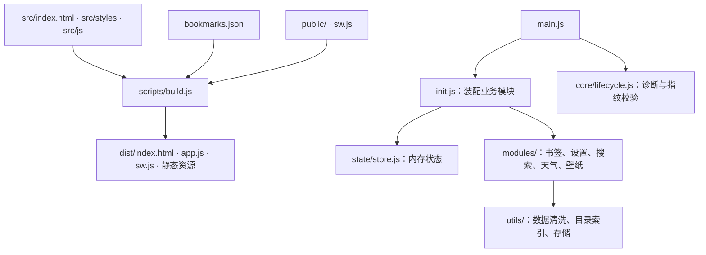
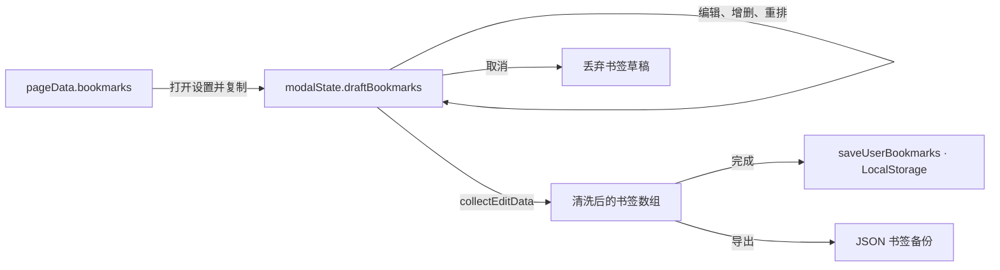

# Glass Start 架构说明

本文说明源码组织、状态流、缓存策略和验证边界。使用与部署见 [README.md](../README.md)，工程约束见 [AGENTS.md](../AGENTS.md)。实现细节以对应源码为准，业务配置统一维护在 `src/js/config/`：通用常量与运行时配置见 `constants.js`，主题、壁纸、引擎及图标配置见各对应模块。

## 目录

- [模块索引](#模块索引)
- [模块与构建](#模块与构建)
- [书签与设置状态](#书签与设置状态)
- [壁纸与主题](#壁纸与主题)
- [切屏与页面生命周期](#切屏与页面生命周期)
- [浮层与无障碍](#浮层与无障碍)
- [离线缓存与更新](#离线缓存与更新)
- [搜索与天气](#搜索与天气)
- [安全与验证边界](#安全与验证边界)

## 模块索引

按功能查找模块；具体函数、导出和配置值以源码为准。

| 功能 | 源码入口 |
| :--- | :--- |
| **通用常量与运行时配置** | `src/js/config/constants.js` |
| **首屏主题与 Safari 预渲染** | `src/js/config/themes.js` |
| **首屏预设壁纸清单** | `src/js/config/backgrounds.js` |
| **搜索引擎元数据与图标** | `src/js/config/engines.js` `src/js/config/engine-icons.js` |
| **天气图标映射** | `src/js/config/weather-icons.js` |
| **全局状态与 DOM 缓存** | `src/js/state/store.js` `src/js/state/dom.js` |
| **书签体系与双栏分类导航** | `src/js/modules/bookmarks.js` |
| **时钟、快捷键与鸣谢** | `src/js/modules/clock.js` |
| **壁纸持久化与即选即存** | `src/js/modules/wallpaper.js` |
| **设置弹窗与生命周期管理** | `src/js/modules/settings.js` `src/js/core/overlay-stack.js` |
| **搜索联想与匹配** | `src/js/modules/search.js` `src/js/utils/bookmark-search.js` |
| **气象数据与显示** | `src/js/modules/weather.js` `src/js/utils/weather-model.js` |
| **浏览器主题色与底色** | `src/js/core/theme-engine.js` |
| **双屏状态、输入与唤醒协调** | `src/js/core/screen-state.js` `src/js/core/screen-input.js` `src/js/core/app-wake.js` `src/js/core/lifecycle.js` |
| **指针 3D 倾斜与高光** | `src/js/core/gestures.js` |
| **拖拽重排与 FLIP 动画** | `src/js/core/drag-sort.js` |
| **全局事件与焦点管理** | `src/js/core/events.js` |
| **文本转义与 URL 处理** | `src/js/utils/helpers.js` |
| **IndexedDB 大图壁纸持久化** | `src/js/utils/idb.js` |
| **本地图标同步与格式转换** | `scripts/sync-icons.mjs` `public/icons/` |
| **启动装配与生命周期入口** | `src/js/init.js` `src/js/main.js` |
| **天气共用数值清洗** | `src/js/utils/weather-data.js` |
| **目录共用索引** | `src/js/utils/category-catalog.js` |
| **书签草稿编辑** | `src/js/modules/bookmark-editor.js` `src/js/state/bookmark-draft.js` |
| **设置事件装配** | `src/js/core/settings-events.js` |
| **确认框与壁纸渲染** | `src/js/core/dialogs.js` `src/js/core/wallpaper-renderer.js` |
| **Service Worker 与缓存分池** | `sw.js` |

## 模块与构建

应用使用原生 ES 模块与 Web API，无 npm 运行时依赖。Tailwind CSS v4 和 esbuild 仅参与开发与构建；TypeScript 用于类型检查，Acorn 和 PostCSS 分别用于 DOM 与 CSS 静态校验，不进入生产页面。

- `main.js`：启动初始化与生命周期诊断；业务之间通过模块导入调用。
- `state/store.js`：持有 `state`、`modalState`、`pageData`，均为普通可变对象；调用方显式更新并触发渲染，不自动订阅变化。
- `state/dom.js`：集中缓存通过 `dom.xxx` 或静态键访问的节点，新增或更名此类节点时同步更新 `cacheDOM()` 与 `types.d.ts` 的 `DOMCache` 类型。仅用于标签关联、无障碍描述或锚点的 ID 无须缓存。
- `core/`：包含浮层、手势等基础设施，也包含事件装配和切屏等业务协调入口；不是严格独立的底层。
- `utils/`：提供 URL 与文本清洗、目录索引、IndexedDB 存储等共用能力。

构建读取 `package.json` 版本号并生成版本徽章；每次构建生成统一指纹，注入 HTML、应用脚本与 Service Worker。HTML 引用的 `app.js` 同时携带版本查询参数。

构建在内存中传递并内嵌本次编译的 CSS，不共享磁盘中间文件。空 CSS、编译或压缩失败会阻断构建；整个 `dist/` 的并发写入仍不保证事务性。HTML 使用唯一构建插槽注入入口、样式和 SVG；标记缺失、重复或顺序错误会阻断构建。主题、壁纸清单、引擎元数据/图标、天气图标与天气清洗脚本分别从 `config/`、`utils/weather-data.js` 注入，避免维护副本。

首屏共享配置来自 `config/backgrounds.js`、`config/engines.js`、`config/engine-icons.js`、`config/weather-icons.js`；`src/index.html` 只保留注入插槽。lint 校验壁纸与主题/色调数组长度、引擎键集合、本地图标文件存在性及插槽唯一性；`test/infra-config-injection.test.mjs` 校验产物包含注入值且无残留插槽。

`public/` 在构建时复制到 `dist/`；`src/index.html` 是构建模板。修改构建脚本或其加载的辅助脚本后需重启开发服务。

## 书签与设置状态

`bookmarks.json` 提供默认快捷书签和分类目录，构建时由 `config/constants.js` 导入。用户配置保存在 LocalStorage：快捷书签使用 URL 键列表，自定义名称、简介和图标使用元数据覆盖；`getDerivedBookmarks()` 从目录与覆盖数据派生当前条目。旧版完整书签数组由 `migrateBookmarksStorage()` 迁移。

`utils/category-catalog.js` 为派生、保存、分类排序和搜索提供共用索引，名称、URL、简介及分类／书签图标变化时重建。持久化使用完整的 `normalizeUrl()` 键，搜索使用自己的去重键，两者语义不同。`normalizeBookmark()` 共用于导入、草稿收集和保存；简介缺省时继承目录，显式空字符串表示清空。

分类导航通过 transform 移出首屏，原生图片懒加载仍可能提前请求其图标。因此导航专用书签图片先保存为 `data-nav-src`。Chrome 在壁纸恢复后的前台空闲任务中，以低请求优先级提前加载前 3 个分类的本地图标，让加载和淡入尽量避开首次切屏；远程图标和其余分类保持延迟。其他浏览器仍在首次进入或会话恢复到导航时设置 `src`，随后由浏览器原生 `loading="lazy"` 按可见距离加载。快速切屏不等待准备任务，往返切屏复用现有节点。侧栏及分类标题的分类图标直接设置 `src`，并在首屏空闲任务中预加载，减少首次切入时的图标空位。

`state/bookmark-draft.js` 集中处理草稿替换、增删、字段修改和重排；事件与编辑器只负责调用和渲染。书签重置通过书签模块恢复入口执行，壁纸状态由壁纸模块维护。

保存与导出直接读取内存草稿。DOM 用于事件定位、焦点管理和拖拽测量；FLIP 动画会读取布局。

拖拽插入标记只更新旧目标和新目标；目标行与插入方向未变时跳过样式类写入，避免高频拖拽使整组行的样式反复失效。

从备选目录添加快捷书签时，按 URL 定位目录模型并复制名称、图标和简介，避免丢失本地图标而转向外部服务。图标失败后的名称编辑只更新首字徽标，不触发重试；待执行的 URL 图标预览在设置关闭或草稿被替换后作废。

书签挑选器按目录索引复用卡片和图片节点；重复打开时不重建列表，草稿 URL 集合变化时只修改受影响卡片的禁用状态及提示。目录内容变化时重建，避免沿用旧图标。

设置职责按模块划分：

| 模块 | 职责 |
| :--- | :--- |
| `modules/settings.js` | 打开、完成、取消、导入导出与重置 |
| `modules/bookmark-editor.js` | 草稿行渲染、计数、收集及目录挑选器 |
| `core/settings-events.js` | 设置控件事件、草稿字段更新和拖拽装配 |
| `core/drag-sort.js` | 鼠标与触屏重排、迟滞判定和 FLIP 动画 |
| `core/dialogs.js` | 共用确认框，不依赖设置或壁纸业务 |

## 壁纸与主题

壁纸选择即存，背景暗度与快捷书签则在点击「完成」时提交。取消设置不撤销已经保存的壁纸。

`modules/wallpaper.js` 管理选择、预加载、图片上传及旧数据迁移；`core/wallpaper-renderer.js` 管理图层切换；`core/theme-engine.js` 管理采样与浏览器外壳颜色。

壁纸恢复只读取一次新版选择记录，缺失时才读取兼容数据。渲染器合并同一 URL 的待完成加载／解码，只保留最近一张成功解码的图片；重复应用已显示或正在淡入的壁纸不重播动画。自定义图片仍按当前遮罩和视口重新采样主题，失败后释放待完成任务以允许重试。

网络直链预览完成加载与解码后，将同一个图片对象交给渲染器；再次选择时可复用渲染器最近加载的图片。同一选择在图片准备和存储期间共享任务，失败后允许重试。保存前比较 IndexedDB 中的实际选择记录，内容相同时跳过写入；LocalStorage 的轻量提示也只在内容变化时更新。

壁纸内容（Data URL 或图片 URL）与预设索引在同一个 IndexedDB 事务中写入。写入及删除等待事务 `complete` 才报告成功；失败时保留原记录。连续选择通过请求序号和提交队列协调，迟到的图片加载结果不能覆盖新选择。上传图片按配置限制尺寸并压缩。

LocalStorage 仅保存背景索引和轻量首屏提示，新选择不写入 Base64。读取时先尝试迁移旧记录，再优先使用 IndexedDB 选择记录；没有新版记录时兼容内存、旧 IndexedDB 键和旧 LocalStorage 键。迁移成功后才清理本次读取的旧值。

首帧与运行时共用 `config/themes.js` 的预设主题与深浅底色；自定义壁纸可由运行时采样决定主题。HTML 预渲染遇到 IndexedDB 自定义壁纸时先恢复底色，等待应用异步恢复图片，避免误请求默认预设。

## 切屏与页面生命周期

`core/screen-state.js` 管理 `state.currentSection`（`start` / `nav`）和过渡锁。CSS 状态类决定两屏位置，`inert` 与无障碍属性隔离离屏内容。

- `core/screen-input.js` 将滚轮在短时间窗口内的同向位移累计到 `CONFIG.GESTURE.SWIPE_THRESHOLD`；反向输入或连续 `WHEEL_IDLE_MS`（180ms）无输入时，开始新一轮。切屏后及动画期间的同向尾部输入不再触发切屏。滚轮事件没有可靠的跨浏览器手势结束标志，静默间隔是近似边界，并非物理惯性检测。
- 内容尚未到顶时，该轮滚轮输入只滚内容；到顶后须重新向上滚动才能返回。侧边栏、天气、编辑按钮及输入控件的手势不参与切屏；带修饰键的滚轮和横向滚动交给浏览器。
- 滚轮识别使用被动监听，不持续拦截导航内容区的滚轮事件；利用上次观察到的内容位置和到顶事件时间，避免合成线程先滚到顶后误判为返回手势。仅在切屏动画期间临时阻止原生滚动，完成、超时、减弱动效或唤醒校准均移除拦截。分类联动先读取侧栏几何信息，再更新高亮，避免写后立即读布局。
- 触屏按滑动方向及 `CONFIG.GESTURE` 中的位移、平均速度阈值识别切屏；手指落下时记录内容是否在顶部，同一次滑动滚到顶部不会接着返回。全局触摸监听为被动监听；允许取消默认滚动的 `touchmove` 仅绑定首屏和处于顶部的导航内容区，导航内容滚离顶部即解除局部监听。局部监听在触摸开始前安装，确保浏览器仍允许取消切屏手势的默认滚动。多指、取消、失焦或唤醒会清除本轮触屏状态。
- 导航页返回首屏须在内容顶部；顶部返回按钮不受此滚动位置限制。键盘输入及浮层状态由 `core/events.js` 协调。
- 所有切屏入口在动画期间不反转、不重启、不排队；过渡时长及曲线由 CSS 定义。过渡通常在 `transitionend` 完成；事件缺失时以配置的动画时长加缓冲兜底。零时长或减弱动效立即完成，过渡中开启减弱动效也会解除锁定。
- 切屏前清除卡片 3D 倾斜，动画期间不重新启用倾斜；已归零的滚动位置不重复写样式。从内容中间返回时，导航列表退场后才归零，避免首帧重绘列表及可见内容跳动；进入导航前仍确保列表位于顶部。

`reconcileScreenState()` 清理过渡任务、恢复保存的目标屏、校准状态类及可访问性，并移除预渲染类 `.nr`。正常进入、退出与校准共用目标状态应用逻辑。它本身不执行 `display` 重置；默认无明确目标且仍在过渡时会跳过，唤醒调用传入 `force=true`。

`core/app-wake.js` 的 `handleAppWakeUp()` 统一处理 `pageshow` 和恢复可见的 `visibilitychange`：清理残留交互及手势状态，强制校准屏幕、时钟与天气刷新，并检查 Service Worker 更新；BFCache 恢复时校准首屏合成层 `willChange`。校准时在禁用过渡的情况下提交目标布局，再恢复过渡，避免补播动画；不重建 DOM。

Chrome（首屏已有的 `.is-chrome` 标记）为两屏保留 `will-change: transform`，导航退出后保留离屏玻璃结构，减少重复进入时的绘制与 GPU 进程任务开销；离屏导航仍由位置、`pointer-events: none`、`inert` 与无障碍属性隔离。其他浏览器在导航退出后继续隐藏并关闭离屏毛玻璃，仅在 `body.is-screen-transitioning` 期间申请合成提示，保留 WebKit 原有回收策略。壁纸切换仍通过 `.is-crossfading` 动态分配 `will-change`。`blur` / `pagehide` 添加 `body.tab-blurred`，收到下一次用户交互后解除，防止悬停残留。

导航卡片高光使用固定渐变纹理，指针每帧只改变相对卡片中心的位移与倾斜，不逐帧重建渐变背景。倾斜通过鼠标 Pointer Events 驱动，触摸输入会清除倾斜；支持悬停和精细指针的能力变化无需刷新页面即可生效。高光伪元素保留渐变实际可见的区域并由卡片裁切；悬停且允许动效时才设置合成提示，离开或启用减弱动效后释放提示。

`core/lifecycle.js` 提供 `window.__GLASS_DIAG__`（`verify`、`probe`、`dump`、`log`）：

1. 启动时比较 HTML 与应用指纹。不一致时尝试以 SessionStorage 记录刷新时间，按冷却期限制刷新；存储不可用时该限制无法跨刷新可靠保留。
2. `snapshotHealth()` 在首屏应显示且未过渡时检查变换矩阵及哨兵元素的宽度；它不检测真实像素或导航页完整可见性。
3. 连续异常先校准状态，再切换首屏 `will-change` 并读取布局；第三次仅记录 `heal-reload-blocked` 并结束，不刷新页面。

日志只保存在有容量上限的内存缓冲中；BFCache 恢复可保留，重新加载清空。控制台调用 `window.__GLASS_DIAG__.dump()` 取证，没有诊断 UI。

## 浮层与无障碍

`OverlayStack` 维护 LIFO 栈，Escape 由 `core/events.js` 调用栈顶关闭函数；遮罩点击交给对应浮层处理。

浮层由低到高分为下拉、设置、辅助弹窗和确认层，对应 z-index 为 150 / 1000 / 2000 / 9999；具体样式见源码。

受管理的弹窗可见性只由 `OverlayStack.push()` / `.pop()` 驱动。层叠栈内部统一设置 `hidden`、`aria-hidden`、入场动画及延迟隐藏，切换前取消旧任务。普通提示区、折叠内容可独立使用 `hidden`；下拉组件仍使用自己的状态类展示，但同样注册关闭回调。

栈内存在模态弹窗时锁定 body 滚动；全部模态弹窗关闭后解锁。打开栈顶弹窗时将焦点移入其中，通过 `inert` 隔离沿祖先路径的兄弟区域；Tab / Shift+Tab 在弹窗内循环。关闭后优先恢复下层弹窗或有效触发元素的焦点，并恢复原有 `inert` 状态。

关闭不存在的浮层直接返回。隔离同步先计算目标集合，只恢复不再隔离的元素并隔离新进入集合的元素；持续隔离的区域保留原始基础状态，避免重复解除／设置 `inert` 引起 DOM 和无障碍树更新。

## 离线缓存与更新

`sw.js` 只处理匹配路由的 GET 请求；其他请求交给浏览器。

| 缓存 | 内容与策略 |
| :--- | :--- |
| `CORE_CACHE` | 按构建版本隔离；HTML、JS/CSS 缓存优先，清单后台重验证；安装时预存核心资源 |
| `FAVICON_CACHE` | 外部图标缓存优先；网络请求有超时，按容量限额 FIFO 淘汰 |
| `IMG_CACHE` | 同源图片按构建分池，先查缓存再请求网络；保留上一版供网络失败或服务端错误时回退 |

缓存命名、配额、超时及预缓存清单统一以 `sw.js` 为准。

安装时校验核心资源存在且响应成功，并核对 HTML 与应用指纹；失败则删除残缺核心池并拒绝安装。核心文档和脚本请求使用 `reload`，首张预设壁纸使用 `no-cache` 条件重验证。安装时不预取外部引擎图标；自定义书签的外部图标按实际请求缓存。

`src/js/core/service-worker-updates.js` 在启动、页面唤醒、恢复联网及前台每五分钟检查更新，使用 `updateViaCache: 'none'`，唤醒检查按五分钟节流。新版安装成功后默认保持 waiting，起始页左上角显示“有新版本”；用户点击并确认后发送 `ACTIVATE_UPDATE`，worker 重新校验核心缓存并调用 `skipWaiting()`，发起页在接管后刷新。其他已受控标签页只显示提示，各自确认后才刷新；编辑弹窗打开时背景更新按钮不可交互。不调用 `clients.claim()`，避免接管未受控页面。超时可重试，不清空缓存或注销 worker；旧客户端全部退出后仍可自然激活。

核心缓存命中时不后台重验证；缓存丢失后的网络回退不逐次校验指纹，由启动检查补充检测 HTML/JS 不一致。

外部图标请求可缓存成功或 `opaque` 响应；`opaque` 的状态与正文不可读，因此这不是内容安全校验。图标显示失败由前端捕获阶段监听处理，尝试 Google S2，最终回退首字母徽标。

同源图片与外部图标中相同的并发请求共享未完成任务，各消费者获得独立响应副本。合并键包含 URL、请求头、模式与凭据等请求属性；缓存写入完成前保留任务，避免响应已返回但缓存尚未提交时重复下载。单个消费者取消不终止共享下载，失败后释放任务以允许后续重试。

同源预设书签图标使用 `./icons/<host>.png`。`scripts/sync-icons.mjs` 默认复用可解码且尺寸合规的本地 PNG，仅补齐缺失或损坏项；`npm run sync:icons:refresh` 全量刷新本地图标。下载时优先匹配 `OFFICIAL_HOST_SOURCES` 官方高清直链，其余回退 Google S2，遇到 404 自动反向尝试 `www` 补全/去前缀，经 macOS `sips` 转换为正方形 PNG。跨域自定义壁纸不进入上述图片池，由页面 CSP 与浏览器网络处理；IndexedDB 仅保存其 URL，不保证远程图片离线可用。

## 搜索与天气

`utils/bookmark-search.js` 负责纯数据匹配与排序，`modules/search.js` 负责候选装配、请求和界面。后者混排本地书签与网络联想，容量与防抖由配置控制；先显示本地结果，等待网络时预留骨架行，减少列表高度变化。

本地匹配优先级为名称全等、名称前缀、名称包含、URL 包含、简介包含、名称模糊、其他字段模糊。拼写容错采用支持相邻字符交换的受限 Damerau–Levenshtein（OSA）距离，编辑距离容差与最小查询长度由配置控制。距离矩阵复用 `Int32Array`，容量不足时扩容。

Bing / Google 使用 JSONP，Wikipedia 使用 CORS `fetch`。相同引擎与查询共享未完成请求及候选节点，成功的空结果也进入短期缓存。请求序号 `activeSuggestReqId`、超时和关闭清理共同隔离过期响应；输入变化时即作废旧请求，防抖等待期间及关闭列表后，旧结果不能覆盖新状态。选中与打开操作读取内存结果，DOM 仅展示并传递索引。

`utils/weather-model.js` 负责天气代码、地点及响应转换，调用方传入配置和时间；`modules/weather.js` 使用 IP 定位与地名解析获取位置，再请求 Open-Meteo。按缓存有效期决定是否更新，唤醒时重新检查。已知地点预报先显示，后台定位及可能发生的地点变更刷新保留在同一个任务中；期间的唤醒和手动刷新共享该任务，完成或失败后释放。

湿度、风速和降水概率分别按配置分档选择图标，不表示降雨强度或气象灾害等级。日出日落显示由当前时间与预报时间选择。数值通过共用的 `weatherNum()` 清洗，时间经 `weatherTime()` 校验，地点等文本在 HTML 输出时转义。

## 安全与验证边界

动态 HTML 文本经 `escapeHtml()` 转义；`safeUrl()` 检查 HTTP(S)、图片 Data URL 及本地图标路径后返回适合 HTML 属性的转义值，不应将该返回值直接当作未转义原始 URL 使用。CSP 同时存在于 HTML 与 `public/_headers`，后者需托管平台实际支持。当前内联脚本及样式仍使用 `'unsafe-inline'`；不能据此声称消除了所有 XSS 风险。

测试入口、命令和环境要求见 README。以下边界用于解释验证结果：

- 生产构建编译时裁掉 `testing/bridge.js`；测试服务器按需在内存编译带接口的脚本，仍需预先设置 `window.__GLASS_TEST__ = true` 才挂载接口，不覆盖生产 `dist/app.js`。
- `infra-module-boundaries.test.mjs` 检查静态导入无环并验证关闭测试接口的页面启动；无环不等于严格分层。
- 浏览器测试使用 Chrome CDP，模拟移动视口和触摸输入不等于真机 Safari / iOS 验证。导航完成与切屏完成分别等待，避免固定延时掩盖竞态。
- W3C 脚本提交 HTML 给在线 Nu 校验器，错误阻断发布；警告、信息及已列明的现代 CSS 兼容性消息分类展示，CSP 警告提示另行核对托管响应头。退出码 0 表示无阻断错误，1 表示页面校验错误，2 表示服务或响应异常导致校验未完成；未完成时需恢复后重试。通过不代表完整无障碍、视觉或功能合规，样式完整性由基础架构测试另行检查。
- `typecheck` 使用 JSDoc 与 `types.d.ts` 检查核心模型，包含负向类型契约；覆盖范围以 `tsconfig.json` 为准，尚未覆盖全项目。
- 生命周期约束通过页面行为测试验证；Service Worker 测试执行完整脚本及真实升级流程，不通过截取函数体判断实现是否正确。
