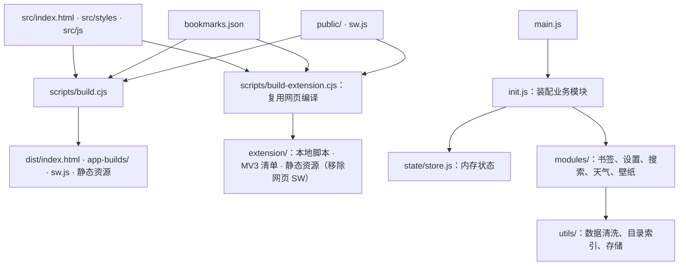
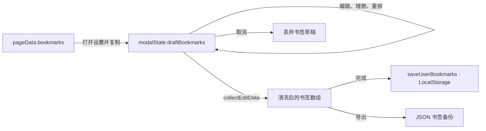

# Glass Start 架构说明

> “如无必要，勿增实体。”——保持极简透明，拒绝过度工程。

本文说明源码组织、状态流、缓存策略和验证边界。使用与部署见 [README.md](../README.md)，工程约束见 [AGENTS.md](../AGENTS.md)。实现细节以对应源码为准，业务配置统一维护在 `src/js/config/`：通用常量与运行时配置见 `constants.js`，主题、壁纸、引擎及图标配置见各对应模块。

## 目录

- [目录速查](#目录速查)
- [模块索引](#模块索引)
- [模块边界与状态归属](#模块边界与状态归属)
- [模块与构建](#模块与构建)
- [书签与设置状态](#书签与设置状态)
- [壁纸与主题](#壁纸与主题)
- [切屏与页面生命周期](#切屏与页面生命周期)
- [浮层与无障碍](#浮层与无障碍)
- [离线缓存与更新](#离线缓存与更新)
- [搜索与天气](#搜索与天气)
- [安全与验证边界](#安全与验证边界)

## 目录速查

| 路径 | 用途与维护位置 |
| :--- | :--- |
| `src/` | 应用源码：`index.html` 为构建模板，`styles/` 为样式，`js/` 为逻辑，`svg/` 为 SVG 精灵，`extension/` 为 Chrome 扩展清单与图标 |
| `src/js/config/` | 业务配置与首屏共享配置；构建时注入 HTML，避免维护内联副本 |
| `public/` | 构建时原样复制的静态资源，包括 `icons/`、`wallpapers/`、许可文件、PWA 清单及托管响应头规则 |
| `bookmarks.json` | 默认快捷书签与分类目录的编辑入口，构建时打包进应用 |
| `sw.js` | Service Worker 源文件，构建时注入缓存版本后输出到 `dist/sw.js` |
| `scripts/` | 构建、开发服务、静态检查、图标同步等工程工具；CommonJS 使用 `.cjs`，ES 模块使用 `.mjs` |
| `test/` | 顶层保留回归用例、运行器及性能评测入口；`support/` 集中 CDP、测试服务器、共用辅助函数和测试选择规则；测试产物位于已忽略的 `test/artifacts/` |
| `docs/` | 持续维护的架构说明、切屏评测说明及可选 Safari 参考清单 |
| `docs/reports/` | 必要的历史修复、验证及性能依据，统一命名为 `YYYY-MM-DD-topic.md`；结论以报告所列版本和环境为限，不重复记录当前架构或每轮开发过程 |
| `docs/performance/`、`docs/assets/` | 性能原始数据与文档图片 |
| `dist/`、`extension/` | 网页版与 Chrome 扩展的构建产物，由构建生成，不手工修改，不纳入 Git |
| `.github/` | CI、部署工作流及 Issue / PR 模板 |
| 根目录工程文件 | `package.json` 与锁文件管理依赖和命令；`tsconfig.json` 与 `tsconfig.sw.json` 管理页面及 Service Worker 类型检查；`wrangler.jsonc` 配置 Cloudflare 部署；`start.command` 为 macOS 启动入口 |

`test/artifacts/` 保存本地测试输出。已归档的调试产物可在 `test/artifacts/archive/YYYY-MM-DD/` 的 `index.json` 中按原路径查找，索引记录文件清单和 SHA-256。该目录由 Git 忽略，历史报告引用的本地产物仅在保有相关记录的工作区可查。

历史验证包括 [2026-10-24 审计修复](./reports/2026-10-24-audit.md)、[2026-10-28 目录与扩展核实](./reports/2026-10-28-structure-verification.md)、[2026-10-28 多语言验证](./reports/2026-10-28-english-localization.md)、[2026-10-29 模块修复](./reports/2026-10-29-module-review.md) 和 [2026-11-08 v5.5.0 验收](./reports/2026-11-08-regression-verification.md)。性能对照见 [2026-10-23 Safari](./reports/2026-10-23-safari-performance.md)、[2026-10-25 切屏基准](./reports/2026-10-25-transition-performance.md) 和 [2026-10-29 切屏与恢复](./reports/2026-10-29-transition-audit.md)。结果仅适用于各报告所列源码与环境。

## 模块索引

### 按问题定位

先按功能找到主入口，再沿实际导入关系阅读。静态 DOM 在 `src/index.html`，运行时生成的节点由各功能模块渲染，缓存登记与类型分别在 `src/js/state/dom.js`、`src/js/types.d.ts`。表内 JS 路径相对 `src/js/`，CSS 相对 `src/styles/`，测试片段可用于 `npm test -- <片段>`。

| 功能 / 问题 | DOM 或检索词 | 逻辑入口 | 样式入口 | 直接相关测试片段 |
| :--- | :--- | :--- | :--- | :--- |
| 启动、全局按键与失焦 | `init()`、`keydown`、`tab-blurred` | `main.js` → `init.js` / `events.js` | `page.css` | `lifecycle.test`、`ui-screen-gestures` |
| 双屏、滚轮、触摸与恢复 | `startSection`、`navSection`、`navContent` | `core/screen-state.js`、`core/screen-input.js` | `page.css`、`animations.css` | `ui-screen-`、`ui-input-device-performance` |
| 快捷书签、分类导航与图标 | `bookmarks`、`navCategories`、`sidebarList` | `modules/bookmarks.js`；字段与 URL 在 `utils/bookmark-model.js`，图标在 `utils/favicon.js`，目录索引在 `utils/category-catalog.js` | `page.css`、`glass.css` | `data-i18n`、`ui-nav-rendering`、`infra-theme-favicon` |
| 搜索、引擎及本地/网络联想 | `searchInput`、`engineBtn`、`suggestionMenu` | `modules/search.js`、`modules/search-events.js`；`utils/bookmark-search.js`；`config/engines.js`、`config/engine-icons.js`、`config/engine-head.js` | `search.css` | `data-request-performance`、`data-pure-models`、`data-bookmarks-features` |
| 设置打开、完成、取消与重置 | `editModal`、`saveEditBtn`、`tabAppearance`、`tabData` | `modules/settings.js`；控件事件在 `modules/settings-events.js` | `settings.css`；外观/数据页布局在 `glass.css` | `data-settings-save`、`ui-modal-accessibility`、`ui-rendered-contracts` |
| 书签草稿、挑选与拖拽 | `draftBookmarks`、`editList`、`bookmarkPicker` | `state/bookmark-draft.js`、`modules/bookmark-editor.js`、`modules/bookmark-picker.js`、`modules/bookmark-drag.js` | `settings.css`、`glass.css` | `data-bookmark-picker`、`data-audit-regressions`、`data-pure-models` |
| 壁纸预览、取消、保存与主题色 | `bgLayer`、`presetWallpaperGrid`、`urlBgInput` | `modules/wallpaper.js`；`core/wallpaper-renderer.js`、`core/theme-engine.js`；`utils/idb.js`；`config/backgrounds.js`、`config/themes.js` | `page.css`；壁纸网格在 `glass.css` | `data-wallpaper`、`infra-theme-favicon` |
| 天气、定位与缓存显示 | `weatherBtn`、`weatherPopover`、`weatherNum` | `modules/weather.js`；`utils/weather-model.js`、`utils/weather-data.js`；`config/weather-icons.js` | `page.css`、`glass.css` | `data-weather-features`、`data-request-performance`、`data-priority-fixes-unit`、`data-pure-models` |
| 语言、目录翻译与旧链接兼容 | `data-i18n`、`languageModal`、`canonicalBookmarkUrl` | `core/i18n.js`；`config/language.js`、`config/locales/` | `page.css`；语言选项在 `glass.css` | `data-i18n` |
| 模态层叠、焦点、确认框 | `OverlayStack`、`confirmModal`、`inert` | `core/overlay-stack.js`、`core/dialogs.js`；具体弹窗入口在 `modules/settings.js` | `settings.css`、`glass.css`、`animations.css` | `ui-modal-accessibility`、`ui-overlay-modals` |
| 时钟与日期 | `clock`、`date` | `modules/clock.js` | `page.css` | `lifecycle.test`、`infra-module-boundaries` |
| 快捷键速查与开源致谢 | `shortcutModal`、`creditsModal` | `modules/settings.js`（内容、开关）、`modules/settings-events.js`（控件事件） | `glass.css` | `ui-overlay-modals` |
| 指针倾斜、卡片高光与书签行位移 | `pointermove`、`--mouse-x`、`animateBookmarkLayout` | `core/gestures.js`；`modules/bookmark-motion.js` | `glass.css`、`animations.css` | `ui-rendering-performance`、`ui-input-device-performance`、`data-animation-cleanup-unit` |
| 网页离线缓存、升级与清理 | `ACTIVATE_UPDATE`、`updateNotice`、`clearCacheBtn` | 根目录 `sw.js`；`core/service-worker-updates.js`；清理流程在 `modules/settings.js`，按钮绑定在 `modules/settings-events.js` | `page.css` | `infra-sw-`、`data-audit-regressions` |
| 网页构建、并发发布、首帧与扩展差异 | 构建插槽、`publishWebBuild`、`__GLASS_EXTENSION__` | 根目录 `scripts/build.cjs`、`scripts/publish-build.cjs`、`scripts/html-template.cjs`、`scripts/build-extension.cjs`、`src/extension/manifest.json` | `main.css` 为唯一编译入口 | `infra-build-pipeline`、`infra-security`、`infra-chrome-extension`、`infra-theme-favicon` |

### 样式索引

| 文件 | 职责与边界 |
| :--- | :--- |
| `src/styles/main.css` | 唯一装配入口：导入顺序、Tailwind `@source`、`@theme` 与自定义变体；不继续堆放功能选择器。 |
| `src/styles/page.css` | 全局变量、字体、焦点/按压反馈、双屏、起始页与分类导航、天气浮层、安全区及通用触控规则。 |
| `src/styles/search.css` | 搜索框聚焦、搜索按钮、引擎菜单、联想列表及其选中/悬停状态。 |
| `src/styles/settings.css` | 切屏模式选择控件、书签编辑行/拖拽标记、挑选器交互、设置页签/操作按钮、导入拖放和确认框。 |
| `src/styles/glass.css` | 共用玻璃材质、卡片高光/倾斜；设置内外观、壁纸网格和数据面板布局；语言选项及降低透明度降级。 |
| `src/styles/animations.css` | 关键帧、入场/退出与减弱动效规则。 |

CSS 通过 `main.css` 按其 `@import` 顺序编译为内联样式，不增加浏览器样式请求。`scripts/lint.mjs` 扫描 `src/styles/` 下全部 CSS 文件；新增样式文件须同时加入入口导入与本索引。布局、材质和动效可以共用于同一控件，修改前核对对应文件中的同名选择器。

### 数据与共享机制

- 共享书签目录和中文默认快捷入口维护在根目录 `bookmarks.json`。语言入口差异、译文和英文默认快捷入口见 `config/locales/catalog-*.json`。运行时配置位于 `config/`，其中 `constants.js` 定义通用阈值、存储键及计时配置。
- 全局模型见 `state/store.js`，草稿操作见 `state/bookmark-draft.js`；新增 DOM 缓存键同步 `state/dom.js` 与 `types.d.ts`。
- HTML 安全输出和列表键盘导航用 `utils/helpers.js`；书签字段及 URL 规则用 `utils/bookmark-model.js`；图标输出与失败处理用 `utils/favicon.js`；LocalStorage JSON 读写用 `utils/storage.js`，壁纸 IndexedDB 用 `utils/idb.js`；目录索引用 `utils/category-catalog.js`。主应用测试接口仅在 `testing/bridge.js`，生产构建裁除；搜索内部状态仅通过只读访问器暴露，不提供测试专用的状态写入口。
- 本地图标下载/转换入口为根目录 `scripts/sync-icons.mjs`，资源在 `public/icons/`；测试共用 CDP 和服务辅助模块在 `test/support/`，回归用例保持 `test/` 顶层。

## 模块边界与状态归属

局部任务先读上方定位表中的拥有模块，再查其直接调用方、配置和对应测试。目录归属取决于实际职责，文件变大本身不是拆分理由；不建立统一转发入口、通用业务框架或新的状态容器。移动函数时同步调整消费方的直接导入，不在旧模块保留兼容转发。

### 依赖方向

| 所在层 | 可导入范围 | 边界 |
| :--- | :--- | :--- |
| 顶层 `main.js / init.js / events.js` | 顶层及下方各运行时层 | 启动、唤醒、全局快捷键及跨业务协调；不承载控件内部的数据流程。 |
| `modules/` | 业务模块、core、utils、state、config | 按具体功能组织；控件事件可放在对应的 `*-events.js`，不得反向导入顶层装配或测试模块。相关业务可直接调用，不强行引入消息总线。 |
| `core/` | core、utils、state、config | 页面共用机制；不导入业务模块，业务回调由顶层装配，例如切屏钩子。 |
| `utils/` | utils、config；需要翻译或共享 URL 标识时可使用 `core/i18n.js` | 不导入共享应用状态、DOM 缓存、业务或顶层装配；DOM 工具只操作显式传入的节点。 |
| `state/` | state、config | 保存共享数据及草稿操作；不渲染、不绑定事件、不发请求或落盘。 |
| `config/` | config；本地化配置可使用 `core/i18n.js` | 提供业务配置；根目录书签 JSON 只从 `constants.js` 载入。i18n 自身只依赖语言常量，避免形成环。 |
| `testing/bridge.js` | 以上各层 | 仅适配现有测试接口。唯一反向入口是 `main.js` 受标记控制的动态导入，生产构建必须裁除。 |

`infra-module-boundaries.test.mjs` 扫描全部 `src/js/**/*.js`，检查静态导入、转发导出和字面量动态导入的依赖方向及无环性，同时验证生产包不含第三方运行时库或测试适配层。运行入口为 `npm test -- infra-module-boundaries`。检查覆盖依赖约束，具体业务职责仍须按下表判断。

### 状态与行为的拥有模块

| 数据 / 行为 | 修改入口与协作边界 |
| :--- | :--- |
| `state.engine` | `modules/search.js` 校验并更新偏好和引擎控件。用户选引擎后，由 `search-events.js` 关闭菜单并用当前查询请求联想。启动和设置重置只应用偏好。全局事件分发搜索按键与跨业务关闭。 |
| `state.currentSection`、切屏锁 | `core/screen-state.js`；输入识别在 `core/screen-input.js`，导航渲染钩子由 `init.js` 注册。 |
| 设置会话与提交阶段 | `modules/settings.js` 更新 `modalState.phase`，由阶段派生 `state.editOpen` 和按钮状态；`settings-events.js` 负责控件绑定与局部交互。 |
| `modalState.draftBookmarks`、`bookmarksChanged` | 通过 `state/bookmark-draft.js` 增删改排；编辑器负责行渲染、清洗与收集，挑选器负责目录卡片，`modules/bookmark-drag.js` 负责拖拽，删除与重排共用 `modules/bookmark-motion.js` 的 FLIP。 |
| 壁纸草稿、`state.bg / customWallpaper`、图片任务及暗度预览队列 | `modules/wallpaper.js` 管理选择、预览和提交；设置模块决定何时保存或取消。图层与取色分别在 `core/wallpaper-renderer.js / theme-engine.js`。 |
| 语言、暗度、切屏动效草稿 | `modules/settings.js` 协调草稿与顺序提交；实际暗度显示交给 wallpaper，切屏模式交给 screen-state，语言生效通过刷新完成。 |
| `pageData.categories / bookmarks` | 分类由 `init.js` 初始化；快捷书签由 `modules/bookmarks.js` 派生、保存并渲染。搜索和挑选器通过目录索引读取，不直接改目录。 |
| 搜索候选、天气请求、图层和主题内部状态 | 留在对应模块内部；跨模块只调用导出操作，不为测试新增生产状态写入口。 |
| 持久化 | 业务模块决定内容与时机；`utils/storage.js / idb.js` 只执行存储操作，不回调业务或渲染。设置保存不是跨存储的原子事务。 |
| 浮层显示、隔离与焦点 | `core/overlay-stack.js` 维护关闭顺序，原生模态负责背景隔离和 Tab 导航；顶层转交 Escape，业务提供关闭回调。 |

### 工程、样式与测试

构建入口 `scripts/build.cjs` 负责产物流程，`publish-build.cjs` 负责发布与前版回收，`html-template.cjs` 只处理模板结构，扩展构建复用网页编译。开发服务与文件监听分别在 `server.cjs / watch.cjs`。单文件通过父目录按文件名监听，并比较当前内容，编辑器原子替换后仍可继续重建。lint 的 DOM、CSS、多语言检查分别由对应辅助脚本实现，不进入浏览器。样式按上方样式索引划分布局、材质和动效，同一控件可组合使用；测试共享设施只放在 `test/support/`，业务源码不得导入。

## 模块与构建

应用使用原生 ES 模块与 Web API，无 npm 运行时依赖。Tailwind CSS v4 和 esbuild 仅参与开发与构建；TypeScript 用于类型检查，Acorn 和 PostCSS 分别用于 DOM 与 CSS 静态校验，Stylelint 用于构建产物的现代 CSS 校验，均不进入生产页面。

`.github/workflows/ci.yml` 统一执行检查与 GitHub Pages 发布：PR 运行 lint、类型、构建和 Chrome 回归；main 推送或 main 手动运行还须通过 W3C 校验，再上传本次已验证的 `dist/`。部署 job 显式依赖检查成功，直接发布该产物，不重新构建。

- `main.js`：启动初始化与构建指纹校验；业务之间通过模块导入调用。
- `init.js` 与 `events.js`：应用装配入口，分别负责初始化和跨业务的全局事件协调。
- `state/store.js`：持有 `state`、`modalState`、`pageData`，均为普通可变对象；调用方显式更新并触发渲染，不自动订阅变化。`pageData` 初始为空，由 `init()` 初始化当前语言目录，`loadBookmarks()` 派生快捷书签，配置模块不在求值时选择语言相关的默认书签。
- `state/dom.js`：集中缓存通过 `dom.xxx` 或静态键访问的节点，新增或更名此类节点时同步更新 `cacheDOM()` 与 `types.d.ts` 的 `DOMCache` 类型。仅用于标签关联、无障碍描述或锚点的 ID 无须缓存。
- `core/`：页面共用机制，包括浮层、手势、切屏、生命周期、主题与壁纸渲染；切屏通过初始化时注册的钩子协调业务，页面唤醒由顶层 `events.js` 装配。具体功能及其控件事件放在 `modules/`，跨业务的应用装配放在 `src/js/` 顶层。
- `utils/`：HTML 安全与键盘工具、书签规则、图标处理、目录索引和存储；具体边界见上表，不集中堆入 `helpers.js`。

切屏、手势和弹窗等浏览器专用入口直接使用标准 DOM API，不为缺失 `window`、`document`、`matchMedia` 或基础元素方法增加兼容分支。供 Node 静态检查或纯模型测试加载的共享模块按实际需要保留环境判断；不在测试运行器中伪造全局浏览器环境。网络、存储失败、用户输入清洗及异步任务失效仍由对应模块处理。

构建读取 `package.json` 版本号并生成版本徽章；每次构建生成统一指纹，注入 HTML、应用脚本与 Service Worker。网页版 HTML 引用不可变的 `app-builds/<构建 ID>.js`，扩展使用随包的 `app.js`。启动时指纹不一致会停止初始化。应用脚本、内联脚本与 CSS 均压缩；Service Worker 在注入版本后复用 esbuild 压缩，根目录 `sw.js` 保留可读源码，缓存、升级与并发请求回归执行生成的 `dist/sw.js`。

构建在内存中传递并内嵌本次编译的 CSS。空 CSS、编译或压缩失败会阻断构建。网页各自编译到独立目录，在发布锁内保留当前入口引用的版本化脚本，再原子替换 `dist` 链接并回收前版目录。预览服务从同一文件描述符读取元数据和正文，已开始的响应可以跨发布完成。下一次发布会回收已退出进程留下的锁。

首次从旧实体 `dist/` 迁移和扩展目录发布有单独的备份路径。若旧目录迁移中断并留下空入口，下一次网页发布会先从 `dist.migration/previous` 恢复旧产物。扩展使用固定的解包目录，发布时在 `.extension-publish/previous` 保留备份。干净的部署环境只产生当前脚本。托管端要为尚未受 Worker 控制的旧文档提供过渡期时，应保留仍被引用的版本化脚本路径。

HTML 使用唯一构建插槽注入入口、样式和 SVG。标记缺失、重复或顺序错误会阻断构建。主题、壁纸清单、引擎元数据/图标、天气图标与天气清洗脚本分别从 `config/`、`utils/weather-data.js` 注入，避免维护副本。

首屏共享配置来自 `config/backgrounds.js`、`config/engines.js`、`config/engine-icons.js`、`config/weather-icons.js`；`src/index.html` 只保留注入插槽。lint 校验壁纸与主题/色调数组长度、引擎键集合、本地图标文件存在性及对应源码插槽的唯一性；构建阶段通过 `replaceOnce()` 消费注入插槽，区域标记另检查前后顺序。lint 不检查最终构建产物。

`public/` 在构建时复制到 `dist/`；`src/index.html` 是构建模板。修改构建脚本或其加载的辅助脚本后需重启开发服务。

#### 工程脚本模块格式约定 (`.cjs` vs `.mjs`)

工程根目录 `scripts/` 下根据运行时职责与加载模式明确区分模块格式：
- **CommonJS (`.cjs`)**：用于构建主链路（`build.cjs`、`build-extension.cjs`、`html-template.cjs`、`server.cjs`、`watch.cjs`）。以同步方式调用 `child_process.execFileSync` 与 `esbuild.buildSync`，保持构建发布状态机的线性确定性与异常拦截。
- **ES Modules (`.mjs`)**：用于静态代码分析与周边工具（`lint.mjs`、`lint-dom.mjs`、`lint-css.mjs`、`lint-i18n.mjs`、`sync-icons.mjs`）。天然对齐 `src/js/` 业务源码的 ESM import 特性，便于通过动态 `import()` 原生加载业务配置（如 `backgrounds.js`、`themes.js`）并复用 Acorn 语法分析树。

Chrome 扩展通过 `npm run build:extension` 独立生成 `extension/`。`scripts/build-extension.cjs` 复用同一编译入口，在临时目录中把内联脚本按原位置和执行顺序外置，并用 `src/extension/manifest.json` 替换 PWA 清单，版本号仍取自 `package.json`。扩展使用 Manifest V3 覆盖新标签页，不包含后台脚本或网页 Service Worker；本地资源随扩展更新。编译标记 `window.__GLASS_EXTENSION__` 让搜索联想使用 JSON 请求并裁掉 JSONP 分支，其余业务和 LocalStorage / IndexedDB 存储复用网页源码。扩展与网页拥有独立的存储来源。

扩展构建将首屏样式移到首个阻塞脚本之前，并声明初始深色画布，避免脚本尚未加载时透出白底；脚本执行后仍按已保存壁纸恢复主题。产物移除 PWA 清单链接、网页 Service Worker 及托管专用文件；设置中的缓存清理文案也切换为扩展说明。开发服务只重建网页版，扩展需单独构建并在 Chrome 中重新加载。

## 书签与设置状态

### 多语言

中英文消息以 JSON 存放在 `config/locales/`，语言键与支持列表位于 `config/language.js`。构建将中英文字典与两种语言的目录配置一次性注入 head，`core/i18n.js` 通过 `window.__GLASS_I18N__` 共享上下文，主应用不再次导入字典。有效语言按手选、浏览器偏好、英文回退确定。首屏预渲染和运行时使用同一翻译接口；body 末尾同步处理 `data-i18n` 文本和白名单属性。英文前景在这一步完成前短暂隐藏，超时会解除，壁纸不受影响。

设置弹窗右上角的语言控件使用 `modalState.draftLanguage`，取消不提交，完成时在其他设置保存成功后持久化 `glass_language`，目标语言与当前页面不同时刷新；失败保留草稿。全部重置包括语言。普通数量消息通过原生 `Intl.PluralRules`，日期通过 `Intl.DateTimeFormat`；时制、单位和时区不随语言自动切换。

内置分类使用 `bookmarks.json` 的稳定 `id` 匹配英文分类，书签通过共享 URL 匹配 `catalog-en.json`。`pageData.categories` 是当前语言的目录，共享默认目录用于旧数据迁移。完整书签只维护在 `bookmarks.json`，URL 使用国际通用入口。`catalog-zh-CN.json` 记录中文入口覆盖及旧链接兼容地址，`catalog-en.json` 提供英文名称、简介及必要的英文入口覆盖；构建统一注入 `catalogs`。支持自动选择语言的网站复用共享入口；已移除的中文入口以 `legacyUrl` 保留，不参与跳转。中文旧入口通过 `canonicalBookmarkUrl()` 对应到共享 URL，`normalizeUrl()` 共用该规则；读取旧快捷书签和元数据时在内存中兼容，去重保留首次位置，下次保存写入共享键。各语言书签可配置 `url` 作为打开链接时的目标地址；`localizeBookmarkUrl()` 在快捷书签、分类导航、搜索与随机打开时统一解析，存储和去重使用共享 URL。书签按名称、简介和图标保存稀疏覆盖。草稿保留目录继承信息，导出的 1.1 备份携带 `overrides`；旧备份仍按显式字段读取。

没有保存的快捷书签配置时，中文使用 `bookmarks.json` 的默认入口，英文使用 `catalog-en.json` 的 `defaultBookmarks` URL 顺序，并从共享目录复用条目。已保存的快捷书签不随语言切换被替换；重置书签使用当前语言的默认入口。

搜索引擎默认值由 `config/engines.js` 共享给首屏预渲染和运行时：中文为 Bing，英文为 Google；有效的 `preferredEngine` 用户偏好始终优先。

天气新缓存保留代码、日期和数值，删除语言相关描述及日期标签；渲染时按语言生成。旧缓存缺少代码时，当前天气在英文界面显示未知状态，中文界面可沿用旧描述；每日预报可沿用旧文字。地点名称带语言标记，失配时异步更新；离线保留现有名称和数值。Wikipedia 的搜索及联想按界面语言选择中文或英文站，权限与 CSP 精确列出两域名。

扩展的 `_locales` 从共用字典生成，管理页元数据跟随 Chrome，页内可另选语言。网页 PWA 安装元数据及爬虫读取的默认静态元数据仍为中文。新增语言时补字典、注册、选择项和服务映射；RTL 需要另行布局验收。新增语言的回归使用 `npm test -- data-i18n`，同时核对扩展元数据与相关接口权限。

翻译消息使用完整句子，不拼接语序片段；参数只替换一次，不递归解释。缺键按英文、键名顺序回退；正式支持的语言仍须通过键和参数完整性校验。字典不存 HTML，动态模板先翻译再 `escapeHtml()`，URL 继续使用 `safeUrl()`。新增语言优先复用现有系统字体、图片和业务流程，不预建语言加载框架；RTL 需另行验证方向、箭头、拖拽及混合文本布局。

`bookmarks.json` 提供默认快捷书签和分类目录，构建时由 `config/constants.js` 导入原始数据。目录本地化在 `init()` 中完成。`loadBookmarks()` 根据语言选择默认 URL 顺序并读取用户偏好，`getDerivedBookmarks()` 从目录与覆盖数据派生当前条目。

LocalStorage 的 `glass_bookmarks` 在一次写入中保存版本、URL 顺序与名称、简介和图标覆盖。新记录缺失时兼容读取 `userBookmarkKeys` 和 `userCustomMeta`，首次保存转换为新格式。恢复默认时先写入空覆盖和默认顺序标记，再清理旧键。清理旧键是尽力回收。提交了默认顺序标记后，遗留键不会重新生效。旧标签继续写入旧键时，新记录仍是读取依据。

`utils/category-catalog.js` 为派生、保存、分类排序和搜索提供共用索引，名称、URL、简介及分类／书签图标变化时重建。持久化和搜索去重共用 `normalizeUrl()` 的共享 URL 标识，持久化另经 `normalizeBookmarkUrl()` 校验链接。`normalizeBookmark()` 共用于缓存读取、导入、草稿收集和保存；缓存中的错误条目和字段忽略，全部 URL 无效时使用当前语言默认入口，读取不改写原存储。简介缺省时继承目录，显式空字符串表示清空。

分类导航通过 transform 移出首屏，原生图片懒加载仍可能提前请求其图标。因此导航专用书签图片先保存为 `data-nav-src`。在壁纸恢复后的前台空闲任务中，以低请求优先级提前加载前 5 个分类的本地图标，让加载和淡入尽量避开首次切屏；远程图标和其余分类保持延迟。切入后安排的离屏图标空闲任务只在导航页可见且切屏已结束时执行。若回调执行时已开始退场，下次切入时重新安排。快速切屏不等待准备任务，往返切屏复用现有节点。侧栏及分类标题的图标随导航 DOM 设置 `src`，目录尚未构建时由图标空闲任务预加载。

启动时用独立的空闲任务预热导航 DOM，分类位置留到切入收尾或导航滚动时测量。如果首次切入时目录尚未预热，Chrome 保留所有卡片的网格占位，并用 `content-visibility: auto` 延后离屏卡片内部的布局和绘制。导航内容开始滚动或离屏图标空闲任务执行时，恢复完整渲染。

分类标题的高亮由导航持有一个动画对象。再次选择、离开导航、页面唤醒或开启减弱动效时结束旧动画。

`state/bookmark-draft.js` 集中处理草稿替换、增删、字段修改和重排；事件与编辑器只负责调用和渲染。书签重置通过书签模块恢复入口执行，壁纸状态由壁纸模块维护。

鼠标和触屏重排使用同一套目标判定。回到原行或滑到空白处会清除指示线，松手按当时的目标和行内位置提交草稿。

保存与导出直接读取内存草稿。导入、保存和导出按共享 URL 保留第一条有效书签及其字段。渲染器只读取现有草稿，替换列表先调用 `replaceBookmarkDraft()`。DOM 用于事件定位、焦点管理和拖拽测量；FLIP 动画会读取布局。

拖拽插入标记只更新旧目标和新目标；目标行与插入方向未变时跳过样式类写入，避免高频拖拽使整组行的样式反复失效。

从备选目录添加快捷书签时，按 URL 定位目录模型并继承名称、图标和简介。用户改名时仅写名称覆盖。图标预览和保存共用同一规则，规范化后仍是原 URL 时保留原图标。图标失败后的名称编辑只更新首字徽标，不触发重试；待执行的 URL 图标预览在设置关闭或草稿被替换后作废。

书签挑选器按目录索引复用卡片和图片节点；重复打开时不重建列表，草稿 URL 集合变化时只修改受影响卡片的禁用状态及提示。目录内容变化时重建，避免沿用旧图标。

设置保存先等待当前壁纸预览完成，再读取并校验最新书签草稿。等待期间仍可编辑和取消。实际提交期间统一禁用取消、语言按钮和设置内容区，按钮状态由 `modalState.phase` 派生。设置会话维护各项提交基线。各项按顺序落盘，成功一项就推进该项基线。失败时保留待提交的草稿，重试时只写入剩余修改，取消恢复到各项已提交结果。

壁纸预览和提交错误显示在外观面板的来源控件下方。迟到的图片错误可留在该面板，导入确认等操作继续使用各自的对话框。

确认恢复默认后同样进入提交阶段，禁用编辑、保存及取消并作废待完成的导入。选图时即将准备任务登记到设置草稿。重置和清缓存期间暂停发布，成功关闭时丢弃选择，失败后继续原任务。部分失败时，未编辑的项随已落盘结果更新，用户已有的草稿编辑仍可保存。IndexedDB 返回后检查设置会话身份，旧重置不会改写新草稿。关闭会话时依据已生效的语言和目标语言决定是否刷新。清缓存确认时明确告知刷新会丢弃草稿。

设置职责按模块划分：

| 模块 | 职责 |
| :--- | :--- |
| `modules/settings.js` | 设置会话、顺序提交、导入导出、重置、缓存清理及说明弹窗内容 |
| `modules/bookmark-editor.js` | 草稿行渲染、计数及收集 |
| `modules/bookmark-picker.js` | 目录挑选器的开关、卡片复用及可选状态更新 |
| `modules/settings-events.js` | 设置控件事件、草稿字段更新、局部反馈和拖拽装配 |
| `modules/bookmark-drag.js` | 鼠标与触屏重排、迟滞判定 |
| `modules/bookmark-motion.js` | 书签行删除退场与共用 FLIP，按行取消或接管动效 |
| `core/dialogs.js` | 共用确认框，不依赖设置或壁纸业务 |

## 壁纸与主题

设置中的壁纸、背景暗度、快捷书签、切屏动效和语言由「完成」提交。取消作废当前会话的读取、加载和解码任务，显示已提交壁纸。弹窗外快捷键在壁纸落盘后显示结果。设置保存先等待壁纸准备，再依次提交书签、暗度、切屏动效、壁纸和语言。

外观页在桌面将自定义壁纸、暗度和切屏动效横排，窄屏自然换行，沿用设置弹窗的高度约束。网络直链输入在自定义壁纸列原位替换来源按钮，不增加设置区高度；壁纸网格按完整卡片计算行高，卡片固定 16:10，名称居中叠在底部的半透明毛玻璃栏，空间不足时由内容区滚动。选中态同步描边、右上角勾选及 `aria-pressed`。

`modules/wallpaper.js` 管理选择、恢复、预加载、图片上传及背景暗度预览；`core/wallpaper-renderer.js` 管理图层切换；`core/theme-engine.js` 管理采样与浏览器外壳颜色。

壁纸恢复读取 IndexedDB 中的选择记录；没有记录时，预设索引回退到 LocalStorage，自定义壁纸沿用内存当前值，不迁移旧自定义壁纸记录。渲染器分别持有待解码请求和已显示画面，解码完成后才切换图片与预设主题。重复应用同一图片时复用请求或已显示画面。设置预览期间保留原画面，取消时直接恢复图片与主题，关闭设置后释放这份引用。自定义图片按当前遮罩和视口采样主题。壁纸淡入由动画对象收尾，减弱动效直接完成换层。

网络直链预览完成加载与解码后，将同一个图片对象交给渲染器；再次选择时可复用渲染器最近加载的图片。同一选择在图片准备和存储期间共享任务，失败后允许重试。保存前比较 IndexedDB 中的实际选择记录，内容相同时跳过写入；LocalStorage 的轻量提示也只在内容变化时更新。

壁纸内容（Data URL 或图片 URL）与预设索引只写入 IndexedDB 的 `wallpaperSelection` 记录。写入及删除等待事务 `complete` 才报告成功，失败时保留原记录。选择任务明确区分草稿预览和即时切换，迟到的图片结果不能覆盖新选择。各写入入口共用提交队列。上传图片按配置限制尺寸并压缩。

打开设置时作废尚未提交的即时选择，等待正在执行的写入后读取完整的已提交记录。保存在异步读取后检查会话有效性，失效时不开始新写入。已经开始的事务完成后仍同步已提交选择，旧设置会话不再改写当前草稿或窗口。

LocalStorage 仅保存背景索引和轻量首屏提示，新选择不写入 Base64。读取时优先使用 IndexedDB 选择记录，失败时回退内存当前值。

首帧与运行时共用 `config/themes.js` 的预设主题与深浅底色。自定义壁纸的主题由当前图片采样和当前暗度计算。预览只更新画面，已提交选择的取色与暗度共同写入 `glass_wallpaper_meta` 的 `appearance` 提示。HTML 只在提示与已保存暗度匹配时使用它。旧格式或缺少匹配提示时先显示默认底色，应用恢复 IndexedDB 图片后重新取色。

如果自定义壁纸在切屏中完成启动恢复，图片立即应用，取色留到切屏结束后的空闲任务。连续切屏会继续推迟取色，待办任务只处理当前壁纸。

## 切屏与页面生命周期

`core/screen-state.js` 管理 `state.currentSection`（`start` / `nav`）和过渡锁。CSS 状态类决定两屏位置，`inert` 与无障碍属性隔离离屏内容。

- `core/screen-input.js` 将滚轮在短时间窗口内的同向位移累计到 `CONFIG.GESTURE.SWIPE_THRESHOLD`；反向输入或连续 `WHEEL_IDLE_MS`（180ms）无输入时，开始新一轮。切屏后及动画期间的同向尾部输入不再触发切屏。滚轮事件没有可靠的跨浏览器手势结束标志，静默间隔是近似边界，并非物理惯性检测。
- 内容尚未到顶时，该轮滚轮输入只滚内容；到顶后须重新向上滚动才能返回。侧边栏、天气、编辑按钮及输入控件的手势不参与切屏；带修饰键的滚轮和横向滚动交给浏览器。
- 滚轮识别使用被动监听。滚动事件记录内容是否到顶，惯性到顶后，本轮余下的同向输入仍归内容滚动，直到滚轮静默或反向才开启新一轮。切屏动画期间临时阻止原生滚动，过渡结算、减弱动效或唤醒校准均移除拦截。分类联动先读取侧栏几何信息，再更新高亮。点击发出滚动请求，高亮始终由当前位置计算。
- 触屏按滑动方向及 `CONFIG.GESTURE` 中的位移、平均速度阈值识别切屏；手指落下时记录内容是否在顶部，同一次滑动滚到顶部不会接着返回。全局触摸监听为被动监听；允许取消默认滚动的 `touchmove` 仅绑定首屏和处于顶部的导航内容区，导航内容滚离顶部即解除局部监听。局部监听在触摸开始前安装，确保浏览器仍允许取消切屏手势的默认滚动。多指、取消、失焦或唤醒会清除本轮触屏状态。
- 导航页返回首屏须在内容顶部；顶部返回按钮不受此滚动位置限制。键盘输入及浮层状态由 `events.js` 协调。键盘切入导航页将后续原生滚动交由 `navContent`，但将焦点移交安排在动效结束后的微任务（`afterScreenTransition`）中执行，避免在起跳首帧对已弄脏的状态类触发整树强制同步重排；首屏按键短路第二屏滚动位置读取。
- 所有切屏入口在动画期间不反转、不重启、不排队。过渡时长及曲线由 CSS 定义。目标样式更新后的首个动画帧读取导航屏自身的 `transform` 过渡对象，完成、取消和没有过渡对象均走同一收尾路径。减弱动效立即完成。
- 切屏前清除卡片 3D 倾斜，动画期间不重新启用倾斜；已归零的滚动位置不重复写样式。从内容中间返回时，导航列表退场后才归零，避免首帧重绘列表及可见内容跳动；进入导航前仍确保列表位于顶部。

首帧从 SessionStorage 恢复 `data-screen`，运行时更新同一属性。两种切屏模式共用目标屏定位，卡片层叠模式单独声明起始屏退场变换和过渡时长。导航首帧的 `screen-restoring` 仅抑制入场动效，由应用接管时移除。

`reconcileScreenState()` 清理过渡任务并校准目标屏和可访问性。正常进入、退出与校准共用目标状态应用逻辑。默认无明确目标且仍在过渡时会跳过，唤醒调用传入 `force=true`。下滑提示由导航发现状态驱动，CSS 完成淡出。恢复默认通过切屏模块删除记录并同步显示。

首次加载由 `init()` 校准目标屏，随后触发的普通 `pageshow` 不会打断进行中的切屏。顶层 `events.js` 的 `handleAppWakeUp()` 处理 BFCache 恢复时的 `pageshow`（`persisted === true`）和恢复可见的 `visibilitychange`，清理残留交互及手势状态，强制校准屏幕，刷新时钟和天气，并检查 Service Worker 更新。BFCache 恢复沿用 CSS 的合成提示策略，不写入内联 `will-change`。校准时在禁用过渡的情况下提交目标布局，再恢复过渡，避免补播动画；复用未变化的书签和分类节点，目录变化时仍可重建导航。页面隐藏时由同一唤醒模块停止时钟计时器，恢复可见后更新时间并重新安排下一整分钟的更新。时钟与日期直接比较已渲染文本，不维护重复的时间/日号缓存或供测试改写缓存的 setter，跨月同日恢复也会更新日期。

Chrome（首屏已有的 `.is-chrome` 标记）为两屏保留 `will-change: transform`，导航退出后保留离屏玻璃结构，减少重复进入时的绘制与 GPU 进程任务开销；离屏导航仍由位置、`pointer-events: none`、`inert` 与无障碍属性隔离。其他浏览器在导航退出后继续隐藏并关闭离屏毛玻璃，仅在 `body.is-screen-transitioning` 期间申请合成提示，保留 WebKit 原有回收策略。壁纸切换仍通过 `.is-crossfading` 动态分配 `will-change`。`blur` / `pagehide` 添加 `body.tab-blurred`，收到下一次用户交互后解除，防止悬停残留。

导航卡片高光使用固定渐变纹理，指针每帧只改变相对卡片中心的位移与倾斜，不逐帧重建渐变背景。倾斜通过鼠标 Pointer Events 驱动，触摸输入会清除倾斜；支持悬停和精细指针的能力变化无需刷新页面即可生效。高光伪元素保留渐变实际可见的区域并由卡片裁切；悬停且允许动效时才设置合成提示，离开或启用减弱动效后释放提示。切屏期间暂停两屏书签卡片的指针命中和卡片/光斑/图标过渡，避免移动中的卡片经过光标时启动悬停重绘；过渡状态解除后恢复原有反馈。Safari 专项性能对照见 [2026-10-23 测试记录](./reports/2026-10-23-safari-performance.md)。

## 浮层与无障碍

`OverlayStack` 维护 LIFO 栈，Escape 由 `events.js` 调用栈顶关闭函数；遮罩点击交给对应浮层处理。

浮层包括下拉菜单与模态弹窗。原生 `<dialog>` 负责顶层显示、背景隔离及 Tab 导航，`OverlayStack` 统一通过 `showModal()` / `close()` 同步模态和业务栈。开启模态时收起背景浮层，模态期间拒绝背景浮层入栈。退栈后立即归还焦点，CSS 离散过渡只保留退场画面；退出层不接收输入。触发元素失效时由栈选择可用的回退焦点。普通下拉菜单使用自己的状态类，并注册关闭回调。

栈内存在模态弹窗时锁定 body 滚动；全部模态弹窗关闭后解锁。两屏自身的 `inert` 由切屏模块管理。

## 离线缓存与更新

本节的 Service Worker 缓存与更新流程适用于网页版。Chrome 扩展使用随包资源离线打开，不注册网页 Service Worker，也不显示网页更新提示；更新需重新构建并在 Chrome 扩展管理页重新加载。扩展设置中的缓存清理仅删除 Cache Storage 临时缓存并刷新页面，保留 LocalStorage / IndexedDB 数据。

`sw.js` 按部署 scope 内的相对路径匹配 GET 请求。文档只匹配部署目录和 `index.html`，核心脚本和清单分别匹配 `app-builds/<构建 ID>.js` 和 `manifest.json`。迁移时旧 HTML 的 `app.js?v=…` 只可从匹配的旧版池读取。应用图片使用 `icons/`、`wallpapers/` 和根目录的两个站点图标路径。其他同源页面和资源保留服务器路由。外部图标缓存只用于应用页面请求的 Favicon.im 和 Google S2 图标。

| 缓存 | 内容与策略 |
| :--- | :--- |
| `CORE_STORAGE` | 按 worker scope 与构建版本隔离，应用文档和脚本缓存优先，清单后台重验证，安装时预存核心资源 |
| `FAVICON_CACHE` | 外部图标缓存优先；网络请求有超时，按容量限额 FIFO 淘汰 |
| `IMG_CACHE` | 同源图片按 worker scope 与构建分池，先查缓存再请求网络；保留上一版供网络失败或服务端错误时回退 |

缓存命名、配额、超时及预缓存清单统一以 `sw.js` 为准。

设置中的缓存清理按当前页面目录匹配部署 scope，只删除对应 `glass-scope-…` 缓存并注销该 scope 的注册；其他部署、无法确认归属的历史池及网页共享 favicon 池保留。扩展拥有独立来源，清理自己的 favicon 池，不注册或注销网页 Service Worker。

安装时校验核心资源存在且响应成功，并核对 HTML 与应用指纹；失败则删除残缺核心池并拒绝安装。核心文档和脚本请求使用 `reload`，首张预设壁纸使用 `no-cache` 条件重验证。安装时不预取外部引擎图标；自定义书签的外部图标按实际请求缓存。

`src/js/core/service-worker-updates.js` 在启动、页面唤醒、恢复联网及前台每五分钟检查更新，使用 `updateViaCache: 'none'`，唤醒检查按五分钟节流。新版安装成功后默认保持 waiting，起始页左上角显示“有新版本”。用户确认后，发起页记录目标 Worker 和当时的搜索输入，再发送 `ACTIVATE_UPDATE`。Worker 补齐并校验核心资源后调用 `skipWaiting()`。目标 Worker 接管时，发起页再次检查设置会话、弹窗和搜索输入。期间出现新草稿、弹窗或搜索时保留当前页面，用户可再次确认刷新。其他标签页也各自确认。更新超时可重试，旧客户端全部退出后仍可自然激活。

核心缓存命中时不后台重验证。导航检查核心资源是否齐备，异常时尝试修补并校验指纹。脚本按请求的构建身份查找，网络响应也须匹配该构建。无法补齐时返回独立恢复页。点击修复后先尝试补齐当前构建，仍无法获取时再请求新版安装并等待接管。

核心与同源图片池使用 scope 路径前缀。安装时将已有核心池记录在当前核心池，接管时只在这份清单内回收。保留当前池和清单内构建时间最新且带激活标记的池。被替换的旧等待版本可以回收，后来开始安装的版本由各自的接管流程处理。找不到已激活的候选池时，保留含旧版 `app.js` 的候选池供迁移。同源图片池保留当前版和其余池中构建时间最新的一版。外部图标池继续同源共享。

外部图标请求可缓存成功或 `opaque` 响应；`opaque` 的状态与正文不可读，因此这不是内容安全校验。图标显示失败由前端捕获阶段监听处理，尝试 Google S2，最终回退首字母徽标。

同源图片与外部图标中相同的并发请求共享未完成任务，各消费者获得独立响应副本。合并键包含 URL、请求头、模式与凭据等请求属性；缓存写入完成前保留任务，避免响应已返回但缓存尚未提交时重复下载。单个消费者取消不终止共享下载，失败后释放任务以允许后续重试。

同源预设书签图标使用 `./icons/<host>.png`。`scripts/sync-icons.mjs` 默认复用可解码且尺寸合规的本地 PNG，仅补齐缺失或损坏项。`npm run sync:icons:refresh` 全量刷新本地图标。每个候选来源都要经过下载、macOS `sips` 解码、正方形 PNG 转换和写入，才能结束该域名的尝试。候选顺序为官方直链、原始主机的 Google S2 和备用 `www` 形式的 Google S2。书签引用只更新已就绪的图标，失败域名保留原引用。跨域自定义壁纸由页面 CSP 与浏览器网络处理，IndexedDB 保存其 URL。

## 搜索与天气

`utils/bookmark-search.js` 负责纯数据匹配与排序，`modules/search.js` 负责候选装配、请求和界面，`modules/search-events.js` 负责控件事件、输入法与搜索按键。本地候选随输入即时更新，网络请求防抖，发出请求后用骨架行预留位置。搜索框有查询时保留上下键，Tab 只在有可选候选时由列表接管。输入法确认依照组合事件，组合结束后的独立 Enter 可立即提交。随机书签在点击事件中打开，骰子旋转独立播放。

方向键只高亮候选，输入框保留用户键入的查询。按 Enter 或点击候选时读取选中项，切换引擎和编辑输入继续使用原文。书签候选用与持久化相同的 URL 标识去重，路径大小写保留，匹配时对文本单独转换大小写。

本地匹配优先级为名称全等、名称前缀、名称包含、URL 包含、简介包含、名称模糊、其他字段模糊。拼写容错采用支持相邻字符交换的受限 Damerau–Levenshtein（OSA）距离，编辑距离容差与最小查询长度由配置控制。距离矩阵复用 `Int32Array`，容量不足时扩容。

网页版的 Bing / Google 使用 JSONP，Wikipedia 使用 CORS `fetch`；Chrome 扩展三种引擎均通过 `fetch` 读取 JSON，域名权限与连接范围由扩展清单声明。相同引擎与查询共享未完成请求及候选节点，成功的空结果也进入短期缓存。请求序号 `activeSuggestReqId`、超时和关闭清理共同隔离过期响应；输入变化时即作废旧请求，防抖等待期间及关闭列表后，旧结果不能覆盖新状态。选中与打开操作读取内存结果，DOM 仅展示并传递索引。

`utils/weather-model.js` 分别转换当前实况与按地点日期索引的每日预报。每日天气码、降水概率和带日期的太阳事件保留各自含义。展示层使用地点时区选择今天、明天和下一次太阳事件，并兼容旧缓存的文字与时间字段。未带时区的旧缓存沿用系统时区，缺失数值显示占位符。

`modules/weather.js` 的一次刷新拥有定位、预报和发布权限。自动刷新可用已知地点的预报临时显示，确认地点后才写入预报缓存。若坐标相同，或地点名称和语言一致且坐标偏差在配置阈值内，可复用这次请求。否则取消仍在进行的旧预报，立即请求新地点。地点确认后单独保存，预报缓存失配或过期时下次刷新仍会请求。定位失败时可回退到已知地点，预报失败时可保留已有画面。唤醒和手动刷新共享当前任务。天气浮层保留温标按钮、刷新按钮和归属链接的节点，更新只替换显示数据的区域。设置重置会中止请求并清除天气视图、地点、预报缓存及温度偏好。

湿度、风速和降水概率按配置分档选择图标。数值通过共用的 `weatherNum()` 清洗，时间经 `weatherTime()` 校验，地点等文本按 HTML 或原生 DOM 边界安全输出。

## 安全与验证边界

动态 HTML 文本经 `escapeHtml()` 转义；`safeUrl(url)` 检查 HTTP(S)、图片 Data URL 及本地图标路径，默认返回适合 HTML 模板属性的转义值；通过原生 DOM 属性赋值时使用 `safeUrl(url, false)`，保留 URL 中的原始字符。两种模式均执行相同的白名单检查，拒绝时返回 `#`。网页版 CSP 同时存在于 HTML 与 `public/_headers`，后者需托管平台实际支持。网页版内联脚本及样式仍使用 `'unsafe-inline'`；不能据此声称消除了所有 XSS 风险。

Chrome 扩展 CSP 由 `src/extension/manifest.json` 定义，构建时同步到页面 meta。脚本仅允许本地来源，内联启动脚本外置为 `bootstrap-*.js`；样式仍允许内联。扩展网络接口变更需同时核对 `host_permissions` 与 `connect-src`。

测试入口、命令和环境要求见 README。以下边界用于解释验证结果：

- 生产构建编译时裁掉 `testing/bridge.js`。需要构建的 `npm test` 会生成独立的生产网页快照和同指纹测试脚本，测试服务按会话读取。Chrome 仍需预先设置 `window.__GLASS_TEST__ = true` 才挂载接口，测试脚本只供测试服务使用。
- `infra-module-boundaries.test.mjs` 检查全部 JS 源文件的依赖方向与无环性、生产包隔离，并验证关闭测试接口的页面启动；通过不等于所有业务职责都能由静态规则判断。
- 浏览器验收以 Chrome 为准，使用 CDP 验证桌面、移动视口及触摸交互；日常开发、全面测试和发布均不要求 Safari/iOS 真机走查，仅在用户明确要求时进行该专项。导航完成与切屏完成分别等待，避免固定延时掩盖竞态。
- `infra-chrome-extension.test.mjs` 在 `npm test` 的会话目录构建扩展，并在独立 Chrome 配置中实际加载，验证新标签页、首屏主题、三引擎联想、设置保存、离线重载及 CSP。联想响应使用固定数据，不能替代真实第三方接口联网走查。
- `scripts/validate-w3c.mjs` 不自动构建，发布时须校验本轮生成的 `dist/`；它通过在线 Nu 检查完整 HTML，通过开发依赖 Stylelint 18 检查每个内嵌 `style` 块的语法、属性值、at-rule 前导及描述符，不启用排版规则或源码中的禁用注释。Stylelint 18 的 `declaration-property-value-no-unknown` 检查含已声明变量的属性值，配合 `value-no-invalid` 检查不可解析的值与非法算式，两条规则职责不同，升级时须保留对应回归。Nu CSS 诊断只有定位在已独立校验的样式块内时才采用 Stylelint 结果并单独计数；不使用属性名称白名单，行内 `style` 属性及无法定位的错误仍由 Nu 检查。Stylelint 不是运行时层叠、变量求值结果或全部浏览器支持情况的证明。请求以 canonical 地址设置 `Content-Location`，可通过 `W3C_DOCUMENT_URL` 覆盖，提交内容仍为本地 HTML；来源语境检查不替代真实部署的响应头验收。退出码 0 表示无阻断错误，1 表示页面校验错误，2 表示服务、工具或响应异常导致校验未完成；未完成时需恢复后重试。通过不代表完整无障碍、视觉或功能合规，样式完整性由基础架构测试另行检查。
- `typecheck` 使用 JSDoc 与 `types.d.ts` 检查 `src/js/` 下全部 JavaScript 模块及 `test/types/contracts.js` 中的负向类型契约；页面与 `sw.js` 分别使用 DOM 和 Worker 类型环境。覆盖范围以 `tsconfig.json` 和 `tsconfig.sw.json` 为准，不包含全部 Node 工具和测试脚本。`npm test` 同样执行两套配置。
- 生命周期约束通过页面行为测试验证；Service Worker 测试执行完整脚本及真实升级流程，不通过截取函数体判断实现是否正确。
