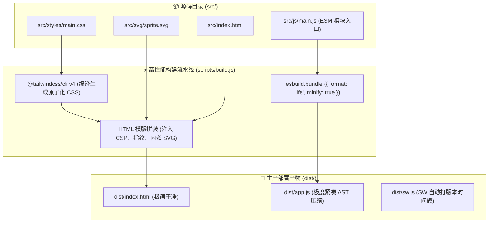

# 🏗️ Glass Start: 源码模块化解耦 (`src/`) 与零运行时单文件秒开 (`dist/`) 架构演化白皮书

> **文档性质**：核心架构演化方案与工程实施指南 (Architectural Migration Blueprint)  
> **适用对象**：后续接手此项重构的 AI Coding Agent 与核心开发者  
> **目标**：将 450KB+、8,250+ 行的单文件巨石代码优雅解耦为纯原生 ES Module 物理目录（`src/`），同时通过 `esbuild` 离线打包保持客户端生产产物（`dist/`）**100% 纯原生、零运行时 npm 依赖、单文件秒开**的初心不变。

---

## 🧭 一、重构动机与核心目标

### 1. 痛点：为什么单文件无法支撑长期进化？
1. **AI 上下文截断与注意力稀释**：8,250+ 行单文件导致任何 AI Agent 在通读或修改时消耗海量 Token，且容易在生成超长 Diff 时因输出上限发生截断崩溃。
2. **逻辑紧耦合与作用域污染**：全局变量（如 `dom`、`state`、`modalState`）横跨数千行，局部修改极易引发难以察觉的隐蔽副作用。

### 2. 演进原则（不可动摇的 3 大铁律）
- 🔴 **零运行时 npm 依赖**：坚决不上 React / Vue / Vite / Webpack，依然依托现代浏览器原生 Web API；
- 🔴 **编译产物 100% 保持单文件零依赖秒开**：构建出的 `dist/index.html` 依然整合内嵌所有关键资源，或者保持极简的 HTML + app.js 双文件结构，首屏加载性能 0 损耗；
- 🔴 **自动化测试全量零回归**：重构完成后，现有的 27 项静态检查（`npm run lint`）与 24 项 CDP 端到端测试（`node test/run.mjs`）必须 100% 绿灯。

---

## 🏛️ 二、目标源码目录拓扑设计 (`src/`)

```text
glass-start/
├── src/                                  # 源码目录 (人类与 AI 的高频编辑区)
│   ├── index.html                        # 纯语义 DOM 骨架 (无复杂脚本，约 400 行)
│   ├── styles/                           # 纯原生与原子化 CSS
│   │   ├── main.css                      # Tailwind v4 编译入口与通用 Reset
│   │   ├── glass.css                     # Liquid Glass 玻璃拟态与毛玻璃层级
│   │   └── animations.css                # 入场动画与关键帧
│   ├── svg/                              # 矢量图标库 (解耦 47+ 个内嵌 SVG)
│   │   └── sprite.svg                    # 全局 SVG Symbol 精灵池
│   └── js/                               # 纯原生 ES Module 业务脚本
│       ├── config/                       # 静态配置与设计令牌
│       │   ├── constants.js              # CONFIG 配置常量、计时器、存储键
│       │   └── themes.js                 # 黑白二元流外壳色彩表 (APP_THEME_DARK/LIGHT)
│       ├── state/                        # 状态与 DOM 引用
│       │   ├── store.js                  # 全局响应式 state 单例
│       │   └── dom.js                    # dom 节点映射缓存池与 $ 查找器
│       ├── core/                         # 核心基础机制
│       │   ├── overlay-stack.js          # 多层弹窗 LIFO 压退栈、Focus Trap
│       │   ├── theme-engine.js           # Safari 顶栏、--bg-base 与底色动态同步
│       │   ├── screen-state.js           # 双屏切屏有限状态机、滚轮/触屏手势拦截
│       │   └── lifecycle.js              # BFCache 唤醒自愈、WebKit 磁贴重栅格化、黑匣子
│       ├── modules/                      # 独立业务模块
│       │   ├── clock.js                  # 时钟与日期轮询
│       │   ├── search.js                 # 搜索引擎切换、三级模糊匹配、联想防竞态
│       │   ├── weather.js                # 天气 API、数值化清洗信任防御、9 阶形态演化
│       │   ├── bookmarks.js              # 书签派生算法、渲染、6 点拖拽排序
│       │   └── settings.js               # 设置弹窗、壁纸即选即存、JSON 导入导出
│       └── main.js                       # 主装配入口 (负责按生命周期调度各模块)
├── scripts/
│   ├── build.js                          # 构建编译脚本 (调用 esbuild AST 压缩打包)
│   ├── server.js                         # 本地增量开发服务 (Watch 50ms 极速防抖)
│   └── lint.mjs                          # 27 项静态门禁检查器
└── dist/                                 # 编译后生产产物 (单文件秒开，直接部署)
    ├── index.html                        # 极速秒开生产产物
    ├── app.js                            # AST 压缩模块代码
    ├── sw.js                             # Service Worker 底座
    └── wallpapers/                       # 高清壁纸静态资源
```

---

## ⚙️ 三、编译构建流水线设计 (`scripts/build.js`)

利用项目中现有的唯一开发构建依赖 **`esbuild`**（打包速度仅需数毫秒），实现纯零开销打平：



### 构建核心技术配置：
```javascript
// 在 scripts/build.js 中扩展 esbuild 配置
const esbuild = require('esbuild');

async function bundleScripts() {
    await esbuild.build({
        entryPoints: ['src/js/main.js'],
        bundle: true,               // 递归解析并合并所有 import 依赖
        format: 'iife',             // 封装为立即执行函数，绝对不污染全局 window
        minify: true,               // AST 高性能安全混淆压缩
        target: ['es2022'],         // 保持纯原生现代语法
        outfile: 'dist/app.js',     // 独立或内嵌由配置决定
    });
}
```

---

## 🗺️ 四、8 大核心模块解耦职责与依赖关系

按照我们在 `index.html` 中打好的 8 大 `@region` 物理区域，平滑迁移映射：

| 模块文件 | 对应源码唯一 `@region` 索引 | 导出 Symbol (Exports) | 核心职责与外部依赖 |
| :--- | :--- | :--- | :--- |
| `src/js/config/themes.js` | `@region [HEAD_THEME_HYDRATION]` | `APP_THEME_DARK`, `APP_THEME_LIGHT`, `PRESET_THEMES` | 纯净黑白二元流外壳色彩配置，零外部依赖 |
| `src/js/state/store.js` | `@region [STATE_AND_DOM_CACHE]` | `state`, `modalState` | 全局单一数据源，承载当前屏、壁纸草稿、弹窗激活状态 |
| `src/js/state/dom.js` | `@region [STATE_AND_DOM_CACHE]` | `dom`, `cacheDOM`, `$` | 80+ 个 DOM 节点的高速Ram映射池 |
| `src/js/core/overlay-stack.js` | `@region [SETTINGS_MODAL_LIFECYCLE]` | `OverlayStack` | 全局 4 级弹窗 LIFO 压退栈、`Escape` 监听与 Focus Trap |
| `src/js/core/theme-engine.js` | `@region [THEME_COLOR_ENGINE]` | `updateThemeColor`, `syncThemeForSection` | 联动 Safari 顶栏、`--bg-base` 与底层 `#bgLayer` 变色 |
| `src/js/core/screen-state.js` | `@region [SCREEN_TRANSITION_AND_BFCACHE]` | `switchToNav`, `switchToStart`, `reconcileScreenState` | 双屏有限状态机、触屏 Flick、Mac 滚轮惯性动量吞咽 |
| `src/js/modules/settings.js` | `@region [WALLPAPER_SELECTION]`<br/>`@region [SETTINGS_MODAL_COMMIT]` | `openEditModal`, `commitWallpaperSelection` | 外观壁纸即选即存、书签排序固化落盘、IndexedDB 双写 |
| `src/js/modules/search.js` | `@region [SEARCH_SUGGESTIONS]` | `initSearch`, `renderSuggestions` | 三级本地模糊搜索、网络联想建议防竞态调度 |
| `src/js/modules/weather.js` | `@region [WEATHER_ENGINE]` | `initWeather`, `weatherNum` | 气象数据拉取、数值化清洗信任边界、9 阶形态演化 |

---

## 🛡️ 五、分步防翻车实操指南 (Phase-by-Phase Plan)

接手的 AI Agent 必须严格遵循以下步骤推进，**严禁跨阶段作业**：

### 阶段 1：脚手架与基础环境搭建 (零业务改动)
1. 创建 `git checkout -b refactor/modular-src` 分支；
2. 新建 `src/` 基础目录骨架，将目前 `index.html` 中的纯 `<svg>` 矢量精灵抽取到 `src/svg/sprite.svg`；
3. 将现有的 CSS 样式分离至 `src/styles/`；
4. 调整 `scripts/build.js`，保证在编译时能无损生成出与当前一模一样的 `dist/index.html`；
5. 运行 `npm run lint`，确保门禁放行。

### 阶段 2：抽取配置、状态与独立工具库
1. 将 `CONFIG`、常量与主题色彩表移入 `src/js/config/`；
2. 将 `storageGet`、`storageSet`、`safeUrl`、`escapeHtml` 移入 `src/js/utils/`；
3. 将 `state`、`dom` 与 `cacheDOM` 抽离为单例模块；
4. 使用 `esbuild` 编译并运行单测：`node test/run.mjs infra --no-build`。

### 阶段 3：按 `@region` 逐个迁移核心业务模块
1. **迁移切屏机制**：将 `@region [SCREEN_TRANSITION_AND_BFCACHE]` 迁入 `src/js/core/screen-state.js` ➔ 运行 `node test/run.mjs ui --no-build`；
2. **迁移设置与壁纸**：将 `@region [WALLPAPER_SELECTION]` 与弹窗逻辑迁入 `src/js/modules/settings.js` ➔ 运行 `node test/run.mjs ui --no-build`；
3. **迁移搜索与天气**：将 `@region [SEARCH_SUGGESTIONS]` 与 `@region [WEATHER_ENGINE]` 分别迁入对应模块 ➔ 运行 `node test/run.mjs data --no-build`。

### 阶段 4：全量对齐与合并
1. 全量生产环境编译：`npm run build`；
2. 跑全量端到端测试：`node test/run.mjs --force`（确保 4 大套件 24/24 项断言全绿）；
3. 检查包体积与 0ms 秒开特性；
4. 提交合并到 `main` 分支。

---

## 🎯 六、新会话 AI 任务引导 Prompt (给新会话直接投喂)

> **复制以下 Prompt 投喂给新会话的 AI**：
>
> “我们正在为 **Glass Start** 执行源码模块化重构工程。请先详细阅读项目根目录下的 [**ARCHITECTURE.md**](./ARCHITECTURE.md)、[**AGENTS.md**](./AGENTS.md) 以及架构演化白皮书 `src-modularization-plan.md`。  
> 
> **本次任务目标**：严格按照白皮书第 5 节的‘分步防翻车指南’，在不引入任何外部运行时 npm 依赖的前提下，将 `index.html` 解耦至 `src/` 原生 ES 模块，并通过现有的 `esbuild` 编译流水线确保输出的 `dist/` 保持单文件零依赖极速秒开。  
> 
> **执行要求**：严禁一次性暴力重写！必须先创建重构分支，分阶段迁移并以 `npm run lint` 与 `node test/run.mjs` 测试套件作为每一步的自愈验证标准，确保全部 24 项断言 100% 绿灯通过。”
